# Settings

The app's own settings, and where they're shown.

- **Settings… in the app menu, `Cmd-,`, or the gear at the bottom of the sidebar, shows Settings in place of the sidebar and the workspace,** in the same window. `Back`, Escape or `Cmd-W` goes back to where you were, with what you were typing still focused, or to a workspace selected in its place meanwhile, such as when the one showing was archived from elsewhere, which then has the keys. While Settings shows, the workspace's keys do nothing, since what they'd act on is hidden, and a reply that comes in the chat it hides is read once you go back. *Unconfirmed:* the gear, the ways back, the workspace selected meanwhile, the keys doing nothing, and the reply waiting.
- **A page for each part of the app is in a sidebar on the left, and the chosen page fills the rest.** The sidebar is as wide as the one it stands in for, with a muted `Back` at its top right, level with the window's buttons. *Unconfirmed.*
- **Settings opens on its first page, but at the page what opens it is about,** as a workspace's `Open Git` opens it at Git, as `workspaces.md` says. *Unconfirmed.*

  **General, the first page.** *Unconfirmed.*

  

- **The pages are listed under small muted headings, each page with an icon before its name.** Personal holds the pages about how the app and its hub work for you, rather than about a project. A page's row is a regular row, 36px tall, as the sidebar's are, and the one showing is filled. *Unconfirmed.*
- **A search at the sidebar's top finds a setting by what it's called or what it does, in any case, as it's typed.** Only the settings that match are left, with the pages they're on and those pages' headings, and a page that draws what's on it itself, such as Agents, is left whole when what it's called or what it's about matches, such as `accounts`, `login` or `token` for Agents, and `github`, `push` or `gh` for Git. The page says so when nothing matches. While it's empty the search says Search settings, in faint text, and it always shows `⌘F`, which puts the cursor in it with what's typed selected, so what's typed next replaces it, as a Mac's search fields do. Escape and `Cmd-W` go back from the search too, and Settings opens again with nothing in it, on its first page, since a search is for finding one setting now. It's 28px tall, on the pane's colour, with an edge lighter than a line, since it's something to type in. *Unconfirmed.*

  **A search, leaving the settings that match, with their pages and headings.** *Unconfirmed.*

  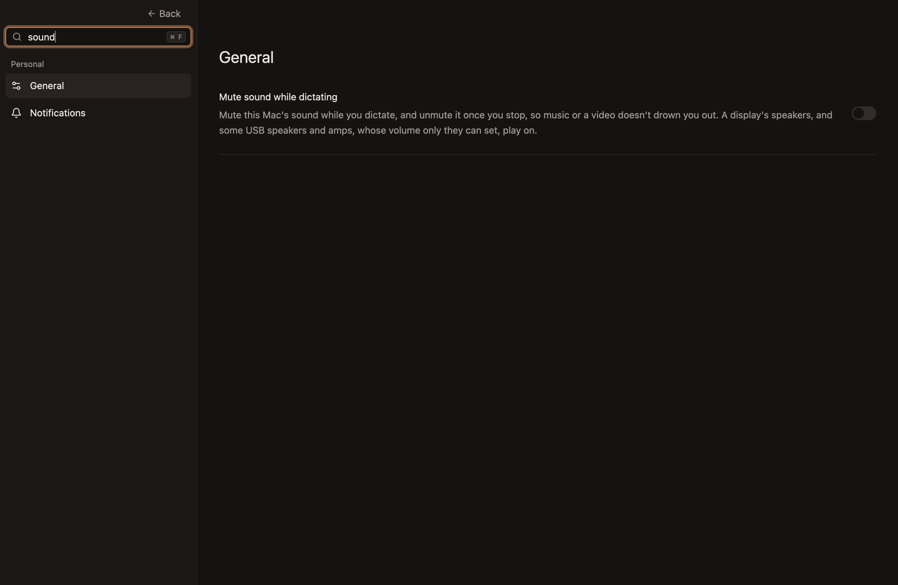

  **A search that matches nothing.** *Unconfirmed.*

  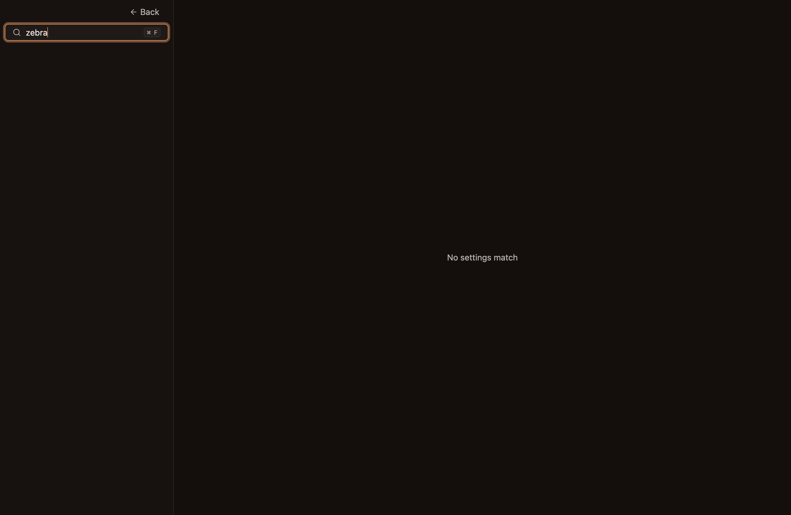

- **A page starts with its name, at 24px, and each setting is a row under it:** what it's called and what it does on the left, its control on the right, and a line under it that sets it apart from the next. The name is below the strip along the top, which stays clear for moving the window.
- **A page with more to show than a setting's row has room for, such as Agents and Git, draws what's on it under its name instead,** and scrolls the same way. *Unconfirmed.*
- **A setting takes effect at once, everywhere it shows, and lasts.** There's no Save button. *Unconfirmed.*
- **A setting belongs to whatever carries it out.** How the app looks and behaves is the app's, and belongs to this Mac rather than to a hub, since the app can show several hubs and has to draw before it reaches any. What a hub does whether or not the app is open is that hub's, which keeps it, so it holds after the hub restarts and every app showing that hub shows the same.
- **A hub's setting can only be changed while its hub is there to ask.** Its switch shows what the hub says, and changes when the hub has. While the hub is out of reach, or with a hub from before it kept settings, the switch shows off and can't be flipped.

  **A hub from before hubs kept settings, whose switches show off.** *Unconfirmed.*

  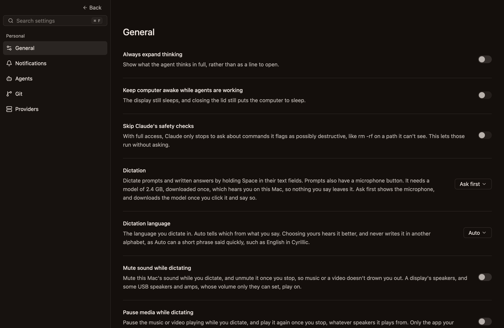

## General

- **Always expand thinking** shows what the agent thinks in full, as it streams and once it's done, rather than as a line to open. It's off unless chosen, since most people read the answer rather than how the agent got there. Thinking you open or close yourself stays as you left it, whichever way the setting is. *Unconfirmed.*
- **Keep computer awake while agents are working** stops the Mac going to sleep by itself while there's work, as `chats.md` says under "A turn". It's the hub's setting. It's on unless turned off, since an agent left working is expected to still be working when you come back. Turned off, the Mac is let go at once, whatever is at work.
- **Skip Claude's safety checks answers Allow for you when an agent with full access asks before using a tool anyway,** as Claude's CLI does when its safety check stops a removal whose target only the command knows, such as `rm -rf "$(cat path)"`, and a subagent's request is answered the same. The chat never waits, nothing tells of it, and the call shows as any other. It's the hub's setting, so it answers while the app is closed too. It's off unless turned on, since what's asked about is what the agent's CLI couldn't rule out doing harm. Plan mode still asks, and so do questions and a plan, and so does an agent whose adapter doesn't say what it asks. A request already waiting as it's turned on waits for you. With a hub from before it, the switch shows off and can't be flipped, as with a hub from before hubs kept settings. *Unconfirmed.*
- **Dictation lets prompt and answer fields be dictated to, as `chats.md` says: Ask first, On or Off.** It needs a model of 2.4 GB, downloaded once into the data directory the app shares with its hub, from Hugging Face, and kept out of Time Machine's backups, since it can be downloaded again. Ask first is what it is until it's chosen: the composer and new-workspace prompt show a microphone, where this Mac can run the model, and offer to turn dictation on, so nothing is downloaded until you say so. On downloads whatever of the model isn't here yet, going on from what an earlier download left, and checks each file before it's used. Then it prepares the model, loading it so the first press doesn't wait. The first time, while Core ML compiles it for the Neural Engine, that can take a few minutes, and it's prepared again each time the app opens with dictation on, which is quick once it's compiled. The model is let go of after 15 minutes with nothing dictated, and the next press loads it again, in under a second. Off has no microphone, stops a download, and keeps what's downloaded for the next time. A choice a newer build saved that this one doesn't know reads as Ask first. It's the app's setting, since what's said is heard on this Mac. *Unconfirmed.* *Not built:* Windows and Linux, where Settings has no Dictation.
- **Under Dictation, a box says how it stands, with what can be done about it,** whenever there's something to say: how much of the model is downloaded, with a bar, that it's preparing, that it's ready and how much room the model takes, what went wrong, with Retry, that this Mac's macOS is too old, or, while it isn't on, that the model is still here. A failed download says why in a few words, such as that the connection stalled or was lost, that Hugging Face couldn't be reached or answered with an error, that what came wasn't the file it should be, or that there's no room for it. The box is a status, so a screen reader says it as it changes. The composer and new-workspace prompt's microphones show the same box while dictation is on and not ready. *Unconfirmed.*

  **Dictation turned on, with half the model downloaded.** *Unconfirmed.*

  

  **Dictation turned on, with the model nowhere to be found.** *Unconfirmed.*

  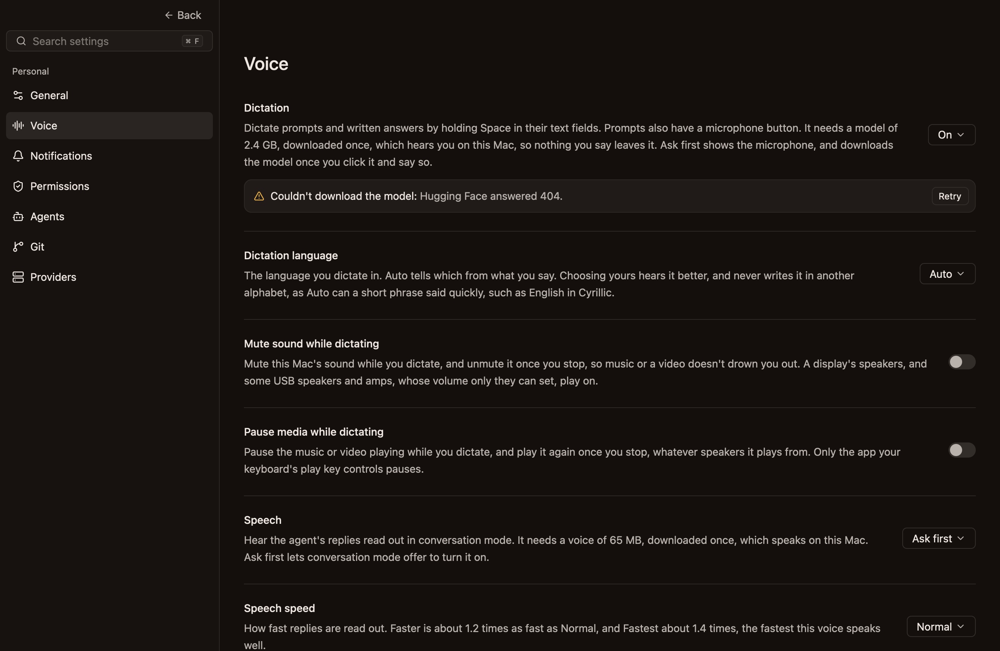

  **Dictation off, with the model still here.** *Unconfirmed.*

  

- **Delete the model frees its room,** from the box, once dictation is ready, or while it isn't on and the model is still here. With dictation on, it's turned off first, so the model is let go of. The box says the model is being deleted until it's gone, and choosing On meanwhile downloads it again only once it has. If it can't all be deleted, an alert says why. *Unconfirmed.*

  **Dictation on, and ready.** *Unconfirmed.*

  

- **Mute sound while dictating, under Dictation, mutes the Mac's sound while something is dictated,** so music or a video doesn't drown out what's said, or get heard with it when it plays from speakers. It mutes once dictating starts, which for held Space is at 0.5 s rather than 0.2 s, when it starts to hear, so a press let go of in between doesn't cut what's playing. It unmutes once dictating stops, however it stops, quitting the app included, and doesn't wait for the last words to go in. It unmutes only what it muted: sound that was muted already stays muted, and sound unmuted meanwhile stays unmuted. It mutes the output sound plays from as dictating starts, and that's what it unmutes, even once sound plays from another. Some outputs can't be muted, such as many displays' speakers and some USB speakers and amps, which set their own volume, and those play on, as they do when the Mac's own mute is pressed. It's off unless chosen, since it changes the sound of the whole Mac rather than the app's. It's the app's setting, as dictation is. *Unconfirmed.* *Not built:* Windows and Linux, which have no dictation.

## Notifications

- **A chat needs you while it needs a look, as the sidebar shows, or while it's stopped short:** it has a reply nobody has read, it's waiting on you for an answer or an approval, or its agent went away mid-turn or failed its turn, until a turn starts again. *Unconfirmed.*
- **Notify when an agent needs you shows a notification as a chat comes to need you,** and never for the chat you're looking at, which is the one showing in the window in front, since it's in view. While another app is in front, the chat showing is told of too, since nobody is looking at it. It's on unless turned off. *Unconfirmed.*
- **A notification is titled with its workspace's name, and says why, then the chat's title,** as `Finished: Fix the flaky test`, `Stopped short` or `Waiting on you`. A chat has one at a time, the newest. Clicking it shows the chat, in place of Settings or Home, and reads no other chat on the way. *Unconfirmed.*
- **A notification lasts as long as its chat needs you,** wherever that changes: until its reply is read, what it waited on is answered, its agent goes again after stopping short, or it's closed, and until it's the chat you're looking at. A reply nobody has read keeps its notification while the agent works again, as it keeps the name bright in the sidebar. *Unconfirmed.*
- **Only what happens while the app is open is told of.** Opening the app tells of nothing that was already waiting, since the sidebar shows that. What happened while the hub restarted is told of once it's back. A notification left from before the app quit stays until it's dismissed in the system's own list, and clicking it brings the app forward without opening its chat, since the app no longer knows it. *Unconfirmed.*
- **Play a sound plays the sound chosen at the same moments, whether or not a notification shows,** and at most once in two seconds, so several chats coming to need you together sound once. It's on unless turned off. The app plays it, so a Mac's Focus doesn't silence it. *Unconfirmed.*
- **Sound is Chime, the app's own soft strike on a bar, unless another is chosen:** one of the computer's alert sounds, or one the person added to their `Library/Sounds`. Its list has Chime, a line, then the rest by name, with the one chosen ticked, and choosing one plays it. The list is read again each time Settings opens, so a sound added meanwhile shows. A sound that has gone since it was chosen plays Chime. *Unconfirmed.* *Not built:* a sound on Windows and Linux, which play nothing, and list only Chime.
- **A Mac asks whether the app may show notifications the first time it shows one,** and only the app opened from its bundle can, so a build run from a checkout shows none. On Linux a notification takes a notification service, and stays until it's dismissed there. *Unconfirmed.*

**The Notifications page.** *Unconfirmed.*

## Agents

- **Agents lists the accounts agents run under in a column 720 wide, each a row in the design of Git's.** Each is a row of columns that line up from row to row: a mark, the name, with a `Default` badge on the default for its kind, how its login was made, what else there is to say, and a `…` menu. A row says only what isn't plain, and its card says what its one line has no room for.
- **The accounts are the hub's records of them, in two lists, Found and then Added, under Default accounts,** which shows the hub's chosen account for each kind whose adapter accepts a hub-held login. The client reads the choice from the hub; it never infers one from account order. A row's mark is a robot in a square, the same on every row, since no kind of agent has a mark of its own, and a login found where agents ran doesn't say which kind it's for. A row is a table's, 44px tall, with a small `…`, which opens under it towards the left, so it stays inside the column, as Git's does. *Unconfirmed.*

  **Agents, with Claude Code's own login found, and a login added in each state.** *Unconfirmed.*

  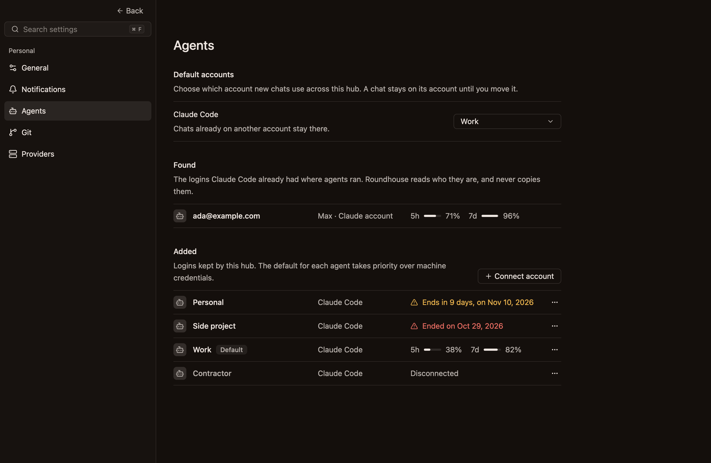

- **How a row's login was made is said in the page's own words: for a login found where agents ran, its plan and how it's logged in, as `Max · Claude account`, and for one the person added, the kind of agent it's for, as `Claude Code`,** then the plan and how it's logged in, where its record says. *Unconfirmed.*
- **What else a row says is how its login stands, once that needs seeing to, and otherwise what's left of its limits.** A login the person added says that it ends soon or has ended, as below, or that it was disconnected, with its name muted, since an agent can't run under it once it has ended or been disconnected. Otherwise the row says what's left of each of the account's limits, as below. Which day the account was last used, and when a login ends before it warns of it, are in its card, since one more column has room for one thing to say, and what needs doing comes before what's left. *Unconfirmed.*
- **Each row has a card of what its one line has no room for, which shows while the pointer rests on the row, or the keyboard's focus is on it.** It says which day the account was last used, when its login ends, even while that's far off, and every limit with what's left, during a login's last month too, when the warning takes the row's column. Assistive apps are told what it says as the row takes the focus. The card is the app's hover card, so it shows once the pointer has rested on the row as long as before a tooltip, and goes as the pointer leaves. Each row is one of Tab's stops, before its menu. *Unconfirmed:* that the card shows at once as the keyboard's focus comes to the row, and stays until the focus moves on, while focus from a click shows it no sooner than the pointer does; that it opens under the row from the row's left edge, or over it while the row is in the window's lower half, so it doesn't cover the row once it's moved to stay in the window, 300 wide; that it says the limits as the chat's limits' card does, under a rule; and that a row whose card would say nothing, as for an account nobody has used whose limits have all started again, has none.

  **Work's card, with the pointer resting on its row.** *Unconfirmed.*

  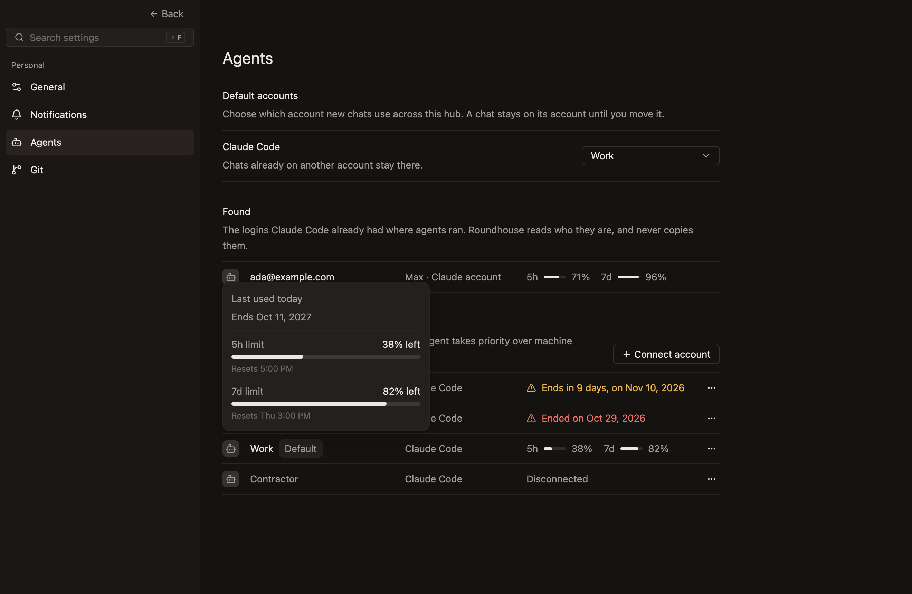

- **A row's card says which day the person last sent something in a chat under the account,** by the calendar in the reader's time zone rather than by the hour: `Last used today`, `Last used yesterday` and `Last used 3 days ago`, then by the week from 7 days, as `Last used 2 weeks ago`, by the calendar month from a month, as `Last used 2 months ago`, so the 1st to the 31st of one month is `4 weeks ago`, and from twelve months on by its date, as `Last used on Sep 28, 2025`. It changes as the day does. It's the hub's record of it, so every app says the same. Before then the line isn't there, rather than saying never, since an account may not have been used yet, and a hub from before it kept that says nothing either. *Unconfirmed.*
- **Found has the logins an agent's own CLI already had where agents ran,** such as Claude Code's on this Mac, which the hub reads as each agent launches there, so a login shows once an agent has run under it. Roundhouse reads who it is and never copies it, as Found's line under its heading says, so it can't renew or disconnect one, and the row has no menu. A row is called by the account's email, and the rows are in order of what they're called. With none, Found says none has been found yet, and that Claude Code's own login shows there once an agent has run under it, rather than that nobody is logged in, since the hub learns of a login only as an agent runs under it. *Unconfirmed.*

  **Agents with nothing found, as on a server with no login of its own.** *Unconfirmed.*

  

- **Default accounts chooses the account each agent kind's chats are put on while they're on none, as each one's agent first starts,** and every later launch, resume and title call of that chat takes it, whatever the default becomes, until the chat is moved. So a new chat, and one on none from before, such as one that ran under the machine's own login then, is put on whatever the default is as its agent next starts. The selector lists that kind's connected accounts whose logins have not ended. For a chat on none, an added default takes priority over every machine's own credentials. There is no choice to prefer machine credentials while a default exists. With none, the row says Machine login, and a chat whose agent first starts then is put on the machine's own login, once the hub knows whose it is, where it stays once a login is added, until it's moved. One whose machine had nobody logged in, or a login the hub can't tell from another, such as one with an API key, has no account to show and so none to move it off, so it's put on the default once one is added; Codex and Antigravity use their machine's own login and have no selector. Above the rows, Default accounts says that new chats use the account chosen, and that a chat stays on its account until it's moved. Under a default that works, its row says chats already on another account stay there. A hub too old to keep defaults has only the first of those, and its row says nothing more. *Unconfirmed:* those words, and which kinds have no selector. A changed choice reaches every client as the hub's settings record. While offline, saving, or connected to a hub too old to keep defaults, the selector is disabled; a failed change says why and keeps the hub's actual choice.

  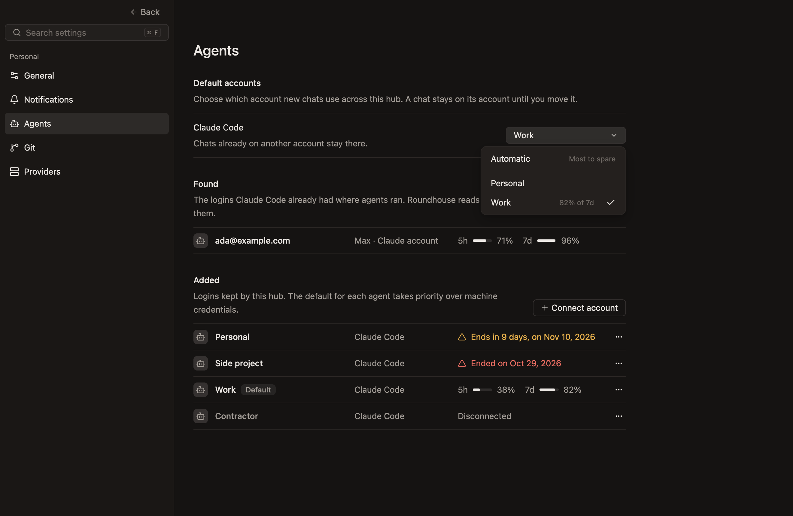

  **A hub that keeps logins but predates defaults says to update, without claiming it follows the new priority.**

  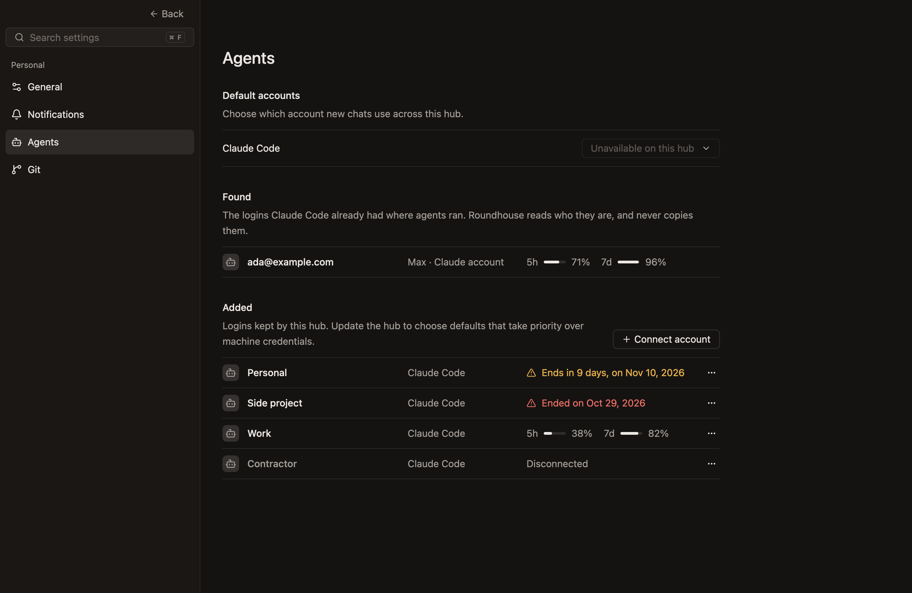

- **The first added account becomes that kind's default.** Updating a hub with accounts already connected chooses the most recently connected or renewed login that has not ended, once. If all have ended, it chooses the most recent and shows that it needs renewing. Later connections and renewals do not change the choice. *Unconfirmed: the initial choice during an update.*
- **A default that expires, is disconnected, or loses its token stays selected and blocks the launches of chats on no account yet, as any account blocks those of the chats on it.** Renew or reconnect it, or select another added account, which unblocks only the chats on none, since a chat on the account stays on it. Its row keeps the default badge and the selector explains the blocked launch, and that choosing another unblocks only new chats. Disconnect's confirmation explains this consequence, and that chats on the account can't start until it's reconnected or they're moved, alongside the fact that running agents continue. There is no clear-default action that returns to machine credentials. *Unconfirmed: keeping a disconnected default selected.*

  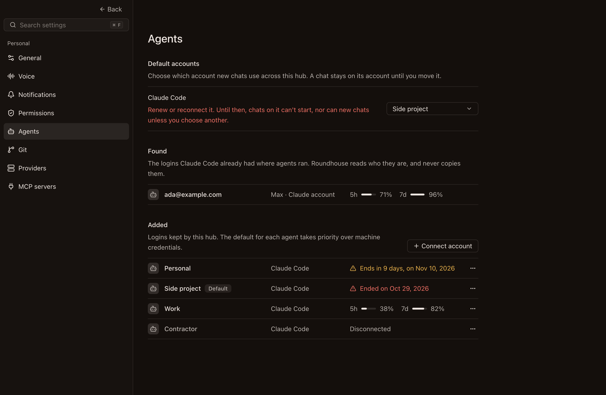

- **Added has the logins the person gave the hub,** each a token the agent's own CLI made. Claude supports hub-held logins; Codex and Antigravity credentials remain with their CLIs on the worker's machine. A row is called by the name the person gave it. Connected accounts come first by name, then disconnected accounts by name. With none, Added says to connect an account to add its login to the hub. *Unconfirmed: the list order, and which kinds hold logins.*
- **A login warns in amber, with a warning sign, from a month before it ends, and in red once it has,** such as `Ends in 9 days, on Nov 10, 2026` and `Ended on Oct 29, 2026`, so there's time to renew it. When a twelfth of how long a login lasts is less than a month, it warns from that long before it ends instead, by the hub's record of when it was connected and when it ends, so one that lasts a week isn't a warning from the moment it's connected. The days are counted by the calendar, so they agree with the date. Before that, only its card says when it ends, as `Ends Oct 12, 2027`, and the card says the warning too, once there is one. The hub takes a token to end a year after it was connected, at the latest, since its CLI doesn't say. *Unconfirmed.*
- **What's left of each of an account's limits is its window, a bar that empties as it's used, and how much is left, such as `5h`, a bar, and `38%`,** said to assistive apps as `5h limit, 38% left`, for the limits the chat's limits' card would show, as `chats.md` says under "The context and the account". A limit goes as it starts again, since what was heard of it is no longer so, and a row whose limits have all started again says nothing more, until an agent under the account hears them again. One no agent has heard a limit for says `No limits heard of yet`, faintly, and so does its card. The card says each limit as the chat's limits' card does: its name, how much is left, a bar, and when it starts again, said to assistive apps as `5h limit, 38% left, resets 5:00 PM`. *Unconfirmed.*
- **Connect account opens a panel at the top of Added, for a login of a new account.** It has the command that makes a token, to copy and run in a terminal of the person's own, where the agent's CLI signs them in its own way: `claude setup-token` for Claude, as the hub's description of the agent gives it. Then a field to paste the token into, which has the cursor, shows only dots and can't be copied from, and a field for the account's name, which a chat under it shows. Connect is off until both have something in them, and Enter in either connects too. Roundhouse never runs the command, signs anyone in or reads a terminal. With several kinds of agent that can have a login, Connect account is a menu of them. *Unconfirmed.*

  **The panel, with a token pasted and a name typed.** *Unconfirmed.*

  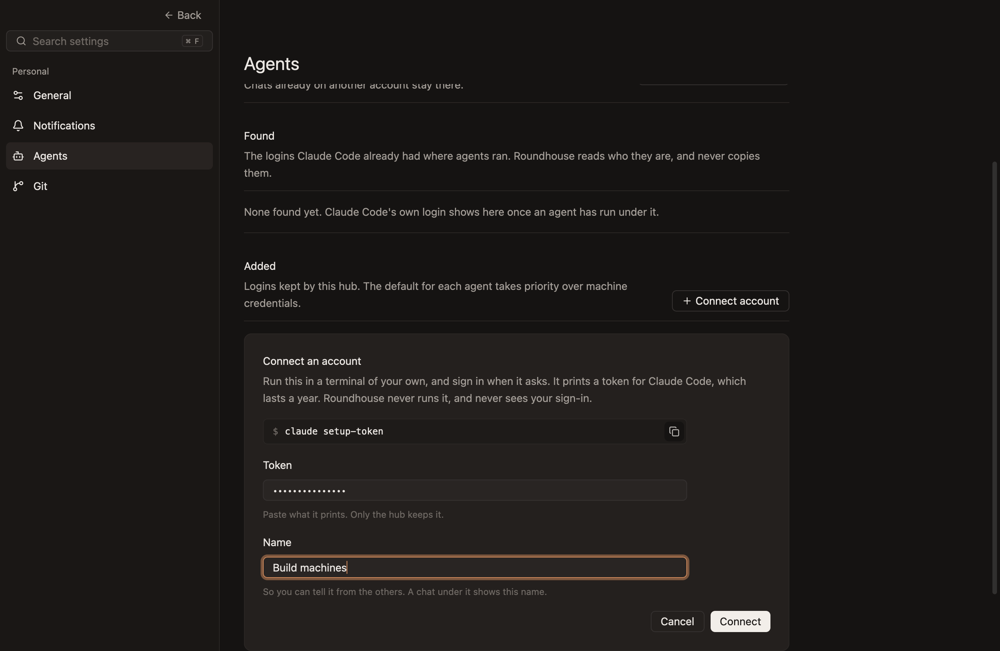

- **The app hands the token to the hub and keeps it nowhere itself:** not on disk, not in a log and not in its settings. The panel goes once the hub has connected it, and the field it was pasted into goes with it. A panel that goes before the hub has answered, as when it's cancelled, another is opened, or Agents is left, takes the wait for the answer with it, so what the hub answers lands on no other panel. When a panel goes while something in it has the focus, the focus goes back to Settings, so its keys still work. *Unconfirmed.*
- **What the hub refuses is said in red in the panel, which stays open with the token's field made empty,** so the token is pasted again: in the hub's own words for a name or a token it can't take, such as a token with a space inside, and in the app's for a token another account holds already, or an account the hub no longer has. *Unconfirmed.*
- **A token that's connected already is refused for a new account under another name, rather than renaming the account that holds it,** which would look as if an account had been added. The panel says it's connected already, under another name. Under the same name it's the same connect again, as when the app didn't hear the hub's answer, and finds that account.
- **Renew has the hub put a new token in place of a login it holds, as when it's about to end. It's in the row's `…` menu, with Disconnect, since a login lasts long enough that neither is wanted often.** Connect again, in place of both in the menu of a login that was disconnected, does the same for it. Renew and Connect again are off while the hub doesn't say what makes a token for the account's kind. Each opens the panel under the account's row, naming the account, without a field for its name, and the account keeps its name, its limits and its chats. A panel is scrolled into sight as it opens, wherever it is on the page, and as much of it as fits shows, from its top. *Unconfirmed.*

  **The menu of a login that ends in nine days.** *Unconfirmed.*

  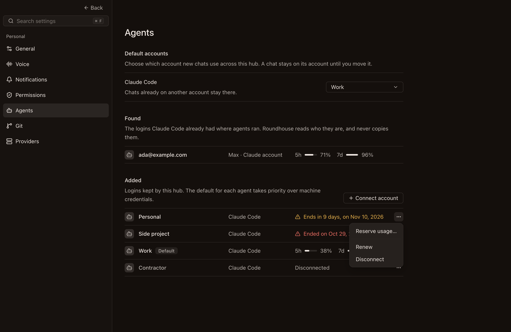

  **Renewing a login that ends in nine days.** *Unconfirmed.*

  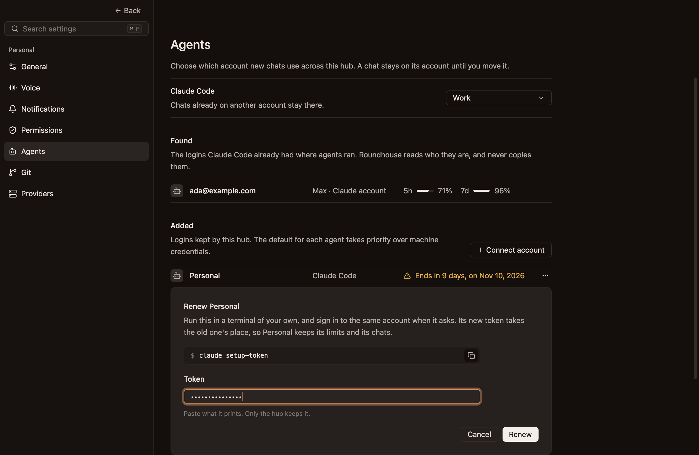

- **Disconnect asks first, in the system's alert, then has the hub forget the token, so connecting it again takes pasting a token again.** The account stays, with Connect again in its menu, since its chats still name it. The token isn't revoked, so it still works wherever else it's kept, and agents already running under it go on until they stop, while the chats on it can't start again until it's reconnected or they're moved, as the alert says. Why the hub couldn't is said under the row, and so is there being no hub to ask, when it went while the alert was up. *Unconfirmed.*
- **With no hub to ask, the accounts stay listed, every button is off, and nothing is said of the hub's age.** *Unconfirmed.*
- **A hub from before hubs kept logins can't connect one, and says so in place of Added's rows, with Connect account off.** One that describes its agents with none of them given what makes a login says so from the start, and one that refuses to connect a login as too old for it says so from then on, while Agents shows. One that hasn't described its agents, as before it has said, has Connect account off and says nothing of its age, since nothing it has said tells. *Unconfirmed.*

  **A hub from before hubs kept logins, which describes Claude with nothing that makes a login.** *Unconfirmed.*

  

## Git

- **Git lists the GitHub accounts agents push and open pull requests as, from the hub's records and settings, in two lists, Added and then Found, in a column 720 wide.** Each is a row of columns that line up from row to row: a picture, the name, with a `Default` badge on the default, how it was connected, `Signed in`, `Token` or `App`, what else there is to say, and a `…` menu. A row says only what isn't plain. The picture is the name's first letter in a circle, since the app fetches nothing from GitHub, or for an app of your own, its mark. A row is a table's, 44px tall, with a small `…`, which opens under it towards the left, so it stays inside the column. *Unconfirmed:* the row's height, and the menu's size and the way it opens.

  **Git, with three accounts added, the default signed in, and the logins found on this Mac and a server.** *Unconfirmed.*

  

- **One added account is the default, used for every GitHub repository on every machine, or else each machine's own login is.** Every machine's git and gh use the default for github.com, so agents push and open pull requests as it, and Roundhouse reads pull requests with it, wherever they run. A machine's own login is used only while it's the default, which it is while the hub has no account. The first account the hub has a record of becomes the default as it's connected, and after that only the person changes it. The page reads which is the default from the hub's settings, and never works it out.
- **Added has the accounts the person gave the hub: the default first, then those the hub holds a login for, then those it doesn't, each by username.** Under its heading, Added says that every machine's git and gh use the default for github.com. With none, it says agents use each machine's own login, and to connect an account to push as it on every machine. *Unconfirmed:* the order, and the words.
- **What else a row says is how its login stands.** A token says when it ends, as `Ends Feb 3, 2027`, since nothing renews it, and in red with a warning sign once it has, as `Ended Oct 29, 2026`. A sign-in says nothing of its token's end, since the hub renews it by itself, but `Renewing` in amber once its token has ended, until the hub has renewed it, and `Needs signing in again` in red once it can't be renewed. One the hub holds no login for says `Disconnected`, with its name muted. The default's row says how it stands as the hub says what it sends every worker for it, rather than as its record and the app's clock work it out, so it says the token has ended only once the hub blocks, and `Can't be used` in red for what no record says, such as a login only a newer Roundhouse can read, or one the hub can't read. When a token ends, before and after, is its record's. A hub from before it said what it sends has every row say what its record says. *Unconfirmed:* the words, the default's row as the hub says it, and that a token's end isn't warned of before it comes.
- **A default that can't be used stays the default, and blocks pushes until it's renewed, signed in again or connected again, or another is chosen, as an agent kind's default does.** Agents push as no one, rather than as the machine's own. While the hub blocks every worker, and only then, a box at the top of Added says `Agents can't push.` and the hub's reason, which says why and what to do, such as renewing it in Settings or choosing another default, in the words git gives as it refuses a push, as a workspace's line says them. The page reads whether the default blocks from the hub's settings, and never works it out, so it says what the hub does when the hub knows more than the account's record says, as while it makes an installation's next token. A hub from before it said what it sends shows no box. *Unconfirmed:* the box, and the hub's words in it.

  **Git, with the default's token ended three days ago, and this Mac's `gh` logged in with a token GitHub refused.** *Unconfirmed.*

  

- **Found has the `gh` login each provider's machines already have, as the hub found it once it started, through the first workspace that ran there since: this machine's first, then the others' by provider.** A row says who `gh` is logged in as, `Not logged in`, with `Run gh auth login there`, or `No gh`, with `Install gh there`, and whose `gh` it is, as `gh on this Mac`, or `gh on` and the provider's name. For a login, it says whether GitHub took its token then: `Works`, `GitHub refused its token` in red, or `Couldn't tell if it works`. The hub asks GitHub with the token, which the machine's worker hands it, and keeps the token nowhere, so a row has no menu. With none, Found says the hub asks each machine once, through the first workspace that runs there after it starts. *Unconfirmed:* the words.
- **Found's heading has the `Default` badge while each machine's own login is the default, and `Make default` at its far end while an account is, which makes each machine's own the default.** *Unconfirmed:* choosing the machine's own there.

  **Git on a hub with no account, so each machine's own login is the default, with this Mac's `gh` logged in and a server's logged out.** *Unconfirmed.*

  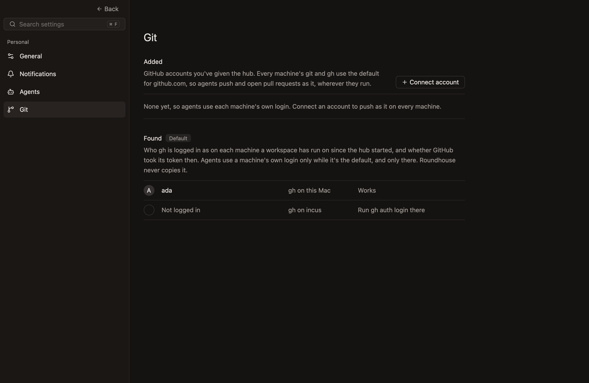

- **Connect account opens a panel at the top of Added, with the ways to connect an account: Sign in with GitHub, Use a token, and Make an app of your own.** Each says who agents act as, you or the app's bot, and what it takes, and has its button, and `Which should I choose?` opens the guide's page on who agents are on GitHub. Connect account is off while a panel is open there. *Unconfirmed:* the words and the link.

  **Connect account, open, with the three ways.** *Unconfirmed.*

  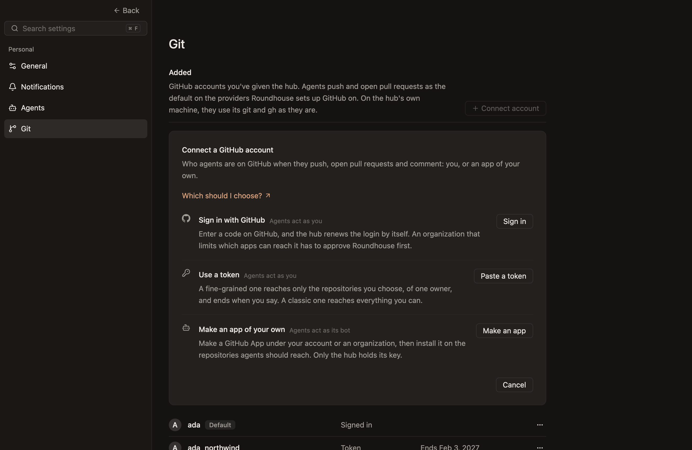

- **Sign in with GitHub has the hub start a sign-in, and its panel shows it as the hub's record of it says.** While it waits, the panel has the code, in code's font, with a button that copies it, `Open github.com/login/device`, which opens where it's typed, and that it waits for the person to approve it on GitHub, until the time the code ends. Cancel has the hub cancel it, and puts the panel away. Then the panel says how it ended: signed in as the account, and that it's the default when it is, with Done; refused, its code ended, or failed, with why, each with Close and Sign in again; or cancelled, with Close. One the hub couldn't start says why, with the same buttons. *Unconfirmed:* the words.

  **A sign-in that waits for its code to be typed on GitHub.** *Unconfirmed.*

  

  **A sign-in refused on GitHub.** *Unconfirmed.*

  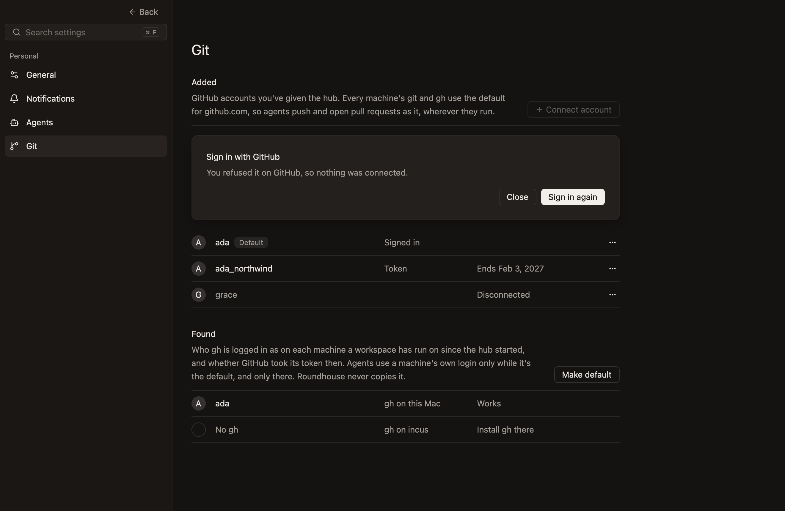

  **A sign-in approved as the default.** *Unconfirmed.*

  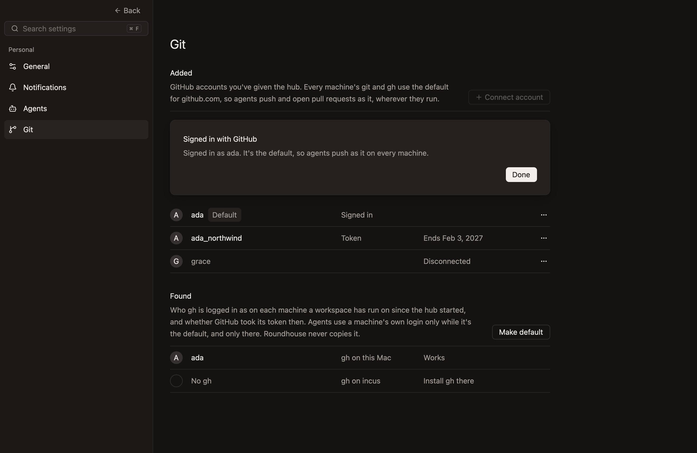

- **A sign-in that waits shows wherever Git does, whichever client started it,** such as another window, or the app before it last quit, so it can be finished or cancelled there, while no panel but Connect account's is open. One whose panel was put away isn't shown again while Git shows, and one that has ended shows only in the panel that showed it waiting, until that's closed. A sign-in started from an account's row says to sign in as that account. *Unconfirmed.*
- **Use a token opens a panel with `Make one on GitHub`, which opens GitHub's page for making a fine-grained token, and a field to paste one into, which has the cursor, shows only dots and can't be copied from.** Connect is off until the field has something in it, and Enter connects too. The app hands the token to the hub, which asks GitHub whose it is and when it ends, and keeps it nowhere itself. The panel goes once the hub has connected it. What the hub refuses is said in red in the panel, which stays open with the field made empty. A panel that goes before the hub has answered takes the wait for its answer with it. *Unconfirmed.*

  **A token pasted for a new account.** *Unconfirmed.*

  

- **Make an app of your own opens a panel in three steps: choosing where to make it and its name, making it on GitHub, and installing it.** Each step has its number until it's done, then a check and what was chosen or made, and only the one it's at has what's in it under its line. Cancel puts the panel away at any step, with whatever it waits on, and once the app is installed Done does. An app GitHub has made stays, as the hub's record, whichever step the panel went at. Agents act as the app's bot, as the panel says under its title, by the bot's name once GitHub has said it, and only the hub holds the app's key. *Unconfirmed:* the steps, how they're drawn, and the words.
- **Choosing where has Your account or An organization, by its name as in its address on GitHub, and the app's name, which has the cursor.** The name starts as the username of the first account in Added that isn't an app's installation, or else of the first `gh` login Found has, with `-roundhouse` after it, and empty with neither. An app is private, so it's made under the account or organization it's for, and installed only there, and one for another organization is made again under that. Make on GitHub is off until the names are filled in, and Enter makes it too. An organization's name GitHub can't have, or a name the hub refuses, is said in red under the fields. *Unconfirmed:* the default name, and the radios.

  **Making an app, at its first step, under your own account, with its name to begin with.** *Unconfirmed.*

  

  **Making it under an organization, by its name.** *Unconfirmed.*

  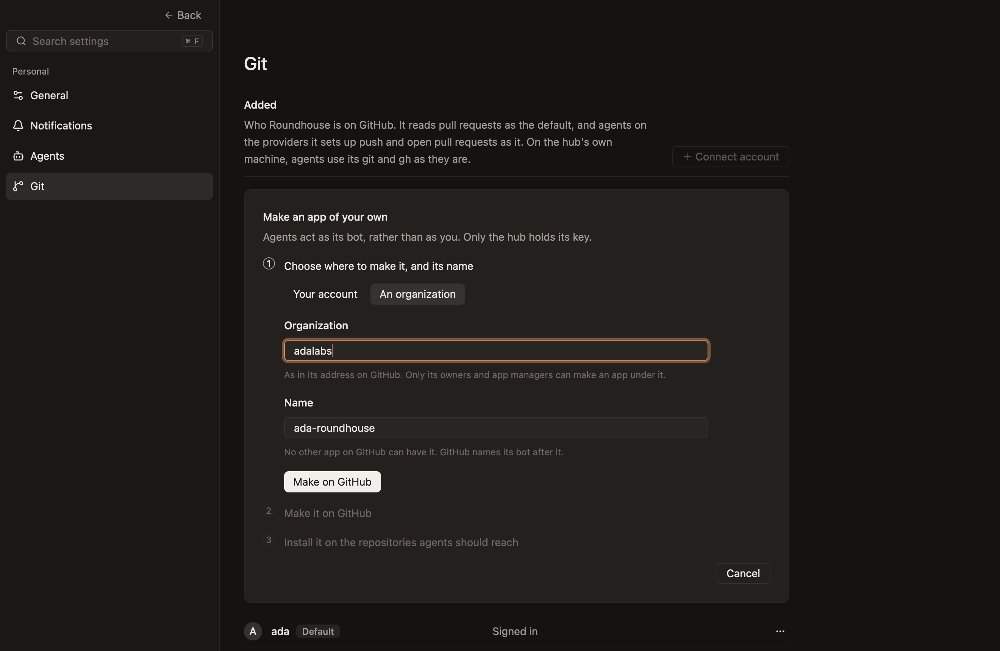

- **Make on GitHub has the hub write the app's manifest, then serves a page that posts it to GitHub's form for making an app, under the account or organization chosen, and opens the browser on it.** The app serves it on this machine, where the browser is, on `127.0.0.1` alone, at a port the system gives it, and the page posts itself, with a button for a browser that runs no scripts. The step says to make the app on that page, where GitHub says if another app has the name and lets it be changed, and that the app waits for GitHub to send the person back, until a time 30 minutes on, with Open GitHub again, which opens the same page. *Unconfirmed:* the 30 minutes, and the words.
- **The app takes only GitHub sending the person back with its code, to its own address, with the `state` it made for that try, which the page posted with the manifest.** It answers with a page that says to go back to Roundhouse, gives the code to the hub, which makes the app from it and keeps its key, and the panel goes on to installing it. Anything else that reaches it is taken for nothing: with another `state`, or none, it's answered with a page saying it isn't from the app being made, and at another path, with one saying there's nothing there. It stops listening once it has the code, on Cancel, as the panel goes, and after its 30 minutes, when the step says it stopped waiting, with Open GitHub again, which listens anew, with a new `state`. *Unconfirmed:* the pages and their words.

  **Making it on GitHub, with the browser opened on GitHub's form, waiting for GitHub to send the person back.** *Unconfirmed.*

  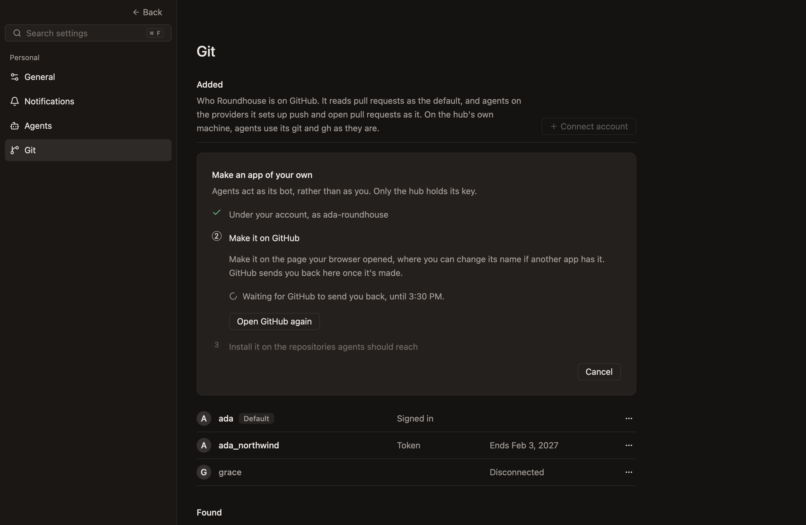

- **What stops a step is said in it, in red, with a way to go on.** A name the hub refuses, a hub that can't be reached, and a listener that couldn't start go back to the first step, with what was chosen, and Make on GitHub. A code the hub couldn't make into the app's key, as when GitHub didn't answer, has Try again, which gives the hub the same code, since GitHub takes it for an hour. A code GitHub no longer takes has Start again, which goes back to the first step, and says the app GitHub made has no key here, so to delete it on GitHub or choose another name. *Unconfirmed:* the way on from each, and the words.
- **Installing has Install on GitHub, which opens GitHub's page for installing the app, where the repositories it reaches are chosen, and Check again.** The panel has the hub look for where it's installed each time the window comes to the front while it waits, and on Check again, and the hub looks every minute by itself too. Once the hub has connected an installation, the step says where it's installed, the panel says the bot is installed there and whether it's the default, and Done puts it away. The hub connects the installation as an account, so it becomes the default as any account the hub has a record of first does. *Unconfirmed:* looking as the window comes to the front, and the words.

  **Installing it, as Install on GitHub in an app's menu opens the panel.** *Unconfirmed.*

  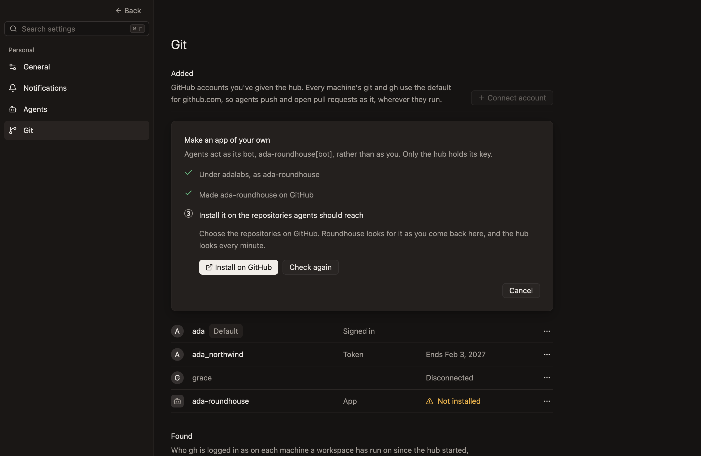

  **Installing it, with the hub saying it couldn't look on GitHub, and Check again.** *Unconfirmed.*

  

- **An account's `…` menu has Make default, but on the default, which is off while its login can't be used; Renew for a token, which opens the token's panel under its row; Sign in again for a sign-in; both of those ways of connecting it again once it was disconnected; and Disconnect, while the hub holds its login.** A sign-in approved as the account's GitHub user renews its login in place. *Unconfirmed.*

  **The menu of a token's account.** *Unconfirmed.*

  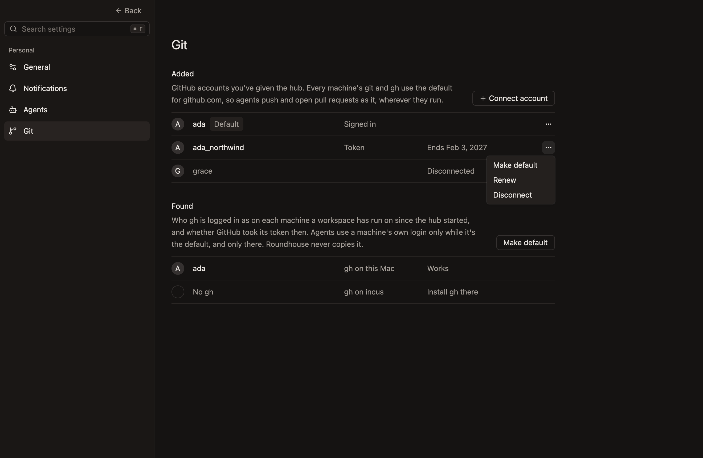

- **Disconnect asks first, in the system's alert, then has the hub forget the login.** The account stays, since the default can still name it, and the token isn't revoked on GitHub. Disconnecting the default says it stays the default, so agents can't push until it's connected again or another account is made the default. Why the hub couldn't do what an account's menu asked is said under its row, and why it couldn't make each machine's own the default under Found's heading. *Unconfirmed.*
- **An app's installation is a row in Added, as an account whose user is the app's bot, listed with the rest: the app's mark in place of a letter, the bot's name, as `ada-roundhouse[bot]`, `App` as how it was connected, and `Installed on` and where, while its login works, or else how it stands: `Disconnected` once the hub holds no login for it, and for the default, as the hub says, `Renewing` in amber once its token has ended while the hub makes the next.** The hub makes each token from the app's key, an hour at a time, so when one ends isn't said, nor on its record, and only the hub can say the default's has ended. Any one can be the default, as any account can. Its menu has Make default, but on the default, which is off while its login can't be used; Disconnect, while the hub holds its login, which asks first, says the app stays installed, and has the hub forget its token; Connect again, which has the hub look for it again, and Install on GitHub, once it was disconnected or uninstalled; and Remove app, while the hub has the app. A default installation that can't be used says why in the box at the top of Added, in the hub's words: that the hub is making its next token, or that it was disconnected or the app uninstalled there, with what to do. *Unconfirmed:* the mark, the menu, and the words.

  **Git, with an app's installation as the default.** *Unconfirmed.*

  

  **Git, with an app's installation as the default, whose token has ended while GitHub won't make the next, so the hub blocks every worker.** *Unconfirmed.*

  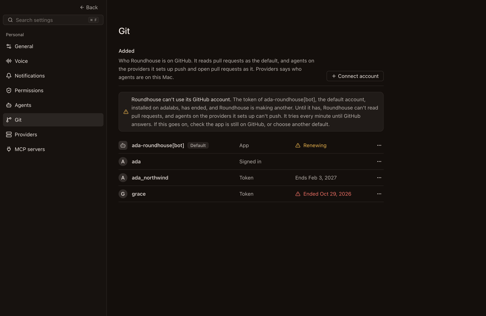

  **The menu of an app's installation.** *Unconfirmed.*

  

- **An app the hub has made that's installed nowhere is a row of its own, after the accounts, by its name, with its mark, `App`, and `Not installed` in amber.** Its menu has Install on GitHub, which opens GitHub's page and the panel at installing it, Check again, which has the hub look for it, and Remove app. *Unconfirmed.*

  **An app installed nowhere, with its menu.** *Unconfirmed.*

  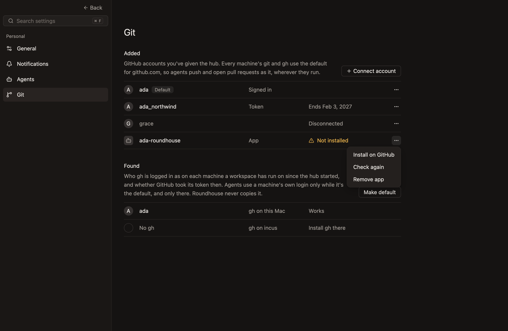

- **Remove app asks first, in the system's alert, then has the hub forget the app's key and every installation's login.** Nothing is deleted on GitHub, and the alert says to delete the app there to be rid of it. An installation that's the default stays the default, so agents can't push until another account is made the default, and the alert says so. Why the hub couldn't do what an app's menu asked is said under its row. *Unconfirmed.*
- **With no hub to ask, the accounts and logins stay listed, and every button is off.** *Unconfirmed.*
- **A hub that keeps no GitHub accounts says so in place of Added's rows, and that agents use each machine's own login, with Connect account off, nothing of a default under Added's heading, and no Found.** It's told apart by its settings, which say nothing of GitHub. *Unconfirmed.*

  **A hub from before hubs kept GitHub accounts.** *Unconfirmed.*

  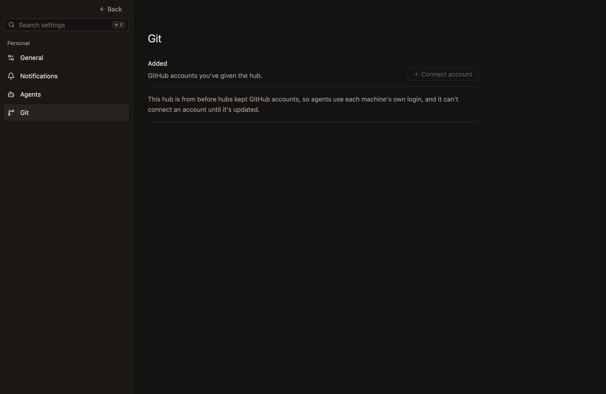
