# Settings

The app's own settings, and where they're shown.

- **Settings… in the app menu, `Cmd-,`, or the gear at the bottom of the sidebar, shows Settings in place of the sidebar and the workspace,** in the same window. `Back`, `Cmd-W`, or Escape while no panel is open, goes back to where you were, with what you were typing still focused, or to a workspace selected in its place meanwhile, such as when the one showing was archived from elsewhere, which then has the keys. While Settings shows, the workspace's keys do nothing, since what they'd act on is hidden, and a reply that comes in the chat it hides is read once you go back. *Unconfirmed:* the gear, the ways back, the workspace selected meanwhile, the keys doing nothing, and the reply waiting.
- **Escape closes a panel that's open in Settings, as its Cancel does, before it goes back from Settings, as the owner decided,** wherever the cursor is in Settings, so what's typed in a panel, such as an MCP server's key, isn't lost with the rest. Cancel lets go of what the panel waits on, so Escape on a sign-in with GitHub that waits has the hub cancel it. A panel with no Cancel, such as a sign-in that has ended, closes as its Close or Done does. A menu open in a panel closes before the panel, and where a page has two panels open, as Agents can, the lower closes first. *Unconfirmed:* closing as Close or Done does, and the lower of two closing first.
- **A page for each part of the app is in a sidebar on the left, and the chosen page fills the rest.** The sidebar is as wide as the one it stands in for, with a muted `Back` at its top right, level with the window's buttons. *Unconfirmed.*
- **A panel in Settings that waits on something says what, muted, after a task's ring, whose light goes round, until the wait is over,** such as `Asking HOST for its tools`, or a sign-in with GitHub waiting to be approved. It holds still under Reduce Motion. *Unconfirmed:* that it's a running task's ring.
- **Settings opens on its first page, but at the page what opens it is about,** as a workspace's `Open Settings` opens it at Git, as `workspaces.md` says. *Unconfirmed.*
- **The app asks for a system permission whenever having it makes something work better, the first time that thing is used,** not before, so the person sees why it's asked: the microphone and leave to monitor input for dictating, as `chats.md` says, and notifications, as Notifications says. What works without it still does. Permissions shows how each stands, and fixes one that isn't allowed, as it says below.

  **General, the first page.** *Unconfirmed.*

  

- **The pages are listed under small muted headings, each page with an icon before its name.** Personal holds the pages about how the app and its hub work for you, rather than about a project. A page's row is a regular row, 36px tall, as the sidebar's are, and the one showing is filled. *Unconfirmed.*
- **A search at the sidebar's top finds a setting by what it's called or what it does, in any case, as it's typed.** Only the settings that match are left, with the pages they're on and those pages' headings, and a page that draws what's on it itself, such as Agents, is left whole when what it's called or what it's about matches, such as `accounts`, `login` or `token` for Agents, `github`, `push` or `gh` for Git, and `tools` or `key` for MCP servers. The page says so when nothing matches. While it's empty the search says Search settings, in faint text, and it always shows `⌘F`, which puts the cursor in it with what's typed selected, so what's typed next replaces it, as a Mac's search fields do. `Cmd-W`, and Escape while no panel is open, go back from the search too, and Settings opens again with nothing in it, on its first page, since a search is for finding one setting now. It's 28px tall, on the pane's colour, with an edge lighter than a line, since it's something to type in. *Unconfirmed.*

  **A search, leaving the settings that match, with their pages and headings.** *Unconfirmed.*

  

  **A search that matches nothing.** *Unconfirmed.*

  

- **A page starts with its name, at 24px, and each setting is a row under it:** what it's called and what it does on the left, its control on the right, and a line under it that sets it apart from the next. The name is below the strip along the top, which stays clear for moving the window.
- **A page with more to show than a setting's row has room for, such as Agents and Git, draws what's on it under its name instead,** and scrolls the same way. *Unconfirmed.*
- **A setting takes effect at once, everywhere it shows, and lasts.** There's no Save button. *Unconfirmed.*
- **A setting belongs to whatever carries it out.** How the app looks and behaves is the app's, and belongs to this Mac rather than to a hub, since the app can show several hubs and has to draw before it reaches any. What a hub does whether or not the app is open is that hub's, which keeps it, so it holds after the hub restarts and every app showing that hub shows the same.
- **A hub's setting can only be changed while its hub is there to ask.** Its switch shows what the hub says, and changes when the hub has. While the hub is out of reach, the switch shows off and can't be flipped.

## General

- **Always expand thinking** shows what the agent thinks in full, as it streams and once it's done, rather than as a line to open. It's off unless chosen, since most people read the answer rather than how the agent got there. Thinking you open or close yourself stays as you left it, whichever way the setting is. *Unconfirmed.*
- **Keep computer awake while agents are working** stops the Mac going to sleep by itself while there's work, as `chats.md` says under "A turn". It's the hub's setting. It's on unless turned off, since an agent left working is expected to still be working when you come back. Turned off, the Mac is let go at once, whatever is at work.
- **Skip Claude's safety checks answers Allow for you when an agent with full access asks before using a tool anyway,** as Claude's CLI does when its safety check stops a removal whose target only the command knows, such as `rm -rf "$(cat path)"`, and a subagent's request is answered the same. The chat never waits, nothing tells of it, and the call shows as any other. It's the hub's setting, so it answers while the app is closed too. It's off unless turned on, since what's asked about is what the agent's CLI couldn't rule out doing harm. Plan mode still asks, and so do questions and a plan, and so does an agent whose adapter doesn't say what it asks. A request already waiting as it's turned on waits for you. *Unconfirmed.*
## Voice

- **Voice, right after General, holds what talking and listening need: dictation and its language and quieting, then speech and its speed,** as the owner chose on 2026-11-21, so they're together rather than at the end of General. It's only where dictation can run, as its rows are, so a device that can't hear has no Voice page rather than an empty one. *Unconfirmed.*

  **Voice, with dictation and speech both asking first.** *Unconfirmed.*

  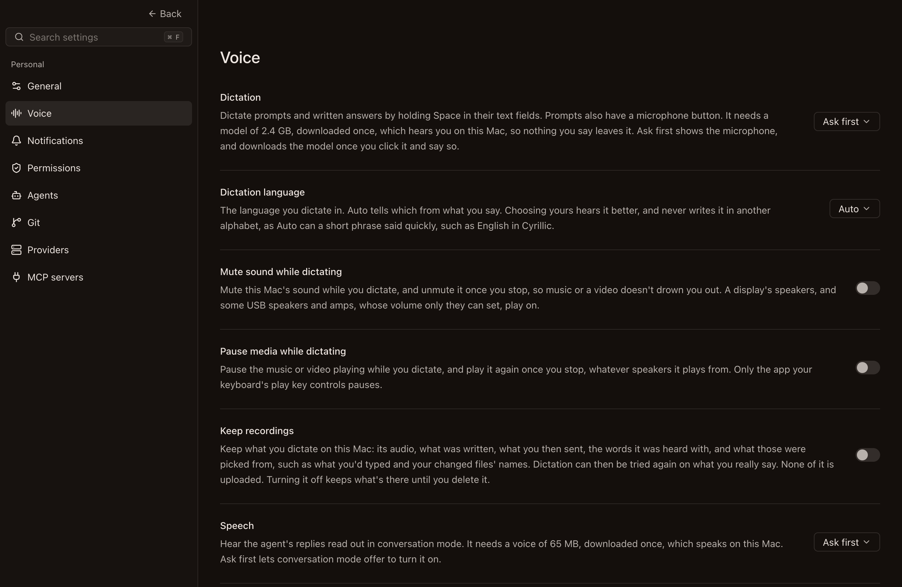

- **Dictation lets prompt and answer fields be dictated to, as `chats.md` says: Ask first, On or Off.** It needs a model of 2.4 GB, downloaded once into the data directory the app shares with its hub, from Hugging Face, and kept out of Time Machine's backups, since it can be downloaded again. Ask first is what it is until it's chosen: the composer and new-workspace prompt show a microphone, where this Mac can run the model, and offer to turn dictation on, so nothing is downloaded until you say so. On downloads whatever of the model isn't here yet, going on from what an earlier download left, and checks each file before it's used. Then it prepares the model, loading it so the first press doesn't wait. The first time, while Core ML compiles it for the Neural Engine, that can take a few minutes, and it's prepared again each time the app opens with dictation on, which is quick once it's compiled. The model is let go of after 15 minutes with nothing dictated, and the next press loads it again, in under a second. Off has no microphone, stops a download, and keeps what's downloaded for the next time. A choice a newer build saved that this one doesn't know reads as Ask first. It's the app's setting, since what's said is heard on this Mac. *Unconfirmed.* *Not built:* Windows and Linux, where Settings has no Dictation.
- **Under Dictation, a box says how it stands, with what can be done about it,** whenever there's something to say: how much of the model is downloaded, with a bar, that it's preparing, that it's ready and how much room the model takes, what went wrong, with Retry, that this Mac's macOS is too old, or, while it isn't on, that the model is still here. A failed download says why in a few words, such as that the connection stalled or was lost, that Hugging Face couldn't be reached or answered with an error, that what came wasn't the file it should be, or that there's no room for it. The box is a status, so a screen reader says it as it changes. The composer and new-workspace prompt's microphones show the same box while dictation is on and not ready. *Unconfirmed.*

  **Dictation turned on, with half the model downloaded.** *Unconfirmed.*

  

  **Dictation turned on, with the model nowhere to be found.** *Unconfirmed.*

  

  **Dictation off, with the model still here.** *Unconfirmed.*

  

- **Delete the model frees its room,** from the box, once dictation is ready, or while it isn't on and the model is still here. With dictation on, it's turned off first, so the model is let go of. The box says the model is being deleted until it's gone, and choosing On meanwhile downloads it again only once it has. If it can't all be deleted, a dialog says why. *Unconfirmed.*

  **Dictation on, and ready.** *Unconfirmed.*

  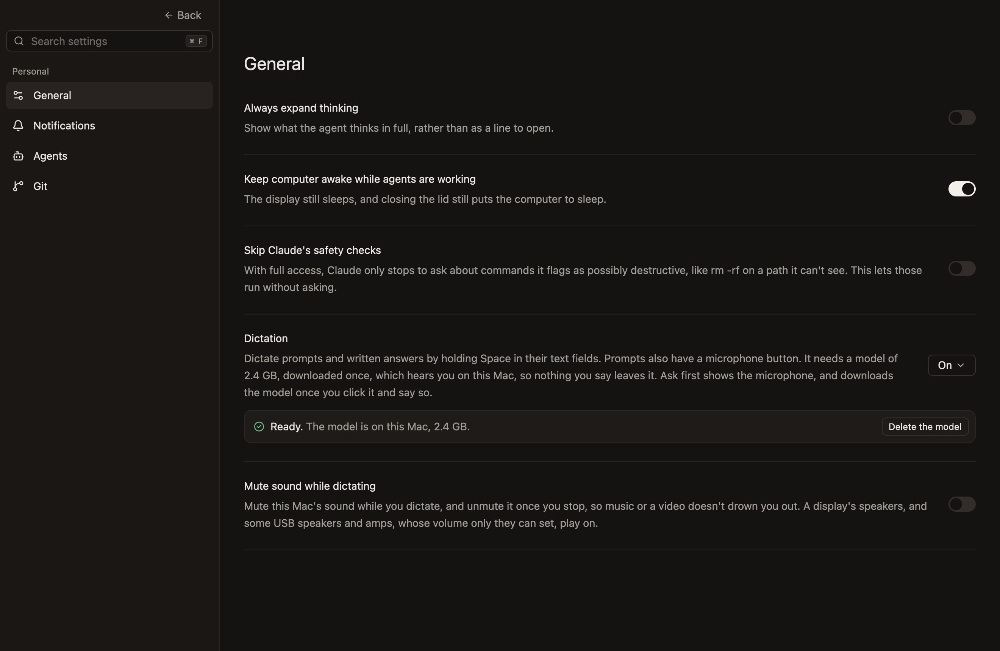

- **Dictation language, under Dictation, is the language what's dictated is heard in: Auto, or one of the 25 the model hears, from a menu that scrolls, with Auto first and the rest by name.** Auto leaves the model to tell which from what's said, and is what it is until one is chosen, since a wrong language is heard far worse than Auto, and Auto about as well as the right one. A chosen language is heard somewhat better, Greek much better, and is never written in another language's alphabet. Under Auto, and even told the language, the model can write a short phrase said quickly in another alphabet, such as English in Cyrillic, so a chosen language leaves out the pieces of every other alphabet. A language a newer build saved that this one doesn't know reads as Auto. It's the app's setting, as Dictation is. *Unconfirmed.* *Not built:* Windows and Linux, which have no dictation.

- **Mute sound while dictating, under Dictation, mutes the Mac's sound while something is dictated,** so music or a video doesn't drown out what's said, or get heard with it when it plays from speakers. It mutes once dictating starts, which for held Space is at 0.5 s rather than 0.2 s, when it starts to hear, so a press let go of in between doesn't cut what's playing. It unmutes once dictating stops, however it stops, quitting the app included, and doesn't wait for the last words to go in. The app is what unmutes it, so if the app ends without quitting, such as when it crashes or is killed, the sound stays muted. That's rare, and undoing it would need a process of its own beside the app for each dictation, as pausing has. It unmutes only what it muted: sound that was muted already stays muted, and sound unmuted meanwhile stays unmuted. It mutes the output sound plays from as dictating starts, and that's what it unmutes, even once sound plays from another. Some outputs can't be muted, such as many displays' speakers and some USB speakers and amps, which set their own volume, and those play on, as they do when the Mac's own mute is pressed. It's off unless chosen, since it changes the sound of the whole Mac rather than the app's. It's the app's setting, as dictation is. *Unconfirmed.* *Not built:* Windows and Linux, which have no dictation.

- **Pause media while dictating, under Dictation, pauses what the app the keyboard's media keys control plays while something is dictated,** such as music or a video, so it doesn't drown out what's said, whatever it plays from, a display's speakers and a USB amp included, which Mute sound while dictating can't silence. On a Mac that's the Now Playing app. It pauses when muting would mute, once dictating starts, and once dictating stops, however it stops, it plays the app again, if it's still the one the media keys control and still paused. So an app that has taken its place isn't started, and one played again meanwhile is left as it is. On a Mac, it plays again even when the app ends without quitting, such as when it crashes. Only that one app pauses, so anything else plays on. A Mac has no public way to pause another app, so it uses a private one, which a macOS update could take away, and then it pauses nothing, without saying so. It's off unless chosen, since it pauses another app. It's the app's setting, as dictation is. *Unconfirmed.* *Not built:* Windows and Linux, which have no dictation.

- **Keep recordings, under Dictation, keeps what's dictated on this Mac,** so a change to dictation can be tried on what someone really says. Each recording is a folder of its own in the data directory, which only its user can read: its audio as the model takes it, the words it was heard with, what those were picked from, what was written of it, live and final, the field, chat and workspace it was in, and how it ended. One that's cancelled, that fails or whose field goes is kept too, marked with how it ended, since those are often the ones that came out wrong. What's said in conversation mode is kept as well. A press let go of before it dictates is kept nowhere. Nothing of it goes to a hub or is sent anywhere, there's no limit on the room recordings take, and backups copy them, since they can't be had again. Turning it off stops new recordings, drops one underway, and keeps the rest until they're deleted. It stays as it's chosen whether dictation is on or off. It's off unless chosen, and it's the app's setting, since what's said is heard on this Mac. *Not built:* Windows and Linux, which have no dictation.
- **What a recording's words were picked from is kept with it,** so it can be heard again with the words another way of picking them would give: what was typed, the question, proposal or diff's file it's about, the paths of the files attached, open, changed and commented on, the repositories a new workspace could be made in, and the names of the workspace, its branches and its repository, with its pull request's title. The chat's messages aren't, since the hub has them, only which of them the app had.
- **What's sent from where something was dictated is kept beside the recordings,** so what dictation wrote can be set against what the person made of it: all of a prompt sent or queued, a new workspace's prompt, an answer, a comment or a proposal's note, dictated and typed, with when and the field, workspace and chat it was sent from. It's kept once for each time something is dictated there, after the app has quit and opened again too, so what's only typed is never kept, and which recordings it came from isn't worked out here. What's said in conversation mode is apart from what's typed in the same composer. Turning Keep recordings off, or deleting recordings, keeps nothing sent for what was dictated before. *Unconfirmed:* that something sent and refused is kept as it was first sent, and not again, and that two comments in one workspace, or two questions in one chat, are one field here, so one that's only typed is kept if it's sent next after the other was dictated into and put away.
- **Under Keep recordings, a box says how much room they take, with Delete recordings,** while there are any. It asks first, since they can't be had back, and then deletes every one, with what was sent. If they can't all be deleted, a dialog says why.

  **Keep recordings on, with recordings kept.**

  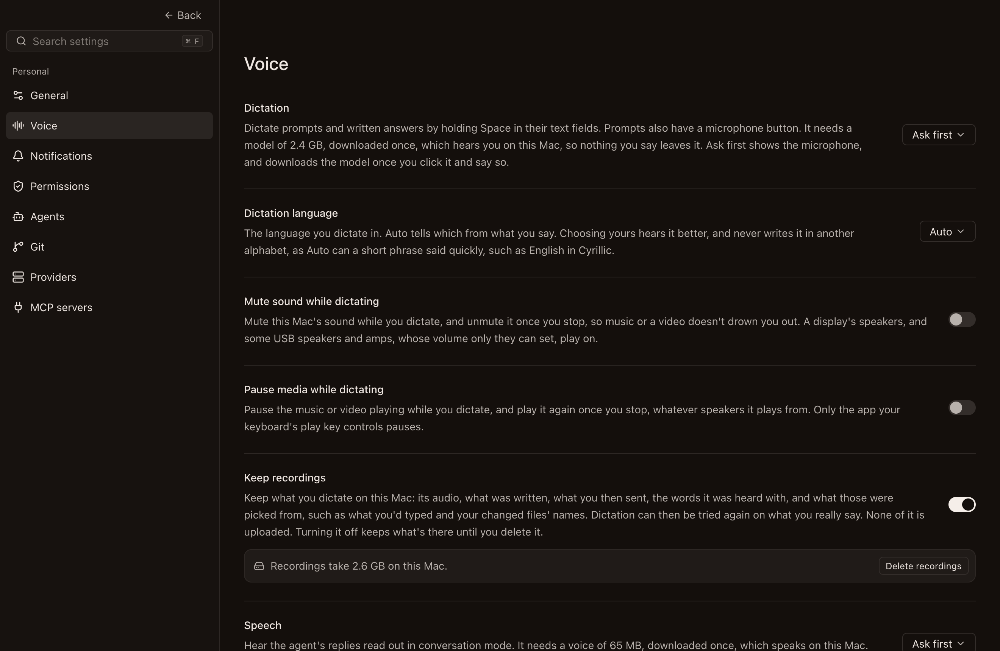

  **Delete recordings, asking first.**

  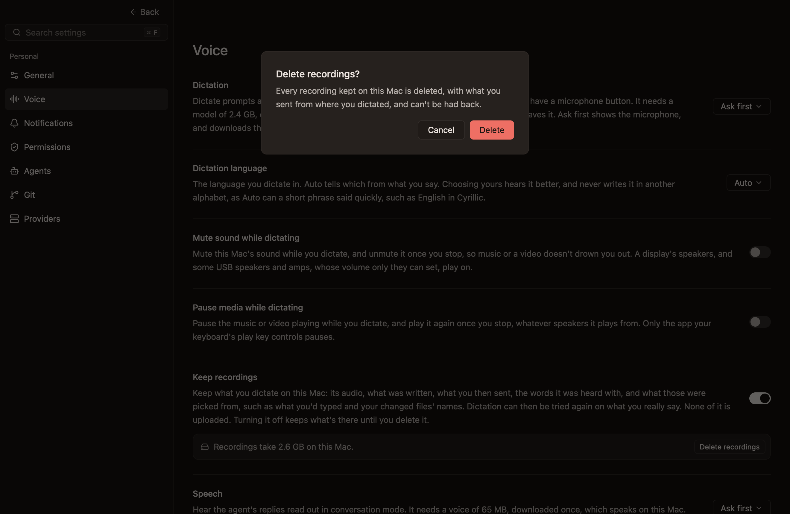

- **Speech reads the agent's replies out in conversation mode, as `chats.md` says: Ask first, On or Off.** It needs a voice of about 65 MB, downloaded once into the data directory the app shares with its hub, from Hugging Face. Ask first is what it is until it's chosen, and conversation mode's card offers to turn it on, so nothing is downloaded until you say so. On downloads the voice if it isn't here, and Off reads nothing more, keeping what's downloaded for the next time. Under it, a box says how it stands while it's on: how much of the voice is downloaded, with a bar, that it's ready, or why it couldn't be downloaded, with Retry. It's the app's setting, since what's read out is spoken on this Mac. It's shown where dictation is, since conversation mode needs both. *Unconfirmed.* *Not built:* deleting the voice, and Speech on its own on Windows and Linux.
- **Speech speed says how fast replies are read out: Normal, Faster or Fastest,** about 1.2 and 1.4 times as fast as Normal, which is what it is until it's chosen, as the owner chose on 2026-11-21. Phonon speaks faster by giving each sound less time, which it does well only so far: past about 1.4 times it slows again, and further on its speech breaks, so there's nothing faster. A change takes effect with the next text the voice is given: the next reply, or the rest of one still being written. It's the app's setting, beside Speech. *Unconfirmed.* *Not built:* faster than Phonon speaks well, which needs the audio stretched, keeping its pitch.

## Notifications

- **A chat needs you while it needs a look, as the sidebar shows, or while it's stopped short:** it has a reply nobody has read, it's waiting on you for an answer or an approval, or its agent went away mid-turn or failed its turn, until a turn starts again. *Unconfirmed.*
- **Notify when an agent needs you shows a notification as a chat comes to need you,** and never for the chat you're looking at, which is the one showing in the window in front, since it's in view. While another app is in front, the chat showing is told of too, since nobody is looking at it. It's on unless turned off. *Unconfirmed.*
- **A notification is titled with its workspace's name, and says why, then the chat's title,** as `Finished: Fix the flaky test`, `Stopped short` or `Waiting on you`. A chat has one at a time, the newest. Clicking it shows the chat, in place of Settings or Home, and reads no other chat on the way. *Unconfirmed.*
- **A notification lasts as long as its chat needs you,** wherever that changes: until its reply is read, what it waited on is answered, its agent goes again after stopping short, or it's closed, and until it's the chat you're looking at. A reply nobody has read keeps its notification while the agent works again, as it keeps the name bright in the sidebar. *Unconfirmed.*
- **Only what happens while the app is open is told of.** Opening the app tells of nothing that was already waiting, since the sidebar shows that. What happened while the hub restarted is told of once it's back. A notification left from before the app quit stays until it's dismissed in the system's own list, and clicking it brings the app forward without opening its chat, since the app no longer knows it. *Unconfirmed.*
- **Play a sound plays the sound chosen at the same moments, whether or not a notification shows,** and at most once in two seconds, so several chats coming to need you together sound once. It's on unless turned off. The app plays it, so a Mac's Focus doesn't silence it. *Unconfirmed.*
- **Sound is Chime, the app's own soft strike on a bar, unless another is chosen:** one of the computer's alert sounds, or one the person added to their `Library/Sounds`. Its list has Chime, a line, then the rest by name, with the one chosen ticked, and choosing one plays it. The list is read again each time Settings opens, so a sound added meanwhile shows. A sound that has gone since it was chosen plays Chime. *Unconfirmed.* *Not built:* a sound on Windows and Linux, which play nothing, and list only Chime.
- **A Mac asks whether the app may show notifications the first time it shows one,** and only the app opened from its bundle can, so a build run from a checkout shows none. On Linux a notification takes a notification service, and stays until it's dismissed there. *Unconfirmed.*
- **Once notifications are allowed, the app asks for the Dock's badge with them, which a Mac grants without asking the person,** since a Mac shows the badge only then, as `sidebar.md` says, and the first notification asks for alerts and sounds alone. It asks whenever there's a badge to show until a Mac shows them, one ask at a time, since the person may allow notifications at any moment, and shows the badge again once it's granted, since a Mac drops a badge it may not show. A badge the person turned off in System Settings stays off. *Unconfirmed.*

**The Notifications page.** *Unconfirmed.*

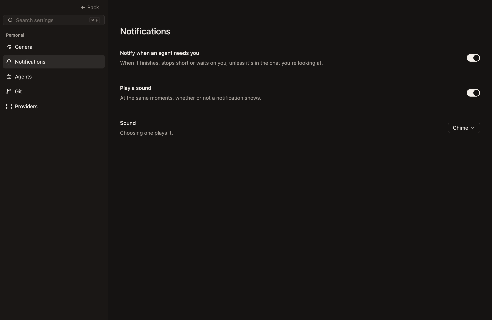

## Permissions

- **Permissions lists each system permission the app uses on this Mac, with what it makes work, how it stands, and the one button that fixes it,** as the owner chose on 2026-11-22: Notifications, Full Disk Access, Screen Recording, Microphone and Input Monitoring, in that order. A row says Allowed, with a tick, Not asked yet, faint, or Off, in amber with a warning sign, then its button: Allow…, where the system hasn't asked, which has it ask, or Open System Settings, where only System Settings changes it. One that's allowed has no button. It's only on a Mac, so elsewhere there's no Permissions page rather than an empty one.
- **Where the system won't say how a permission stands, its row says Can't tell, faint, with no button,** as of notifications in a build run from a checkout, or of Full Disk Access on a Mac with none of the folders it's read by. *Unconfirmed.*
- **The page never has the system ask by itself,** as the owner chose on 2026-11-22. Only its buttons do, and what needs a permission still asks the first time it's used. *Not built:* a step in onboarding that asks for them before any agent runs, so an agent opening a folder doesn't bring up a dialog for each.
- **How each stands is read as the window opens and each time it comes in front,** since that's when the person may have changed one in System Settings, and again once the system has answered what a button asked. *Unconfirmed.*
- **Full Disk Access lets agents open any folder without a dialog for each.** Without it, a Mac asks the first time an agent opens each of Desktop, Documents, Downloads and the other folders it guards. The app, its hub and every agent are one app to a Mac, so one grant covers them all. *Unconfirmed.*
- **Full Disk Access and Screen Recording only say Allowed or Off, since a Mac only says whether they're allowed,** as the owner chose on 2026-11-22. Their button first tries what the permission guards, which lists the app there, switched off, then opens System Settings at it, where the person switches it on. For Screen Recording, the system also asks, the first time. *Unconfirmed:* that the app is listed under Full Disk Access once it's refused. One that isn't is added there with +.
- **Full Disk Access is read by trying a folder only it opens, Safari's, or Mail's on a Mac without Safari's,** which a Mac refuses without a dialog. So from the window first opening, the app is listed under Full Disk Access, switched off, whether or not the page has been shown. *Unconfirmed.*

  **The Permissions page, with Full Disk Access and Screen Recording off, and Input Monitoring not asked yet.** *Unconfirmed.*

  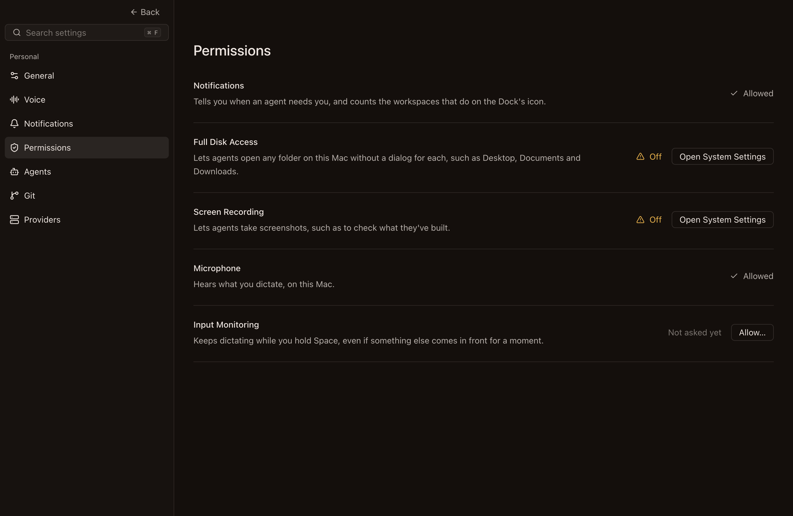

## Agents

- **Agents lists the accounts agents run under in a column 720 wide, each a row in the design of Git's.** Each is a row of columns that line up from row to row: a mark, the name, with a `Default` badge on the default for its kind, how its login was made, what else there is to say, and a `…` menu. A row says only what isn't plain, and its card says what its one line has no room for.
- **The accounts are the hub's records of them, in two lists, Found and then Added, under Default accounts,** which shows the hub's chosen account for each kind whose adapter accepts a hub-held login. The client reads the choice from the hub; it never infers one from account order. A row's mark is a robot in a square, the same on every row, since no kind of agent has a mark of its own, and a login found where agents ran doesn't say which kind it's for. A row is a table's, 44px tall, with a small `…`, which opens under it towards the left, so it stays inside the column, as Git's does. *Unconfirmed.*

  **Agents, with Claude Code's own login found, and a login added in each state.** *Unconfirmed.*

  

- **How a row's login was made is said in the page's own words: for a login found where agents ran, its plan and how it's logged in, as `Max · Claude account`, and for one the person added, the kind of agent it's for, as `Claude Code`,** then the plan and how it's logged in, where its record says. *Unconfirmed.*
- **What else a row says is how its login stands, once that needs seeing to, and otherwise what's left of its limits.** A login the person added says that it ends soon or has ended, as below, or that it was disconnected, with its name muted, since an agent can't run under it once it has ended or been disconnected. Otherwise the row says what's left of each of the account's limits, as below. Which day the account was last used, and when a login ends before it warns of it, are in its card, since one more column has room for one thing to say, and what needs doing comes before what's left. *Unconfirmed.*
- **Each row has a card of what its one line has no room for, which shows while the pointer rests on the row, or the keyboard's focus is on it.** It says which day the account was last used, when its login ends, even while that's far off, and every limit with what's left, during a login's last month too, when the warning takes the row's column. Assistive apps are told what it says as the row takes the focus. The card is the app's hover card, so it shows once the pointer has rested on the row as long as before a tooltip, and goes as the pointer leaves. Each row is one of Tab's stops, before its menu. *Unconfirmed:* that the card shows at once as the keyboard's focus comes to the row, and stays until the focus moves on, while focus from a click shows it no sooner than the pointer does; that it opens under the row from the row's left edge, or over it while the row is in the window's lower half, so it doesn't cover the row once it's moved to stay in the window, 300 wide; that it says the limits as the chat's limits' card does, under a rule; and that a row whose card would say nothing, as for an account nobody has used whose limits have all started again, has none.

  **Work's card, with the pointer resting on its row.** *Unconfirmed.*

  

- **A row's card says which day the person last sent something in a chat under the account,** by the calendar in the reader's time zone rather than by the hour: `Last used today`, `Last used yesterday` and `Last used 3 days ago`, then by the week from 7 days, as `Last used 2 weeks ago`, by the calendar month from a month, as `Last used 2 months ago`, so the 1st to the 31st of one month is `4 weeks ago`, and from twelve months on by its date, as `Last used on Sep 28, 2025`. It changes as the day does. It's the hub's record of it, so every app says the same. Before then the line isn't there, rather than saying never, since an account may not have been used yet, and a hub from before it kept that says nothing either. *Unconfirmed.*
- **Found has the logins an agent's own CLI already had where agents ran,** such as Claude Code's on this Mac, which the hub reads as each agent launches there, so a login shows once an agent has run under it. Roundhouse reads who it is and never copies it, as Found's line under its heading says, so it can't renew or disconnect one, and the row has no menu. A row is called by the account's email, and the rows are in order of what they're called. With none, Found says none has been found yet, and that Claude Code's own login shows there once an agent has run under it, rather than that nobody is logged in, since the hub learns of a login only as an agent runs under it. *Unconfirmed.*

  **Agents with nothing found, as on a server with no login of its own.** *Unconfirmed.*

  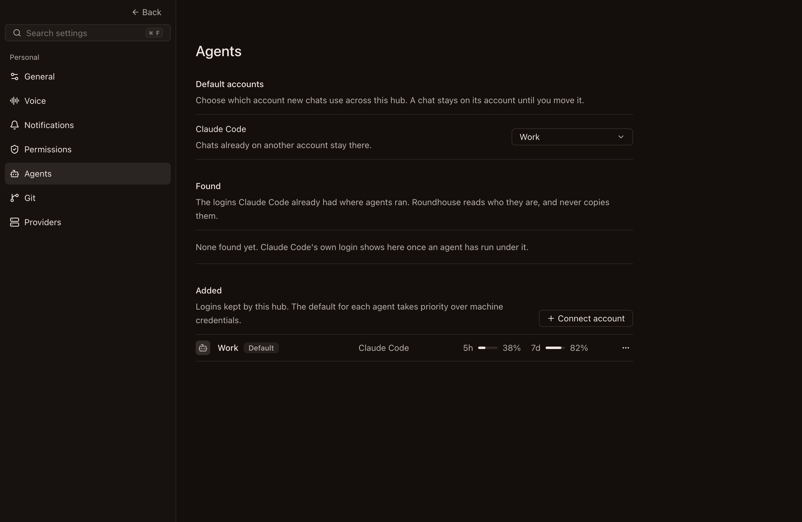

- **Default accounts chooses the account each agent kind's chats are put on while they're on none, as each one's agent first starts,** and every later launch, resume and title call of that chat takes it, whatever the default becomes, until the chat is moved. So a new chat, and one on none from before, such as one that ran under the machine's own login then, is put on whatever the default is as its agent next starts. The selector lists Automatic first, then that kind's connected accounts whose logins have not ended, each with how much of its week is left, as `82% of 7d`, as the chat's `Move` menu does. For a chat on none, an added default takes priority over every machine's own credentials. There is no choice to prefer machine credentials while a default exists. With none, the row says Machine login, and a chat whose agent first starts then is put on the machine's own login, once the hub knows whose it is, where it stays once a login is added, until it's moved. One whose machine had nobody logged in, or a login the hub can't tell from another, such as one with an API key, has no account to show and so none to move it off, so it's put on the default once one is added. The machine's own login includes a key the profile or what started the hub exports, as `workspaces.md` says, so someone who wants agents on their subscription connects it and makes it the default; Codex and Antigravity use their machine's own login and have no selector. Above the rows, Default accounts says that new chats use the account chosen, and that a chat stays on its account until it's moved. Under a default that works, its row says chats already on another account stay there. *Unconfirmed:* those words, and which kinds have no selector. A changed choice reaches every client as the hub's settings record. While offline or saving, the selector is disabled; a failed change says why and keeps the hub's actual choice.

  

- **Automatic puts each new chat of the kind on the account with the most of its week to spare, short of what it reserves,** as its agent first starts, where it stays, as on a default, until it's moved. What's spare is what's left of the week beyond what the account reserves, for each hour until the week starts again, since what's left is gone then, shared among the chats on a turn on the account now and the new one. So an account whose week starts again tomorrow is used before one with more left that lasts days. A week no agent has heard of counts as all there, with all of it to go, and so does one the hub heard of before it forgot it, as an update can make it, until an agent under the account says it again. Only a login the hub holds for the kind, which hasn't ended, can be chosen, so a login found where agents ran never is. Nor is one that reserves All, one that has used all of any limit, such as its five hours, or one down to what it reserves. Two with the same to spare go to the one with fewer chats at work, then to the first by its ID, so the same records always choose the same account. While Automatic chooses, the row says `Automatic`, and that each new chat goes to the account with the most of its week to spare, short of what's reserved, and that chats already on an account stay there. No account has the default badge, though the hub keeps the one chosen before, and choosing an account in the selector ends Automatic. The hub chooses, as a chat's agent starts, from its records of the accounts, so every client agrees and none works out a choice of its own. A chat says Automatic chose its account, on the card that says whose it is, as `chats.md` says. Until a login is added for the kind, the hub refuses Automatic, as there's no account to put chats on, and a hub too old for Automatic refuses it as it does any request it doesn't know, and the selector says so in red. *Unconfirmed:* what's spare, its ties, a week the hub forgot counting as all there, a found login taking no part, and the row's words. A new chat that Automatic finds no account with usage to spare for doesn't start, and says so, with the accounts it could start on anyway, as `chats.md` says.

  **Agents with Claude's chats put on accounts automatically.** *Unconfirmed.*

  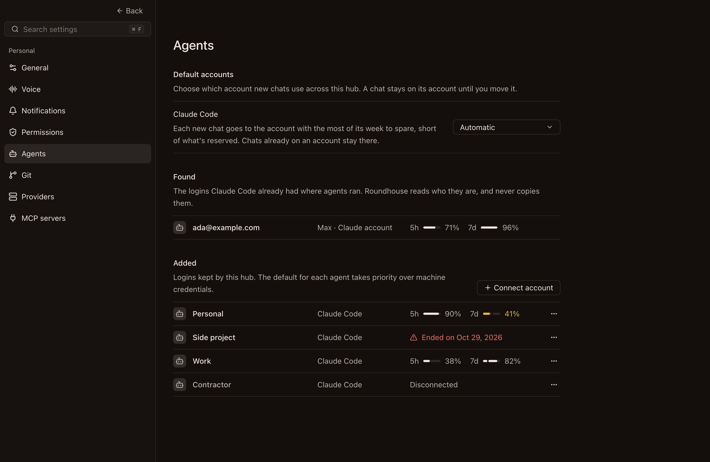

- **The first added account becomes that kind's default.** Updating a hub with accounts already connected chooses the most recently connected or renewed login that has not ended, once. If all have ended, it chooses the most recent and shows that it needs renewing. Later connections and renewals do not change the choice. *Unconfirmed: the initial choice during an update.*
- **A default that expires, is disconnected, or loses its token stays selected and blocks the launches of chats on no account yet, as any account blocks those of the chats on it.** Renew or reconnect it, or select another added account, which unblocks only the chats on none, since a chat on the account stays on it. Its row keeps the default badge and the selector explains the blocked launch, and that choosing another unblocks only new chats. Disconnect's confirmation explains this consequence, and that chats on the account can't start until it's reconnected or they're moved, alongside the fact that running agents continue. There is no clear-default action that returns to machine credentials. *Unconfirmed: keeping a disconnected default selected.*

  

- **Added has the logins the person gave the hub,** each a token the agent's own CLI made. Claude supports hub-held logins; Codex and Antigravity credentials remain with their CLIs on the worker's machine. A row is called by the name the person gave it. Connected accounts come first by name, then disconnected accounts by name. With none, Added says to connect an account to add its login to the hub. *Unconfirmed: the list order, and which kinds hold logins.*
- **A login warns in amber, with a warning sign, from a month before it ends, and in red once it has,** such as `Ends in 9 days, on Nov 10, 2026` and `Ended on Oct 29, 2026`, so there's time to renew it. When a twelfth of how long a login lasts is less than a month, it warns from that long before it ends instead, by the hub's record of when it was connected and when it ends, so one that lasts a week isn't a warning from the moment it's connected. The days are counted by the calendar, so they agree with the date. Before that, only its card says when it ends, as `Ends Oct 12, 2027`, and the card says the warning too, once there is one. The hub takes a token to end a year after it was connected, at the latest, since its CLI doesn't say. *Unconfirmed.*
- **What's left of each of an account's limits is its window, a bar that empties as it's used, and how much is left, such as `5h`, a bar, and `38%`,** said to assistive apps as `5h limit, 38% left`, for the limits the chat's limits' card would show, as `chats.md` says under "The context and the account". A limit goes as it starts again, since what was heard of it is no longer so, and a row whose limits have all started again says nothing more, until an agent under the account hears them again. One no agent has heard a limit for says `No limits heard of yet`, faintly, and so does its card. The card says each limit as the chat's limits' card does: its name, how much is left, a bar, and when it starts again, said to assistive apps as `5h limit, 38% left, resets 5:00 PM`. *Unconfirmed.*
- **What an account reserves of its week is split off the start of the week's bar by a small gap, on its row, in its card and in a chat's card of its limits,** as the context's bar splits off the room its agent keeps back, since it's the last of the week a chat uses. Once what's left is down to it, the bar's fill and how much is left are in amber, and the card says `Using the 50% reserved` after when the week resets, where it otherwise says `50% reserved`. Assistive apps are told it after the limit, as `7d limit, 41% left, using the 50% reserved`.
- **Connect account opens a panel at the top of Added, for a login of a new account.** It has the command that makes a token, to copy and run in a terminal of the person's own, where the agent's CLI signs them in its own way: `claude setup-token` for Claude, as the hub's description of the agent gives it. Then a field to paste the token into, which has the cursor, shows only dots and can't be copied from, and a field for the account's name, which a chat under it shows. Connect is off until both have something in them, and Enter in either connects too. Roundhouse never runs the command, signs anyone in or reads a terminal. With several kinds of agent that can have a login, Connect account is a menu of them. *Unconfirmed.*

  **The panel, with a token pasted and a name typed.** *Unconfirmed.*

  

- **The app hands the token to the hub and keeps it nowhere itself:** not on disk, not in a log and not in its settings. The panel goes once the hub has connected it, and the field it was pasted into goes with it. A panel that goes before the hub has answered, as when it's cancelled, another is opened, or Agents is left, takes the wait for the answer with it, so what the hub answers lands on no other panel. When a panel goes while something in it has the focus, the focus goes back to Settings, so its keys still work. *Unconfirmed.*
- **What the hub refuses is said in red in the panel, which stays open with the token's field made empty,** so the token is pasted again: in the hub's own words for a name or a token it can't take, such as a token with a space inside, and in the app's for a token another account holds already, or an account the hub no longer has. *Unconfirmed.*
- **A token that's connected already is refused for a new account under another name, rather than renaming the account that holds it,** which would look as if an account had been added. The panel says it's connected already, under another name. Under the same name it's the same connect again, as when the app didn't hear the hub's answer, and finds that account.
- **Renew has the hub put a new token in place of a login it holds, as when it's about to end. It's in the row's `…` menu, with Disconnect, since a login lasts long enough that neither is wanted often.** Connect again, in place of both in the menu of a login that was disconnected, does the same for it. Renew and Connect again are off while the hub doesn't say what makes a token for the account's kind. Each opens the panel under the account's row, naming the account, without a field for its name, and the account keeps its name, its limits and its chats. A panel is scrolled into sight as it opens, wherever it is on the page, and as much of it as fits shows, from its top. *Unconfirmed.*

  **The menu of a login that ends in nine days.** *Unconfirmed.*

  

  **Renewing a login that ends in nine days.** *Unconfirmed.*

  

- **Disconnect asks first, in a dialog, then has the hub forget the token, so connecting it again takes pasting a token again.** The account stays, with Connect again in its menu, since its chats still name it. The token isn't revoked, so it still works wherever else it's kept, and agents already running under it go on until they stop, while the chats on it can't start again until it's reconnected or they're moved, as the dialog says. Why the hub couldn't is said under the row, and so is there being no hub to ask, when it went while the dialog was up. *Unconfirmed.*

  **Asking before disconnecting an account, with Disconnect filled in the error's colour.** *Unconfirmed.*

  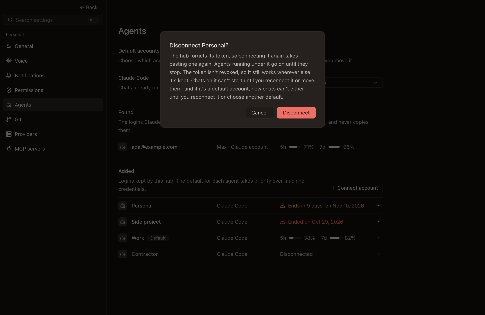
- **Reserve usage…, first in an added account's `…` menu, sets how much of its week the person keeps for themselves:** None, 10%, 25%, 50% or All of its 7d limit, as a switch, in a panel under the account's row, as Renew's is. Automatic puts no new chat on an account that's down to what it reserves, so that much is there for the person, as Default accounts says, and All keeps the account out of Automatic. It's the hub's rule of where it puts chats, not something the provider knows of, so chats already on the account carry on, as does use outside Roundhouse, and a chat says when it's using what's reserved, as `chats.md` says. Only the week has one, since it's the limit people keep some of for themselves. The panel says what the choice comes to under the switch, and draws the account's week as its row will, with what's left and when it resets. Save hands it to the hub, and the row draws it once the hub has it. What the hub refuses is said in red in the panel, and Save is off while the hub hasn't answered, and with no hub to ask. A found login has no menu, so none can be reserved, since Automatic only puts chats on logins the hub holds. *Unconfirmed:* the choices, and the found logins having none.

  **Reserving a quarter of Work's week, with Personal down to the half it reserves.** *Unconfirmed.*

  

  **Personal's card, as it uses the half of its week it reserves.** *Unconfirmed.*

  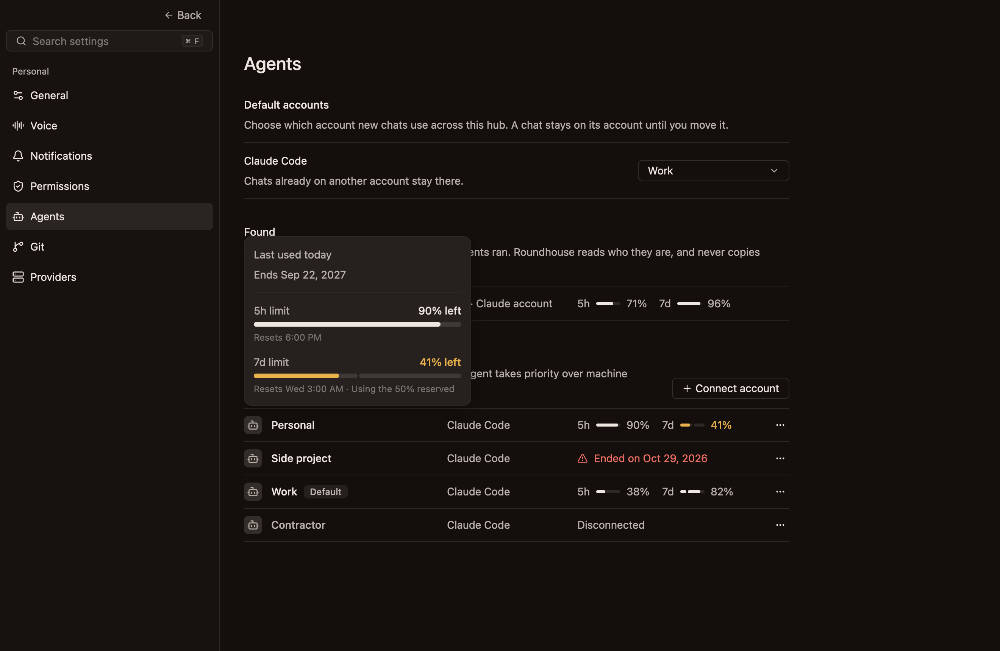

- **With no hub to ask, the accounts stay listed, and every button is off.** *Unconfirmed.*
- **A hub that hasn't described its agents, as before it has said, has Connect account off.** *Unconfirmed.*

## Git

- **Git lists the GitHub accounts Roundhouse reads GitHub as, and agents on the providers it sets up push and open pull requests as, from the hub's records and settings, in a list, Added, in a column 720 wide.** Each is a row of columns that line up from row to row: a picture, the name, with a `Default` badge on the default, how it was connected, `Signed in`, `Token`, `App` or `gh on this Mac`, what else there is to say, and a `…` menu. A row says only what isn't plain. The picture is the name's first letter in a circle, since the app fetches nothing from GitHub, or for an app of your own, its mark. A row is a table's, 44px tall, with a small `…`, which opens under it towards the left, so it stays inside the column. *Unconfirmed:* the row's height, and the menu's size and the way it opens.

  **Git, with three accounts added, the default signed in.** *Unconfirmed.*

  

- **One added account is the default: who Roundhouse reads GitHub as, such as for pull requests, and who agents push and open pull requests as for every GitHub repository on every machine where Roundhouse sets up GitHub.** Git and `gh` there use the default for github.com, and git's addresses for GitHub over SSH, such as `git@github.com:owner/repo.git`, are rewritten to HTTPS, so a remote written for SSH pushes as the default too, and no SSH key there is used for GitHub. On a provider that leaves GitHub to its machines, as the one on the hub's own machine always does, as `workspaces.md` says, Roundhouse rewrites nothing, and agents use the machine's own git, `gh` and SSH key whatever the default, as Providers shows. The default is never a machine's own login. The first account the hub has a record of becomes the default as it's connected, and after that only the person changes it. The page reads which is the default from the hub's settings, and never works it out.
- **A commit made in a repository on github.com is by the default GitHub account too, on every machine where Roundhouse sets up GitHub.** Who that is comes from the account's user on GitHub, as GitHub's profile of the user said when the hub last asked. The hub asks again once a day, so a name or an email changed on GitHub reaches commits within a day, and a changed username reaches the account's row too. With no default, a commit there is by whoever that machine's git config says. While the hub doesn't know the default's username, as for a moment after an update that stopped keeping it in the database, or after the hub's cache file is emptied, it asks GitHub at once, and meanwhile a push there fails, saying Roundhouse is asking GitHub who its default account is. Once it knows the username, and until it knows the name and email, a commit has the username and the address GitHub gives the user. *Unconfirmed:* asking once a day, and failing a push while the username isn't known.
- **A commit's name is the one the account's user goes by on GitHub, and its email is the one their profile shows everyone.** A user with no name there, or with a name git won't commit as, commits under their username. A user who shows no email commits with the address GitHub gives them, `<number>+<username>@users.noreply.github.com`, which GitHub links to them whatever their username becomes. The email is never the primary one a sign-in can read, since GitHub refuses a push of commits by a private email when the person has asked it to. An app's installation commits as the app's bot, with the address GitHub links to the bot, so commits, pushes and pull requests all name the bot.
- **The account's name and email apply only in a repository with a remote on github.com, where they win over the repository's own git config and the machine's.** A repository elsewhere, such as on GitHub Enterprise or GitLab, or with no remote, commits as its own config or the machine's says. The default is only for github.com, and a commit by the wrong author takes rewriting history to undo once it's pushed. Any remote counts, not only `origin`, so a repository whose `origin` is elsewhere and that has another remote on github.com commits as the account. On a machine whose git is older than 2.36, every repository commits as its own config or the machine's says, and agents there still push as the default. *Unconfirmed:* any remote counting, and what a git older than 2.36 does.
- **Everything a workspace on such a machine runs uses the default: its agents, whatever their kind, its setup and archive scripts, and each terminal's shell.** So what's typed in a terminal pushes as the agents do. While an account is the default, `gh` there reads none of the person's own `gh` config, such as their aliases. *Unconfirmed:* a terminal's shell.
- **A change to the default reaches what's already running on a provider where Roundhouse sets up GitHub, from its next `git` or `gh`.** That holds for another default, a renewed token, a default that can no longer be used, and no default, each of the last two of which blocks. An agent, script or shell that started under a hub from before, while each machine's own login was the default, keeps the machine's own until it starts again. *Unconfirmed.*
- **Added has the accounts the person gave the hub: the default first, then those the hub holds a login for, then an app's installations it doesn't, each by username.** An account whose username isn't known, as until the hub has asked GitHub after an update, is drawn by its user's number, as `#7`, wherever its name goes, and comes after the named ones. Under its heading, Added says it's who Roundhouse is on GitHub: that Roundhouse reads pull requests as the default, that agents on the providers it sets up push and open pull requests as it, and and that Providers says who agents are on this Mac. With none, it says that without one, Roundhouse can't read pull requests and agents on the providers it sets up can't push or use `gh`, and to connect one, such as `gh`'s login on this Mac. *Unconfirmed:* the order, and the words.

  **Added before the hub has asked GitHub what one account's user is called, with that account by its user's number, after the named ones.** *Unconfirmed.*

  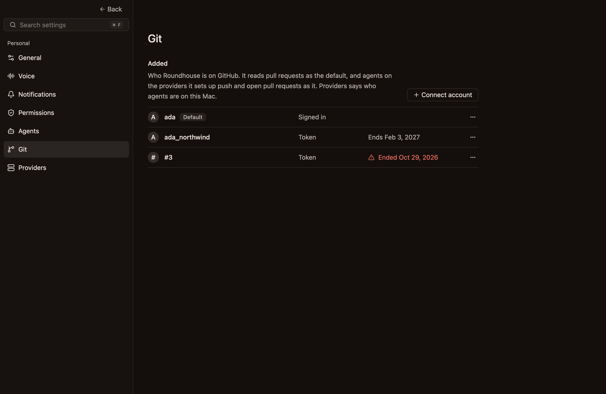

- **What else a row says is how its login stands.** A token says when it ends, as `Ends Feb 3, 2027`, since nothing renews it, and in red with a warning sign once it has, as `Ended Oct 29, 2026`. A sign-in says nothing of its token's end, since the hub renews it by itself, but `Renewing` in amber once its token has ended, until the hub has renewed it, and `Needs signing in again` in red once it can't be renewed. An app's installation the hub holds no login for says `Disconnected`, with its name muted, and so does an account a hub from before Disconnect removed it kept. The default's row says how it stands as the hub says what it sends every worker for it, rather than as its record and the app's clock work it out, so it says the token has ended only once the hub blocks, and `Can't be used` in red for what no record says, such as a login only a newer Roundhouse can read, or one the hub can't read. When a token ends, before and after, is its record's. A hub from before it said what it sends has every row say what its record says. *Unconfirmed:* the words, the default's row as the hub says it, and that a token's end isn't warned of before it comes.
- **A default that can't be used stays the default, and blocks pushes until it's renewed, signed in again or connected again, or another is chosen, as an agent kind's default does.** Agents on the providers Roundhouse sets up GitHub on push as no one, rather than as the machine's own. While the hub blocks every worker it sets up GitHub on, and only then, a box at the top of Added says `Roundhouse can't use its GitHub account.` and the hub's reason, which says once what's wrong, what Roundhouse can't do until it's put right, that it can't read pull requests and agents on the providers it sets up can't push, and what to do, such as renewing it or choosing another default, in the words git gives as it refuses a push, as a workspace's line says them. The reason never says where it's read, as "this workspace" or "there" for the hub's machine would, since git says it on any provider's machine and the box shows on any device. The page reads whether the default blocks from the hub's settings, and never works it out, so it says what the hub does when the hub knows more than the account's record says, as while it makes an installation's next token. A hub from before it said what it sends shows no box. *Unconfirmed:* the box, and the hub's words in it.

  **Git, with the default's token ended three days ago.** *Unconfirmed.*

  

- **With no account, there's no default, so Roundhouse reads nothing of GitHub, and agents on the providers it sets up GitHub on can't push or use `gh`.** Their workers are given a block that says Roundhouse has no GitHub account and to connect one, which git says as it refuses a push, rather than leaving them to whatever the machine has. Agents on a provider left to its machines are as they always are. Added says so in place of its rows. *Unconfirmed:* the hub's words.
- **With accounts but none the default, as once the default was disconnected, Roundhouse reads nothing of GitHub, and agents on the providers it sets up GitHub on can't push or use `gh`, as with no account.** Their workers are given a block that says Roundhouse has no default GitHub account, and to make one the default or connect another. A box at the top of Added says `No account is the default.` and the hub's reason, as the box for a default that can't be used does, and Providers says Roundhouse itself has no default account, and to choose or connect one in Git. *Unconfirmed:* the words.

  **Git, once the default was disconnected, with two accounts left.** *Unconfirmed.*

  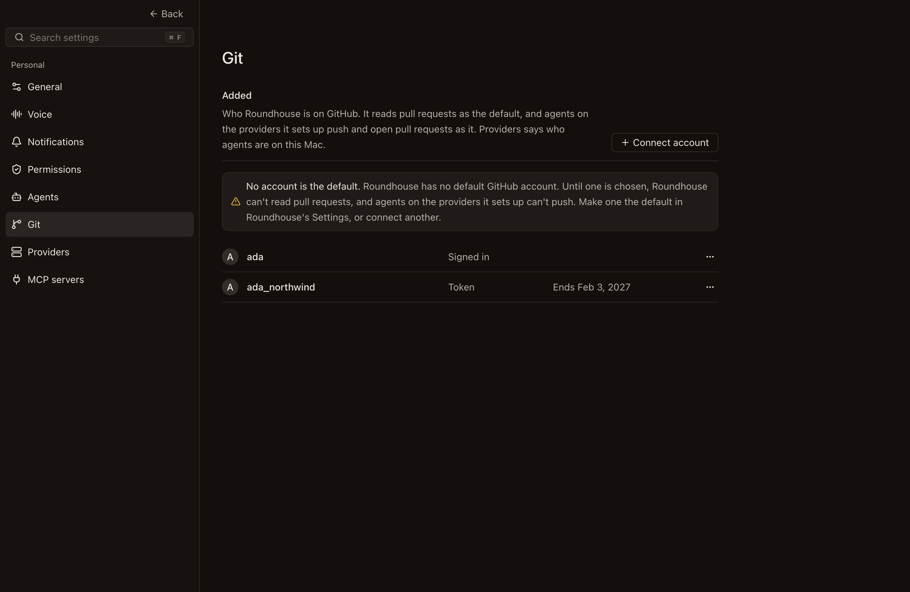

  **Git on a hub with no account.** *Unconfirmed.*

  

- **Connect account opens a panel at the top of Added, with the ways to connect an account: Sign in with GitHub, Use a token, and Make an app of your own.** Each says who agents act as, you or the app's bot, and what it takes, and has its button, and `Which should I choose?` opens the guide's page on who agents are on GitHub. Connect account is off while a panel is open there. *Unconfirmed:* the words and the link.

  **Connect account, open, with the three ways.** *Unconfirmed.*

  

- **While `gh` on the hub's machine is logged in to github.com with a token GitHub doesn't refuse, Connect account's panel offers that login first, as Use gh's login, unless an account holds it already.** The panel asks the hub who `gh` is each time it opens, and the hub runs `gh` and asks GitHub then, so the choice shows once the hub has said. It says who `gh` is logged in as, which is `gh`'s own login, the one `gh auth login` and `gh auth switch` change, whatever `GH_TOKEN` or `GITHUB_TOKEN` the profile exports, so it can be someone other than the one This Mac's row in Providers names. It says that Roundhouse reads its token from `gh` when it needs it and keeps no copy, so logging `gh` out stops Roundhouse too. Its button says `Use ada's login`, by the username. It isn't offered while any account's username isn't known, since that account could be `gh`'s. It's offered too when the hub couldn't ask GitHub, which then says why as the button's used. While `gh` there is logged out, there's no `gh`, or GitHub refuses its token, the panel has only the other three ways. The hub never uses `gh`'s login by itself: only this button does. What the hub refuses is said in red in the panel, which stays open, naming the hub's machine by what it is, as `gh on the Mac Roundhouse runs on`, with what to run, then to try again. *Unconfirmed:* the words, its place first, and asking each time the panel opens.

  **Connect account, open, with `gh` on this Mac logged in as `ada`.** *Unconfirmed.*

  

  **Using `gh`'s login, refused, since GitHub refused its token.** *Unconfirmed.*

  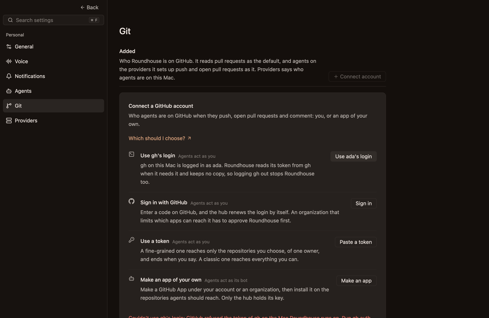

- **An account that's `gh`'s login on the hub's machine says `gh on this Mac` as how it was connected, and the hub keeps none of its token.** It reads the token from `gh` as it starts, before it carries on with any agent, and at each check of its logins, once a minute, and uses one it read at most five minutes before, so logging `gh` out, or switching it to another user, reaches agents within a minute. A token `gh` renews by itself, once GitHub refuses it, is renewed as a run of `gh` the person made would. Only `gh` on the hub's own machine can be such an account, since the hub reads GitHub with no worker running, and hands the token to workers on other machines. Its menu has Make default and Disconnect, since `gh` renews its own login. *Unconfirmed:* a minute, and five minutes.

  **Git, with `gh`'s login on this Mac as the default.** *Unconfirmed.*

  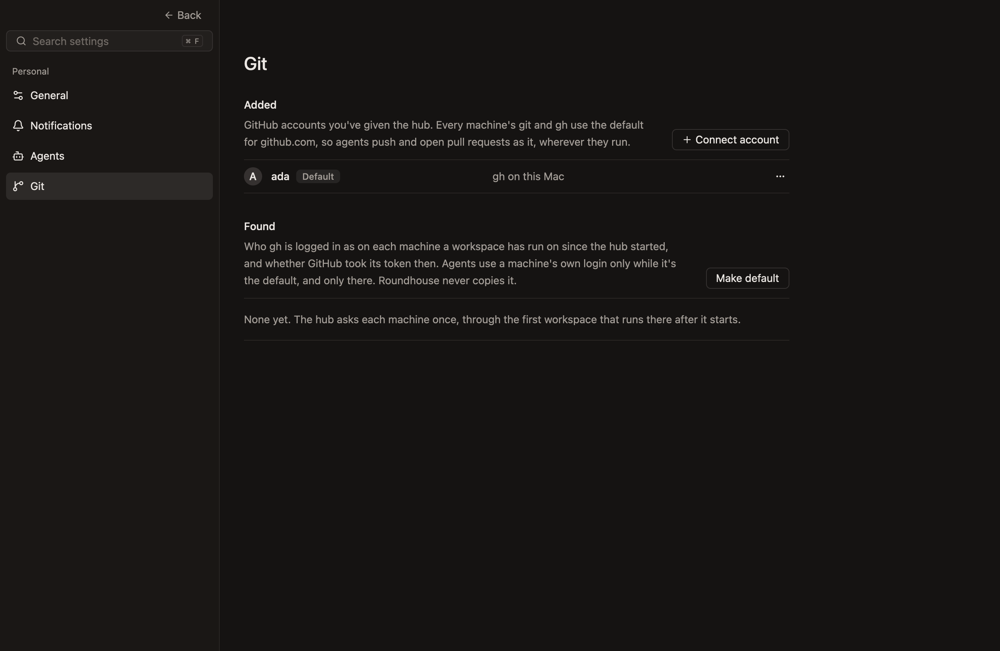

- **While `gh`'s login is the default and `gh` there has no login that works for it, the row says why and the box at the top of Added says the hub's reason.** `gh is logged out` in red once `gh` there is logged out, there's no `gh`, or GitHub refused its token, with what to do, `gh auth login`. `gh is another account now` in red once `gh` there is logged in as another GitHub user, with `gh auth switch` back, or connecting the other user. `Can't read gh` in amber while the hub hasn't read it lately, as when `gh` doesn't answer. *Unconfirmed:* the words.

  **Git, with `gh` on this Mac logged out.** *Unconfirmed.*

  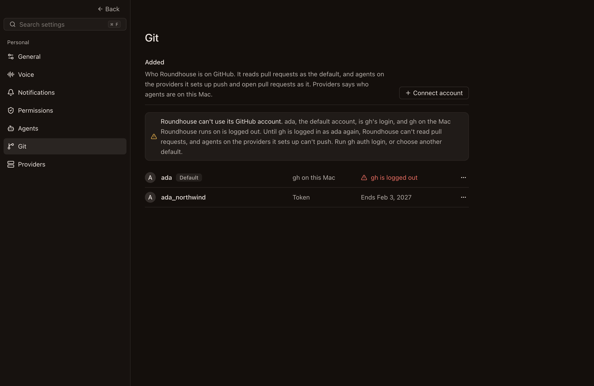

  **Git, with `gh` on this Mac switched to `grace`.** *Unconfirmed.*

  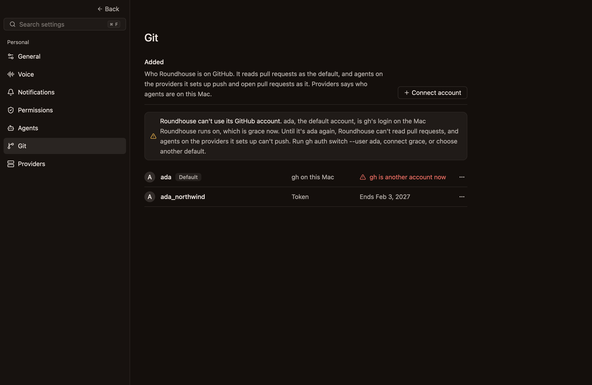

  **Git, while the hub hasn't read `gh` on this Mac lately.** *Unconfirmed.*

  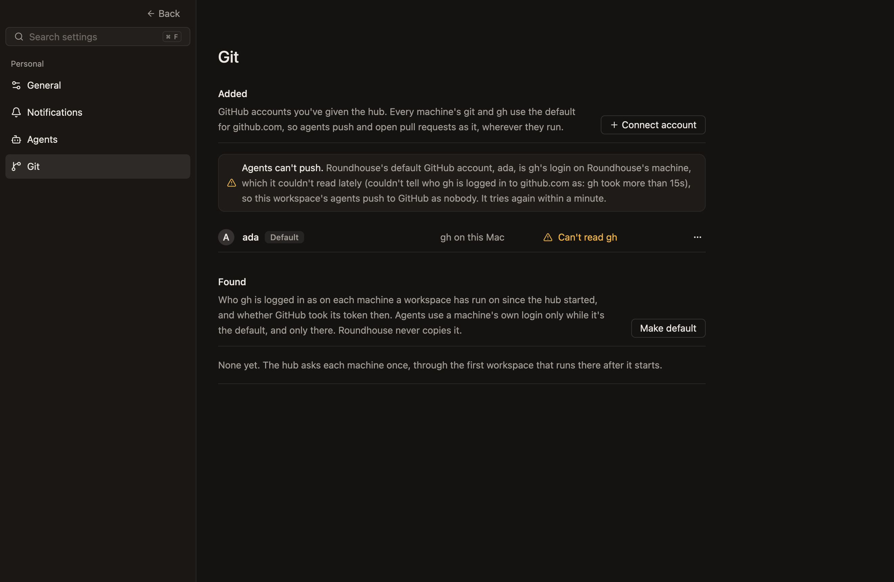

- **Sign in with GitHub has the hub start a sign-in, and its panel shows it as the hub's record of it says.** While it waits, the panel has the code, in code's font, with a button that copies it, `Open github.com/login/device`, which opens where it's typed, and that it waits for the person to approve it on GitHub, until the time the code ends. Cancel has the hub cancel it, and puts the panel away. Then the panel says how it ended: signed in as the account, and that it's the default when it is, with Done; refused, ended before it was approved, or failed, with why, each with Close and Sign in again; or cancelled, with Close. One the hub couldn't start says why, with the same buttons. *Unconfirmed:* the words.

  **A sign-in that waits for its code to be typed on GitHub.** *Unconfirmed.*

  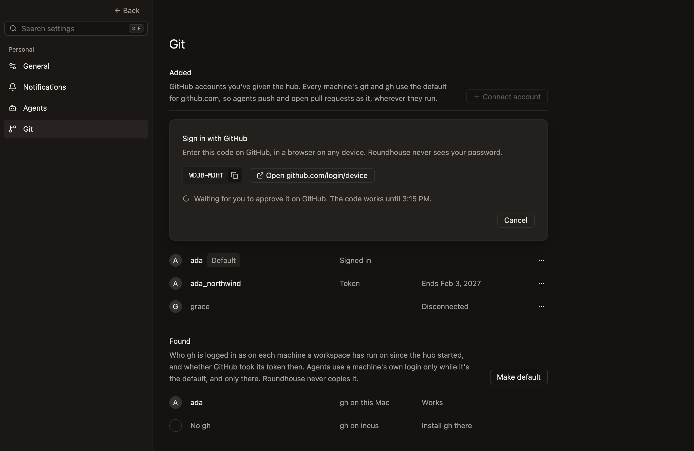

  **A sign-in refused on GitHub.** *Unconfirmed.*

  

  **A sign-in approved as the default.** *Unconfirmed.*

  

- **A sign-in asks GitHub for what an agent could do with the person's own login:** the scopes `repo`, `workflow`, `read:org`, `gist`, `project`, `write:packages` and `user:email`.
- **A sign-in that waits shows wherever Git does, whichever client started it,** such as another window, or the app before it last quit, so it can be finished or cancelled there, while no panel but Connect account's is open. One whose panel was put away isn't shown again while Git shows, and one that has ended shows only in the panel that showed it waiting, until that's closed. A sign-in started from an account's row says to sign in as that account. *Unconfirmed.*
- **A sign-in that's still waiting when its hub stops is over.** Once a hub is running again, the panel says `The sign-in ended before it was approved on GitHub, so nothing was connected. Sign in again for a new code.`, with Close and Sign in again. It says the same when the code runs out, so the words blame neither the code nor the hub. The app restarts its hub after an update, which can end a sign-in someone is part way through.
- **A sign-in approved as a GitHub user the hub holds a sign-in for renews that account's login in place, and any other adds an account.** So signing in as the user of an account that was connected with a token adds a second account for that user.
- **Use a token opens a panel with `Make one on GitHub`, which opens GitHub's page for making a fine-grained token, and a field to paste one into, which has the cursor, shows only dots and can't be copied from.** Connect is off until the field has something in it, and Enter connects too. The app hands the token to the hub, which asks GitHub whose it is and when it ends, and keeps it nowhere itself. The panel goes once the hub has connected it. What the hub refuses is said in red in the panel, which stays open with the field made empty. A panel that goes before the hub has answered takes the wait for its answer with it. *Unconfirmed.*

  **A token pasted for a new account.** *Unconfirmed.*

  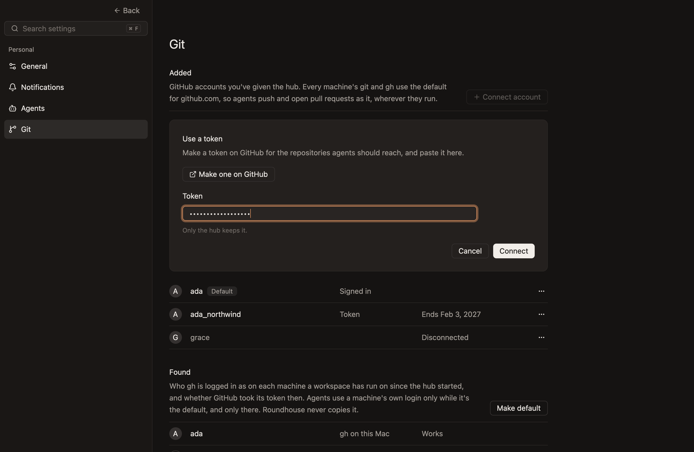

- **Make an app of your own opens a panel in three steps: choosing where to make it and its name, making it on GitHub, and installing it.** Each step has its number until it's done, then a check and what was chosen or made, and only the one it's at has what's in it under its line. Cancel puts the panel away at any step, with whatever it waits on, and once the app is installed Done does. An app GitHub has made stays, as the hub's record, whichever step the panel went at. Agents act as the app's bot, as the panel says under its title, by the bot's name once GitHub has said it, and only the hub holds the app's key. *Unconfirmed:* the steps, how they're drawn, and the words.
- **An app of your own asks GitHub for what agents use:** to write contents, pull requests, issues and workflows, and to read actions, checks, statuses and metadata. The person can give it more on GitHub.
- **Choosing where has Your account or An organization, by its name as in its address on GitHub, and the app's name, which has the cursor.** The name starts as the username of the first account in Added that isn't an app's installation, with `-roundhouse` after it, and empty with none. An app is private, so it's made under the account or organization it's for, and installed only there, and one for another organization is made again under that. Make on GitHub is off until the names are filled in, and Enter makes it too. An organization's name GitHub can't have, or a name the hub refuses, is said in red under the fields. *Unconfirmed:* the default name, and the radios.

  **Making an app, at its first step, under your own account, with its name to begin with.** *Unconfirmed.*

  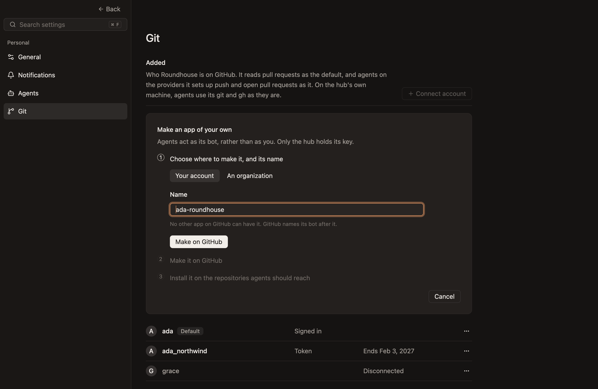

  **Making it under an organization, by its name.** *Unconfirmed.*

  

- **Make on GitHub has the hub write the app's manifest, then serves a page that posts it to GitHub's form for making an app, under the account or organization chosen, and opens the browser on it.** The app serves it on this machine, where the browser is, on `127.0.0.1` alone, at a port the system gives it, and the page posts itself, with a button for a browser that runs no scripts. The step says to make the app on that page, where GitHub says if another app has the name and lets it be changed, and that the app waits for GitHub to send the person back, until a time 30 minutes on, with Open GitHub again, which opens the same page. *Unconfirmed:* the 30 minutes, and the words.
- **The app takes only GitHub sending the person back with its code, to its own address, with the `state` it made for that try, which the page posted with the manifest.** It answers with a page that says to go back to Roundhouse, gives the code to the hub, which makes the app from it and keeps its key, and the panel goes on to installing it. Anything else that reaches it is taken for nothing: with another `state`, or none, it's answered with a page saying it isn't from the app being made, and at another path, with one saying there's nothing there. It stops listening once it has the code, on Cancel, as the panel goes, and after its 30 minutes, when the step says it stopped waiting, with Open GitHub again, which listens anew, with a new `state`. *Unconfirmed:* the pages and their words.

  **Making it on GitHub, with the browser opened on GitHub's form, waiting for GitHub to send the person back.** *Unconfirmed.*

  

- **What stops a step is said in it, in red, with a way to go on.** A name the hub refuses, a hub that can't be reached, and a listener that couldn't start go back to the first step, with what was chosen, and Make on GitHub. A code the hub couldn't make into the app's key, as when GitHub didn't answer, has Try again, which gives the hub the same code, since GitHub takes it for an hour. A code GitHub no longer takes has Start again, which goes back to the first step, and says the app GitHub made has no key here, so to delete it on GitHub or choose another name. *Unconfirmed:* the way on from each, and the words.
- **Installing has Install on GitHub, which opens GitHub's page for installing the app, where the repositories it reaches are chosen, and Check again.** The panel has the hub look for where it's installed each time the window comes to the front while it waits, and on Check again, and the hub looks every minute by itself too. Once the hub has connected an installation, the step says where it's installed, the panel says the bot is installed there and whether it's the default, and Done puts it away. The hub connects the installation as an account, so it becomes the default as any account the hub has a record of first does. *Unconfirmed:* looking as the window comes to the front, and the words.
- **An app's name, its owner, its bot and where it's installed are as GitHub says them now.** The hub asks GitHub as the app as it starts and each day after, so an app renamed, or moved to another owner, on GitHub shows so within a day. Until it has asked, as for a moment after an update that stopped keeping them in the hub's database, an app is named by its number, as `#9`, and Install on GitHub opens GitHub's page of apps rather than any one app's. The panel's first two steps then say `As #9` and `Made on GitHub`, with no owner. An app whose key is gone can't be asked, so it stays named by its number, and can only be removed. *Unconfirmed.*

  **Installing it, as Install on GitHub in an app's menu opens the panel.** *Unconfirmed.*

  

  **Installing it, with the hub saying it couldn't look on GitHub, and Check again.** *Unconfirmed.*

  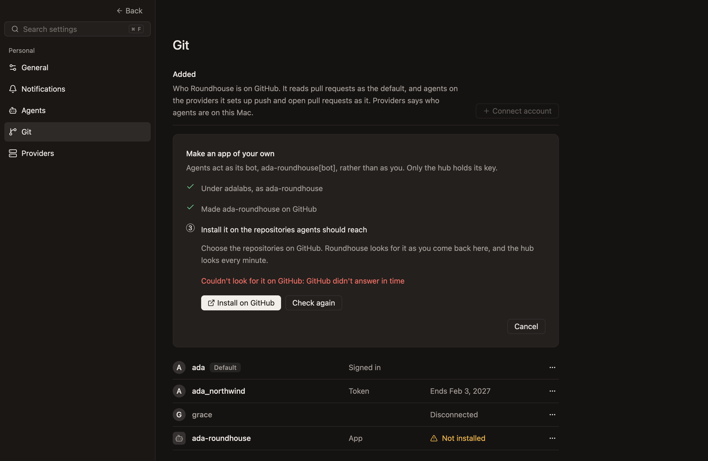

- **An account's `…` menu has Make default, but on the default, which is off while its login can't be used; Renew for a token, which opens the token's panel under its row; Sign in again for a sign-in; and Disconnect.** An account a hub from before Disconnect removed it kept with no login has Connect again and Sign in again in place of Renew and Disconnect. A sign-in approved as the account's GitHub user renews its login in place. *Unconfirmed.*

  **The menu of a token's account.** *Unconfirmed.*

  

- **Renew takes only a token of the account's own GitHub user.** The hub refuses another user's token, and the panel says so in red, as it does whatever the hub refuses. *Unconfirmed.*
- **Disconnect asks first, in a dialog, then has the hub forget the account and its login, so its row goes, and using it again takes connecting it again.** Nothing else names an account but the default, so nothing is left naming one that's gone. The login isn't revoked on GitHub, so it still works wherever else it's kept, such as `gh`'s on this Mac. Disconnecting the default leaves no default, rather than choosing another, and the dialog says that until another account is made the default, Roundhouse can't read pull requests and agents on the providers it sets up can't push. An app's installation is the exception, as below. Why the hub couldn't do what an account's menu asked is said under its row, and an account that was gone already, as when another app disconnected it, is taken as disconnected. *Unconfirmed.*
- **An app's installation is a row in Added, as an account whose user is the app's bot, listed with the rest: the app's mark in place of a letter, the bot's name, as `ada-roundhouse[bot]`, `App` as how it was connected, and `Installed on` and where, while its login works, or else how it stands: `Disconnected` once the hub holds no login for it, and for the default, as the hub says, `Renewing` in amber once its token has ended while the hub makes the next.** The hub makes each token from the app's key, an hour at a time, so when one ends isn't said, nor on its record, and only the hub can say the default's has ended. Any one can be the default, as any account can. Its menu has Make default, but on the default, which is off while its login can't be used; Disconnect, while the hub holds its login, which asks first, says the app stays installed, and has the hub forget its token; Connect again, which has the hub look for it again, and Install on GitHub, once it was disconnected or uninstalled; and Remove app, while the hub has the app. A default installation that can't be used says why in the box at the top of Added, in the hub's words: that the hub is making its next token, or that it was disconnected or the app uninstalled there, with what to do. *Unconfirmed:* the mark, the menu, and the words.

  **Git, with an app's installation as the default.** *Unconfirmed.*

  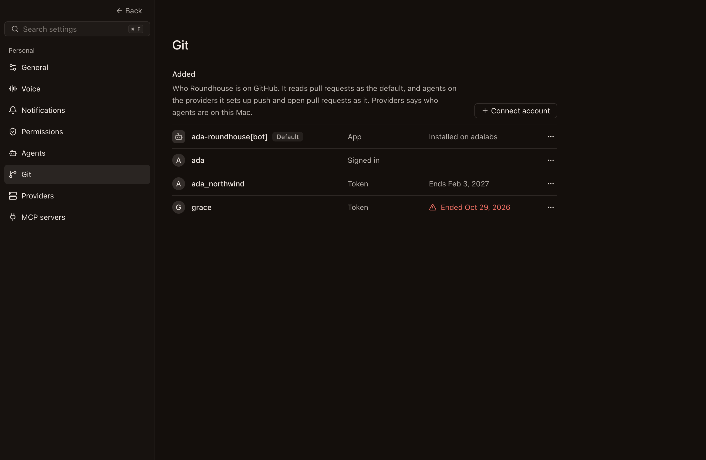

  **Git, with an app's installation as the default, whose token has ended while GitHub won't make the next, so the hub blocks every worker.** *Unconfirmed.*

  

  **The menu of an app's installation.** *Unconfirmed.*

  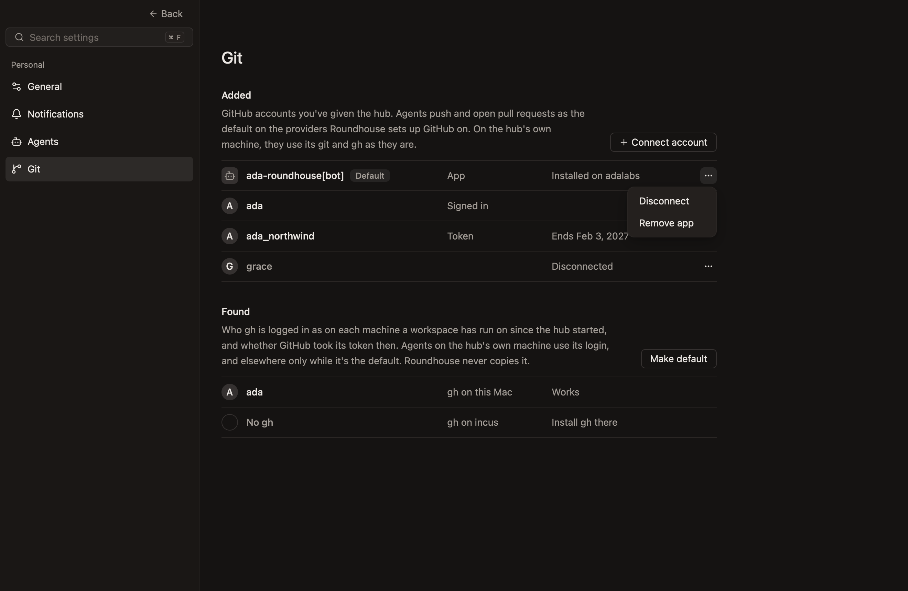

- **An app installed again where it was uninstalled connects as the same account,** so a default that was it works again. An installation the person disconnected stays disconnected, though the app is still installed there, until they choose Connect again. *Unconfirmed.*
- **An app the hub has made that's installed nowhere is a row of its own, after the accounts, by its name, with its mark, `App`, and `Not installed` in amber.** Its menu has Install on GitHub, which opens GitHub's page and the panel at installing it, Check again, which has the hub look for it, and Remove app. *Unconfirmed.*

  **An app installed nowhere, with its menu.** *Unconfirmed.*

  

- **Remove app asks first, in a dialog, then has the hub forget the app's key and every installation's login.** Nothing is deleted on GitHub, and the dialog says to delete the app there to be rid of it. An installation that's the default stays the default, so agents on the providers Roundhouse sets up GitHub on can't push until another account is made the default, and the dialog says so. Why the hub couldn't do what an app's menu asked is said under its row. *Unconfirmed.*
- **With no hub to ask, the accounts and logins stay listed, and every button is off.** *Unconfirmed.*

## Providers

- **Providers lists where agents run, and who they are on GitHub there, as the hub's settings say which providers Roundhouse sets up GitHub on and which it leaves to their machines: those left to their machines first, this Mac first among them, then those it sets up, in the order the hub has them.** *Unconfirmed:* all of this section, its words and its layout.
- **On this Mac, Roundhouse hands agents nothing for GitHub, so their git and `gh` behave exactly as in your terminal, and they commit as your git config says.** This Mac's section only informs: its rows say who `gh` is to agents there and whose SSH key GitHub takes, as `ssh -T git@github.com` names it, or that it takes none. Who `gh` is to agents is the owner of a `GH_TOKEN` or `GITHUB_TOKEN` in what they run with, as `workspaces.md` says, such as one the profile exports, since `gh` uses it over its own login, and otherwise who `gh` is logged in as. A key that isn't `gh`'s account says so. Under them, it says who Roundhouse itself reads pull requests as, the default account in Git, so a person sees when the two differ.

  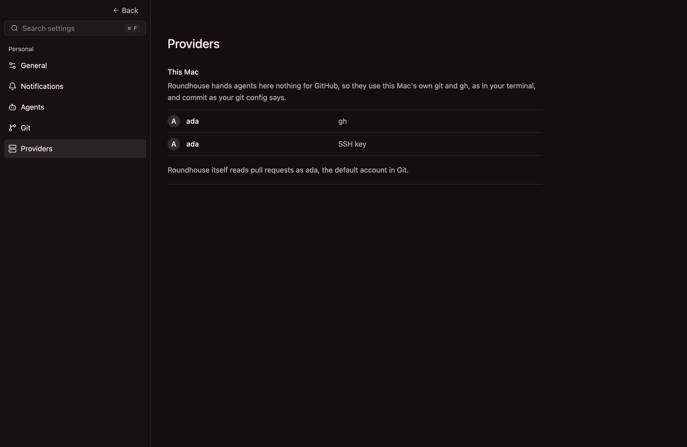

  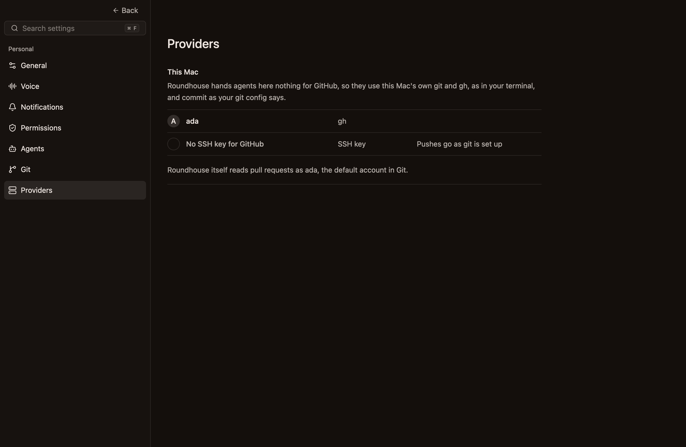

  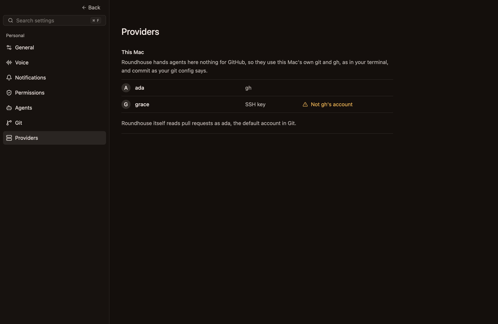

  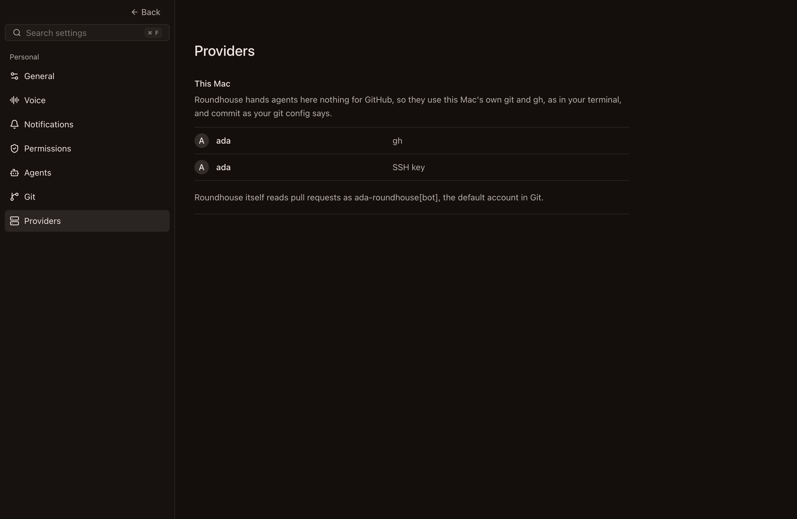
- **The page asks the hub who `gh` and the SSH key are each time it opens, since either can change at any time, and the hub keeps nothing of them.** The hub runs `gh` and asks GitHub whether it takes its token, as Connect account's panel does, and runs `ssh -T git@github.com` on its own machine, which never asks anything, so a key with a passphrase or a host key `ssh` doesn't know comes out as `Couldn't tell`, and which it stops after 15 seconds. Until the hub says, the section says it's asking, and a hub that couldn't be asked has the section say Roundhouse couldn't tell. A `gh` the hub couldn't read is `Couldn't tell` too. *Unconfirmed:* asking each time the page opens, the 15 seconds, and the words.
- **While `gh` on this Mac is logged out or not there, a box says its agents can't use `gh`, and what to run, and that their pushes still go as git is set up here.**

  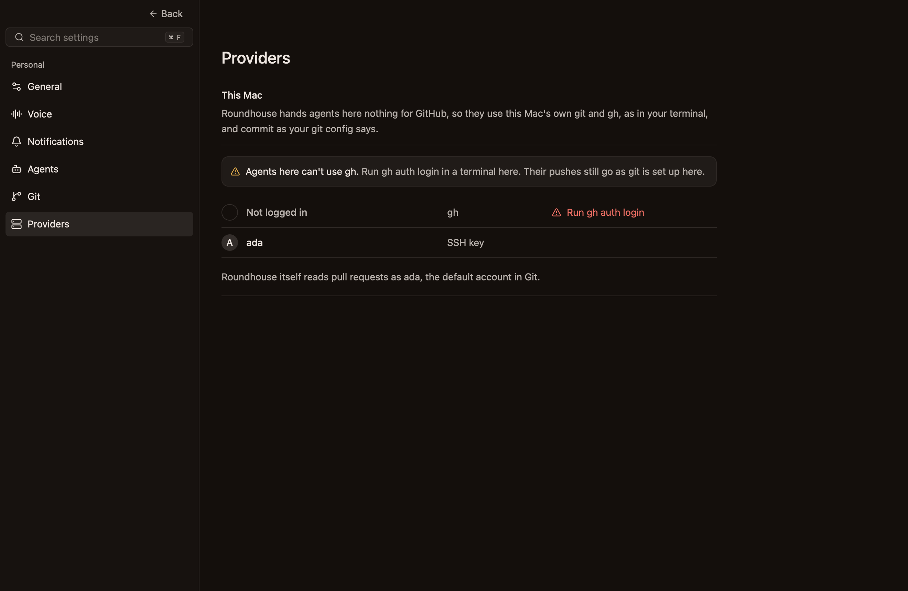

  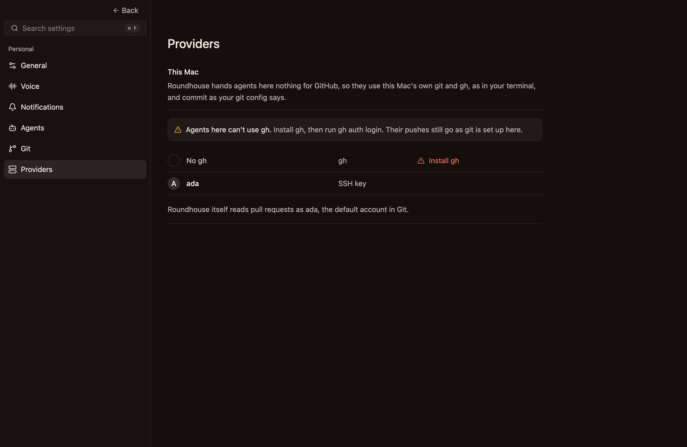
- **A provider whose machines Roundhouse sets up says so, and that its agents are the default account in Git, which its row names, or that there's none, and to connect one in Git.**

  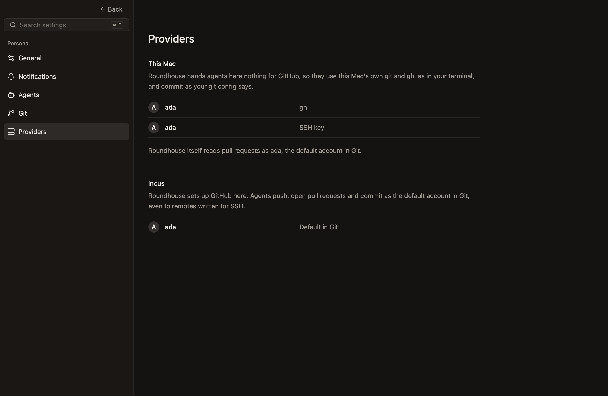
- **Another provider left to its machines says Roundhouse hands agents there nothing for GitHub, so they use git and `gh` as those machines have them set up, and has no rows, since the hub reads only its own machine's.** *Unconfirmed.*

## MCP servers

- **MCP servers lists the servers the hub has of its own, in a list, Added, each a row in the design of Git's: its name, its address, and what else there is to say.** Every agent in every project has them, whichever machine it's on, beside the ones its own CLI has. The address is the host in its URL, with the port if it has one. A row says only what isn't plain: `Key` for a server a key is sent to, `Needs you to sign in`, in red, for one whose sign-in is missing or no longer works, and `Sign in for more access`, in red, for one that works and wants more access than its sign-in has. Whether a server can be reached depends on the machine an agent is on, so a chat says that and this page doesn't. A hub too old to have servers of its own says it has to be updated as one is added. *Unconfirmed:* the words for more access, and what a hub that's too old says.

  **MCP servers, with two accounts at one server, one of which needs you to sign in, one server anyone can use, and one of a company's own.** *Unconfirmed.*

  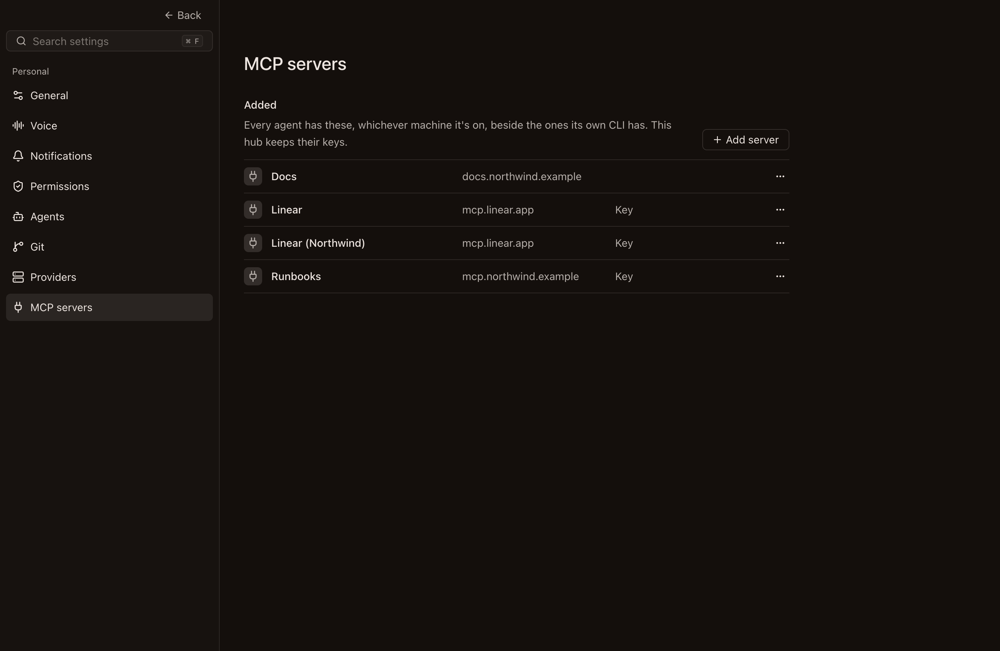

  **MCP servers, where Linear wants more access.** *Unconfirmed.*

  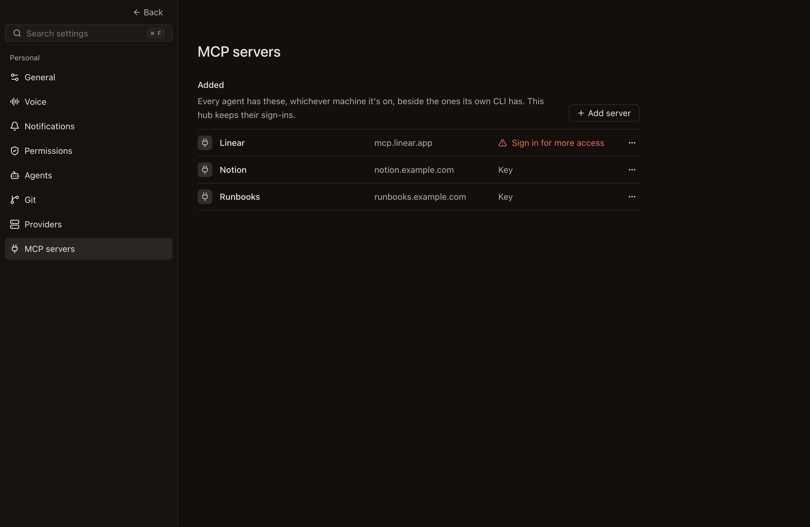

  **MCP servers on a hub with none.** *Unconfirmed.*

  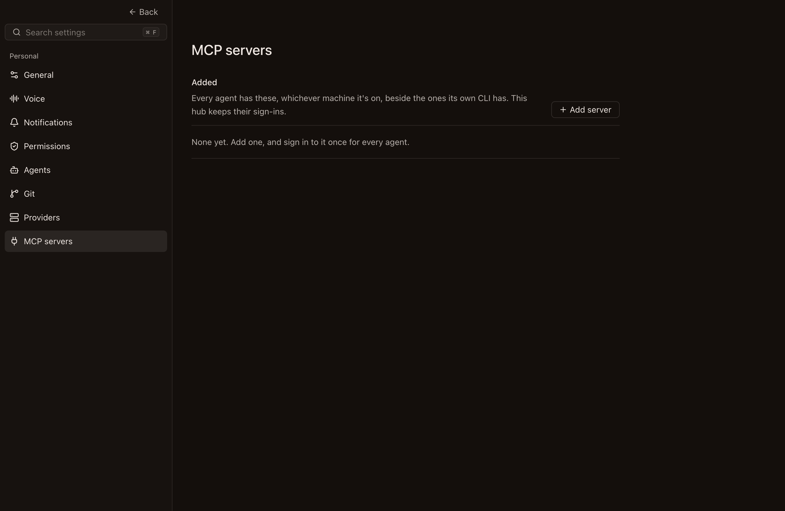

- **Each server has one sign-in, so a second account at the same server is a second server,** with a name of its own, such as `Linear (Northwind)`. A server's key is its own in the same way.
- **Adding a server is one panel: its name, its URL, and a dropdown, Authentication, of how it knows who you are, which is Sign in, Key or None, as the owner decided.** It opens on Sign in, with the cursor in the name, and has more fields only where the choice needs them. Key has the header, `Authorization` unless changed, and the key, in one row, with the header as wide as the dropdown and the key taking the rest. Under the dropdown is what the choice means, which for Key says that only the hub keeps it, said once in the panel, and each row of the dropdown's menu has a note that says it in a few words. The panel's button is Sign in for Sign in, and Add otherwise. Choosing another way keeps the name and the URL, drops what was typed as a key and clears a refusal, and choosing Key puts the cursor in the key. A URL that's already there says so, and which server it is, the first by name where there are two, and stops nothing. What the hub refuses is said in red in the panel, which stays open. The key shows only as dots. *Unconfirmed:* the panel's words, the menu's notes, the header and the key sharing a row, where the panel says that only the hub keeps the key, and what choosing another way keeps and where choosing Key puts the cursor.
- **A key for `Authorization` with no space in it is sent as `Bearer` and the key,** since a server gives out a key alone and the header holds its scheme too. One with a space has its scheme already, such as `Basic`, and is sent as it is, as a key in any other header is.

  **Adding a server, with the dropdown open.** *Unconfirmed.*

  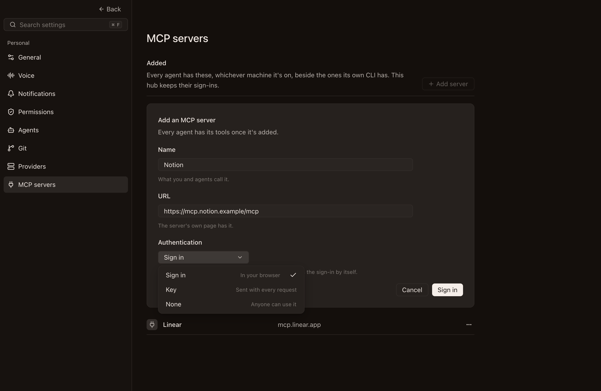

  **Adding a server a key is sent to.** *Unconfirmed.*

  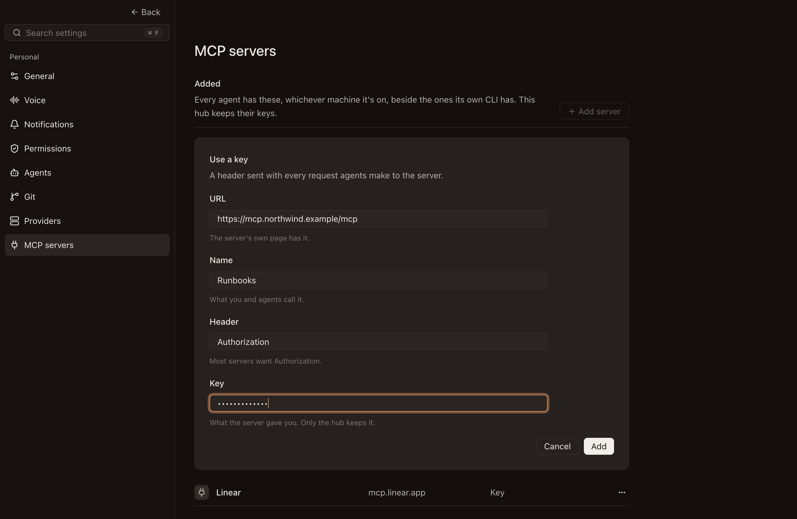

  **Signing in to a server, as it's added.** *Unconfirmed.*

  

  **Signing in with a second account at a server that's already there.** *Unconfirmed.*

  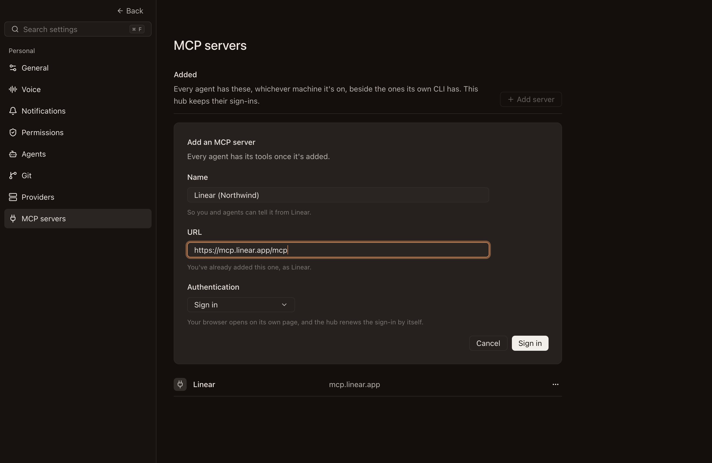

  **Adding a server with None, refused, since its name is taken.** *Unconfirmed.*

  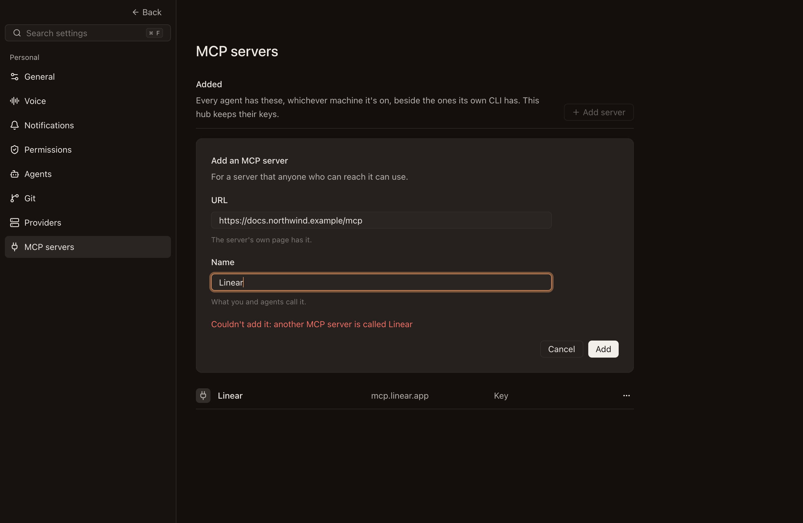

- **Before a server with Key or None is added or saved, the hub connects to it and asks for its tools, for at most 15 seconds, as the owner decided.** The hub asks as part of adding or saving it, rather than the app asking it first, as the owner decided. A server that's signed in to isn't asked, and nor is one whose name alone is changed. While the hub adds or saves it, the panel's fields and Authentication are off, as Add or Save is, so nothing in the panel changes what was sent, and Cancel works, as the owner decided. While it's asked the panel says `Asking HOST for its tools`, with its host and a task's ring. The hub doesn't say when the server has answered, so the line stays until the hub has added or saved it, which it does at once after. Cancelling, or closing the panel or Settings, adds and saves nothing, unless the hub had begun to save it, when it's saved all the same. Once it answers, it's added or saved. What the hub refuses, such as a name that's taken, it refuses before it asks the server, and once it has asked, it refuses what another app changed meanwhile that the server wasn't asked with, such as another key. A hub from before this says it has to be updated, as one too old to have servers does. *Unconfirmed:* asking nothing of a server whose kept key this hub can't read, four asked at once at most, checks among them, the line staying until it's saved, that one the hub had begun to save is saved all the same, what's refused once it has been asked, that the app's one request says whether it's anyway, and that the ID it's let go of by is the save's own.
- **A server that doesn't list its tools isn't added or saved. Why is said in red, where a refusal is, and the buttons become Cancel, Add anyway or Save anyway, and Try again, which is the main one, as the owner decided.** Add anyway and Save anyway have the hub add or save it without asking it again. Changing any field brings back Add or Save and takes the reason away, and Enter does what the main button does. The panel's end is scrolled into sight as that comes. *Unconfirmed:* the scroll. The reason has no words of the server's, and no key, and neither does an error or the log.

  | What came of it | Words |
  |---|---|
  | 401 or 403, with a key | `Runbooks refused this key.` |
  | 401, with None | `Runbooks asks who you are, so it needs a sign-in or a key.` |
  | It can't be reached | `The hub can't reach mcp.northwind.example.`, and why where that's known, as `Connection refused.` |
  | It answers, and isn't MCP | `mcp.northwind.example isn't an MCP server at this URL.` |
  | 5xx | `mcp.northwind.example has a problem of its own (503).` |
  | It connects, and answers with an error when it's asked for its tools | `Runbooks connected, and wouldn't list its tools.` |
  | Its host isn't found. *Unconfirmed* | `The hub can't reach mcp.northwind.example. There's no such host.` |
  | There's no way to its host. *Unconfirmed* | `The hub can't reach mcp.northwind.example. There's no way to it from the hub's machine.` |
  | Its certificate isn't trusted. *Unconfirmed* | `The hub can't reach mcp.northwind.example. The hub's machine doesn't trust its certificate.` |
  | It doesn't speak TLS. *Unconfirmed* | `The hub can't reach mcp.northwind.example. It doesn't speak https there.` |
  | The hub's machine has no list of certificates. *Unconfirmed* | `The hub can't reach mcp.northwind.example. The hub's machine doesn't say which certificates it trusts.` |
  | Not in 15 seconds. *Unconfirmed* | `mcp.northwind.example didn't answer in time.` |
  | The connection ends first. *Unconfirmed* | `The hub lost its connection to mcp.northwind.example before it answered.` |
  | A redirect that isn't followed. *Unconfirmed* | `mcp.northwind.example sends the hub on to another URL. Type that one if it's this server's.` |
  | 403, with None. *Unconfirmed* | `Runbooks doesn't let the hub in (403). It may need a sign-in or a key.` |
  | 404. *Unconfirmed* | `mcp.northwind.example has nothing at this URL (404).` |
  | 429. *Unconfirmed* | `mcp.northwind.example has had too many requests for now (429).` |
  | More than 4 MB. *Unconfirmed* | `mcp.northwind.example answered with more than the hub reads.` |
  | It's MCP, and won't start a session. *Unconfirmed* | `Runbooks answered, and wouldn't connect.` |
  | Something only a newer hub says. *Unconfirmed* | `Runbooks didn't list its tools. Update this app to see why.`, or `Runbooks was asked for its tools. Update this app to see what came of it.` |

- **The server is asked at the URL that was typed, with what agents' calls would carry,** over plain HTTP and on a private network too. A kept key goes only to the server it was given for, and a redirect is followed only where an agent's call would be, within the same scheme, host and port. The hub asks, so whether an agent on another machine can reach the server is still for its chat to say.
- **What's typed as a key stays in its field until the server is added or saved,** so trying again, or adding it anyway, takes no typing it again. Nothing of it stays once the hub has taken it, after Cancel, or once the panel is closed.

  **Adding a server, while it's asked for its tools.** Drawn from an approved mock. *Unconfirmed.*

  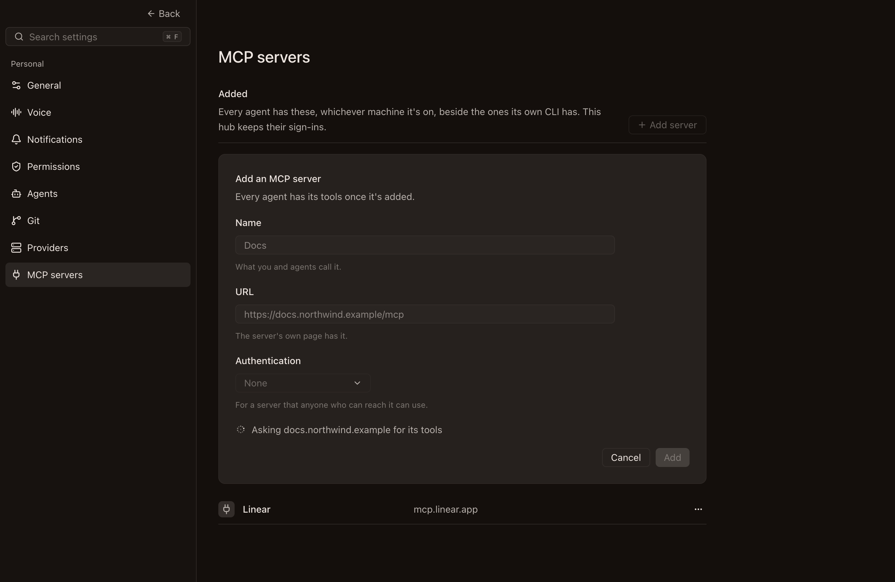

  **A server that refuses its key, as it's added.** Drawn from an approved mock. *Unconfirmed.*

  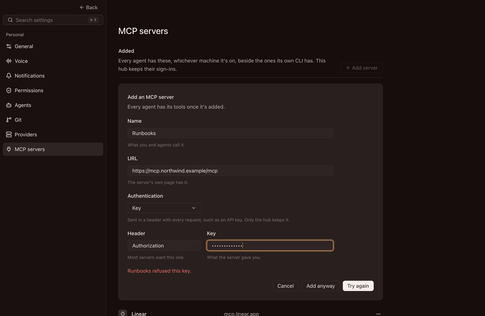

  **A server that can't be reached where it's moved to, as it's edited.** *Unconfirmed.*

  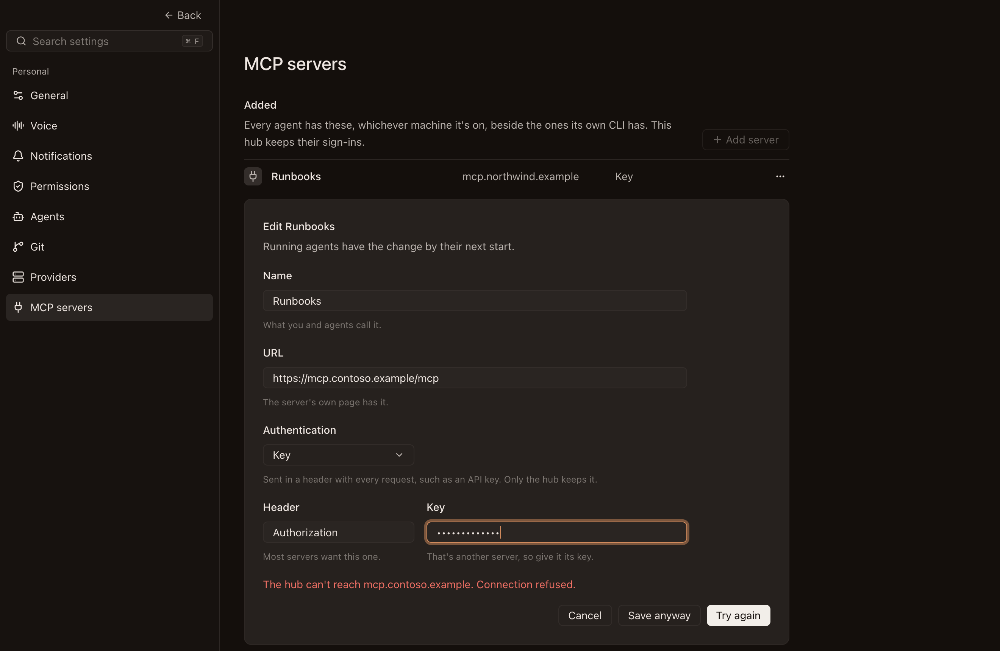

- **A server's name can be whatever you like, up to 64 characters on one line, and the app always shows it as you typed it.** Agents call the server by a name Roundhouse makes from it, which every agent's CLI takes: its ASCII letters, digits and `-` as they are, with each run of anything else as one `_`, and no `_` or `-` at either end, so `Linear (Northwind)` is `Linear_Northwind`. That name is at most 32 characters, and `server` when nothing is left. A new name is what an agent calls the server from the agent's next start. A name whose agents' name another server has, in any case, is refused, saying which server, and that agents would call both the same where the names differ, and so is one that agents would call `roundhouse`, which Roundhouse's own tools are.
- **Signing in opens the server's page in the browser on this device, and the panel waits, with a button that opens it again.** Nothing is added until it's approved. The panel names the host of that page and the server's, as `Approve Roundhouse on auth.linear.app for mcp.example.com`, as the owner decided, since a server can send you to any service's page, such as Linear's for a server that isn't Linear's. A server on the page's own host, whatever its port, is named once, as `Approve Roundhouse on mcp.example.com`. It works for a hub on another machine too, since the browser sends you back to this device, at a port the app listens on only while it waits. The hub first asks the server how it's signed in to, which can take half a minute, and the panel says so. A server that anyone can use, and that has a sign-in too, is signed in to when you choose to sign in to it. A sign-in asks to be allowed at most 32 of what a server names, the first it names, and to stay signed in where the service has that. *Unconfirmed:* the words naming both hosts, and naming the host once whatever the server's port.
- **An agent's call takes a server's sign-in over plain `http` only to an address that isn't on the internet, such as one on a private network or the agent's own machine.** The worker checks each address it connects to, whatever the server's name comes to on its machine then, and connects only to the private ones of a name that comes to both. So a laptop on another network, where the name comes to an address on the internet, connects to nothing, and the agent is told `Linear (Northwind)'s address isn't private, so its sign-in isn't sent to it over http. Give it an https URL in Settings › MCP servers.` A key goes over `http` wherever the name comes to, since you chose to send it. *Unconfirmed:* the words.
- **Where the service a server is signed in to doesn't take the document that says who Roundhouse is, the hub registers Roundhouse with it, and uses that each time you sign in to the server again.** It registers once it has found that the rest can work, which can take as long again. A service that only registers apps with a secret can't be signed in to, nor can one that won't register Roundhouse, and the panel says which, with what the service calls the reason. If the service has forgotten the registration, its page shows an error, and signing in once more registers again, or once more than that if the hub has restarted between. *Unconfirmed:* when it registers.
- **The dropdown never moves by itself, as the owner decided.** When a server that's added or edited turns out to have no way to sign in, the panel is there again as it was typed, still on Sign in, with why in red where every other refusal is. A server that anyone can use says so, and to choose None, or Key if it gave you one. One that can't be signed in to says why, and that it may take a key. A server that's signed in to again and has no way says only why, in the sign-in's own panel, with Close. No text of a server's own is shown as Roundhouse's words: where a server, or the service it's signed in to, says it's another, only the host of the address it gives is shown, as `It says its sign-in is for mcp.other.example, which isn't its address.`, and where what it gives isn't an address, none of it is, as `It says its sign-in is for another server.` The service a server is signed in to is named by the host of its address alone too, as `Roundhouse can't sign in to this server. auth.northwind.example, where it's signed in to, takes only apps with a secret, and Roundhouse has none.` *Unconfirmed:* the words, and what signing in again says.

  **Signing in to a new server that anyone can use.** *Unconfirmed.*

  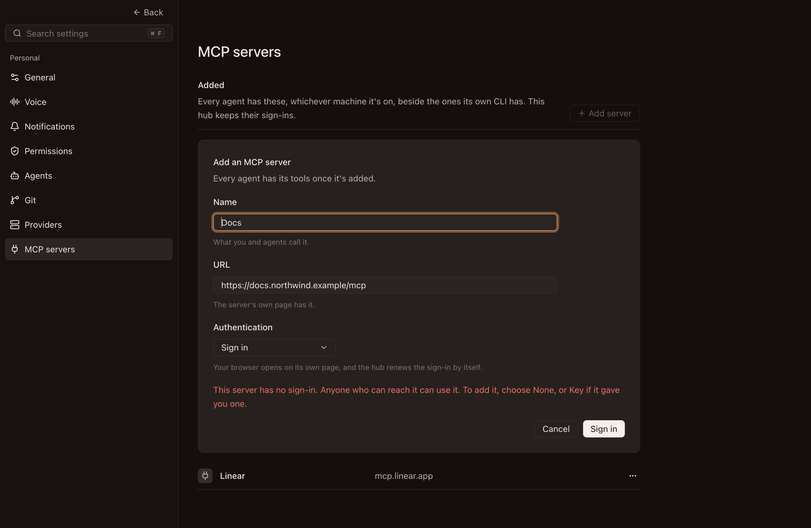

  **Signing in to a new server that can't be signed in to.** *Unconfirmed.*

  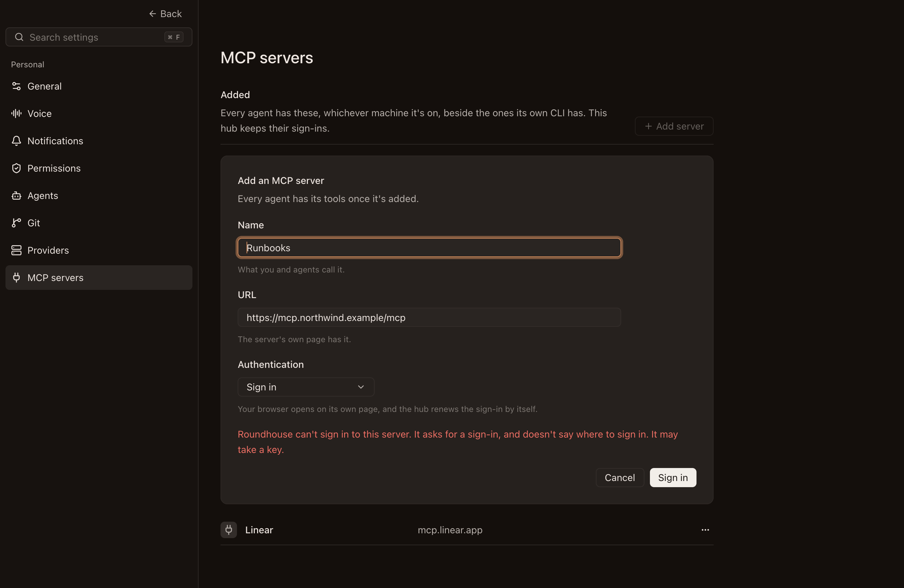

- **What the browser is sent back with goes to the hub alone,** and the app keeps none of it once the hub has answered. Only the first redirect with the sign-in's own state counts, and any other is dropped, with the sign-in still waiting. The browser's page says whether you approved it and to go back to Roundhouse. The app opens only a page on the web. *Unconfirmed.*
- **A running agent is connected to a server once you sign in to it, or sign in again,** if it was started with the server and isn't connected to it. Claude and Codex connect to it once the agent's turn ends, or at once if it's on none, as the owner decided, and Antigravity at your next prompt. An agent started before the server was added has it from its next start. Nothing is written in the chat. *Unconfirmed:* all but when.

  **Waiting for a sign-in to be approved in the browser.** *Unconfirmed.*

  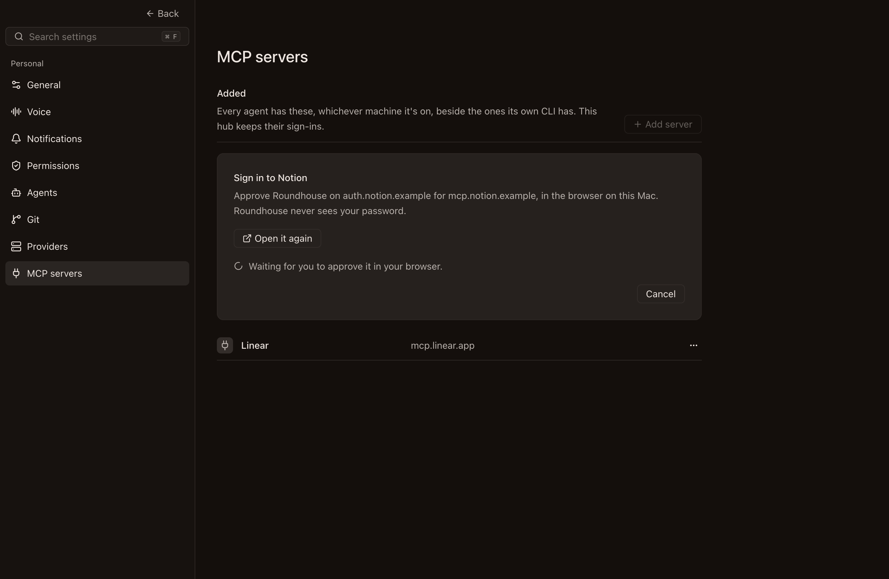

- **A sign-in that comes to nothing says why, in red, with a way to try again,** whether it was refused, it failed, nobody approved it within 15 minutes, the hub no longer has it, or its server's name was taken meanwhile. For a server that's added or edited, that's the panel it was started from, with what was typed still in it. For one that's signed in to again, it's the sign-in's own, with Try again. *Unconfirmed:* all but the 15 minutes.
- **The app has one sign-in to a hub's servers at a time, and it goes on with Settings closed.** MCP servers shows it wherever it was started. Starting another cancels it, and so does Cancel, after which nothing listens. If the connection to the hub is lost once you've approved it, it's finished when the connection is back. *Unconfirmed:* that MCP servers shows it wherever it was started, and that nothing listens after Cancel.

  **A sign-in refused, in the panel it was started from.** *Unconfirmed.*

  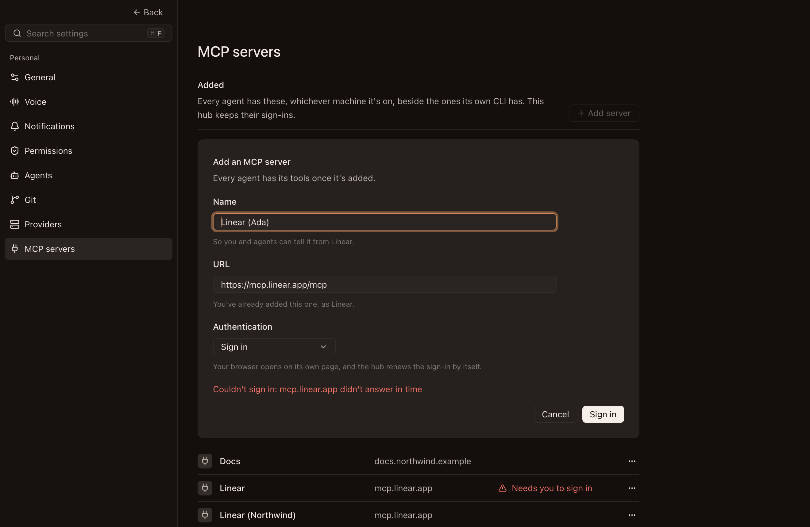

  **Signing in again, refused.** *Unconfirmed.*

  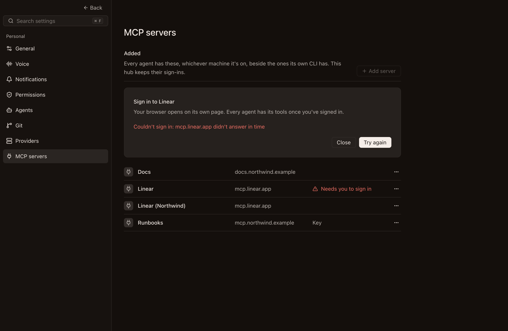

- **A server that wants more access than its sign-in has fails only the call it wants it for,** as when an agent changes an issue and only reading was allowed. The agent is told that the server wants more access and to sign in to it again from Settings › MCP servers, and its other calls work as before. The server's row and each chat's plug say so until it's signed in to again. Signing in again asks to be allowed all that was asked for before, all that was granted, and what the server has wanted since. More may have been granted than was asked for, as where the server said nothing and its service chose. A server that wants only what was already asked for isn't asked for it again, and only the agent is told, as it is of one that doesn't say what it wants. *Unconfirmed:* being told and not asked during the turn.
- **The hub renews a sign-in by itself, and loses it only when the service refuses that for good:** when it says the sign-in has ended or been taken back, or, for a service the hub registered Roundhouse with, that it no longer knows that registration. The row then says `Needs you to sign in`. Any other failure leaves the sign-in as it is, and the hub tries again a minute later, then after waits that double, up to ten minutes. That includes a service that says it doesn't know Roundhouse where it's told who Roundhouse is by its document, since it says that whenever it can't fetch the document, as while Roundhouse's site is down or wrong. The row says nothing of a failure meanwhile, while the server's calls fail once its token has ended.
- **A server has at most 8 calls under way from a workspace's agents, and each call past that fails at once,** so a server that takes calls and never answers them holds up only itself, and not Roundhouse's own tools or any other server. Calls from every chat in the workspace count together, so one chat's calls that the server never answers fail the others' too, until they end. The agent is told `Linear (Northwind) has 8 calls under way that it hasn't answered, so Roundhouse sends it no more until one of them ends.`, and the connection the call came on is closed with the answer. A stream of the server's events counts as a call only until the server begins it, so an agent connected to it is never refused for having one open. *Unconfirmed:* the words, and that a stream counts only until the server begins it.
- **A URL that looks like it has a key in it says so under its field, in amber, as it's added or edited: `This looks like it has a key in it. Every app on this hub can see the URL. If the server takes a key in a header, use Key.`** It stops nothing, since a URL can't be told to have one. It looks like it where an option's name ends in `apikey`, `token`, `secret` or `password`, in any case and without its `_` and `-`, and its value has at least 16 characters, one of them a digit.

  **Adding a server whose URL looks like it has a key in it.** *Unconfirmed.*

  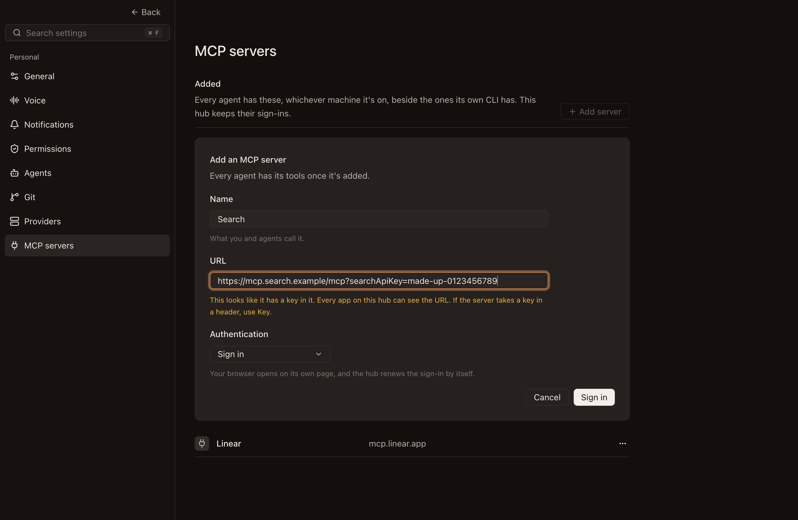

- **A server's menu has Sign in again, where it's signed in to, Edit and Remove.** Sign in again signs in to that server as adding it did, and changes nothing until it's approved. Sign in again and Edit are off while a panel is open, so what's typed in one isn't lost, and Edit isn't there for a server that knows you in a way only a newer hub has. Remove asks first, as disconnecting a GitHub account does, and then the hub forgets the server with its sign-in or its key, which isn't revoked at the server. What the hub couldn't do is said under the row, in red. *Unconfirmed:* all but Sign in again and Edit being off while a panel is open. A running agent that has the server is refused each call to it from then on, with `Roundhouse can't use this MCP server now. It may have been removed, or its key or sign-in can't be read.`, since its worker can't tell a server that's removed from one the hub can't send it, as when it can't read the server's key. A stream the server had open to the agent ends, as it does for a server that's moved, and a call under way finishes there.

  **The menu of a server that's signed in to.** *Unconfirmed.*

  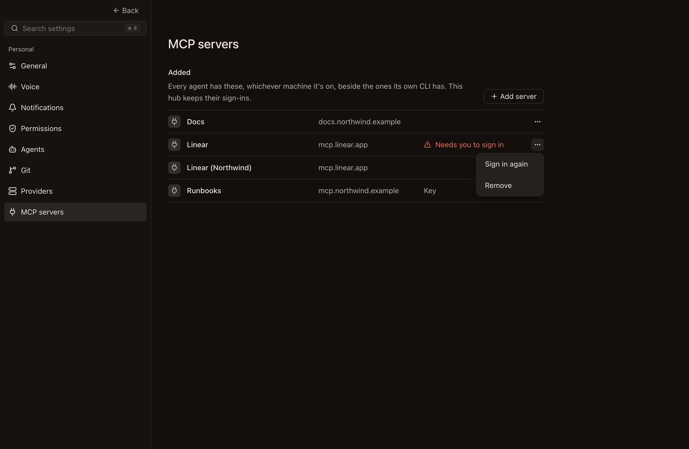

- **Edit opens adding's form, filled in with the server's name, its whole URL and how it knows you, with Save, or with Sign in where what's changed takes one.** Only what's changed is saved, so what another app has changed meanwhile stays, and each change does this:

  | Change | Sign-in or key | Running agents |
  |---|---|---|
  | Its name | Kept | The new name from each one's next start |
  | Only its URL's query | Kept | Their calls use the new URL at once. One that's connected to the server lists its tools again once its turn ends, if it can, as Claude can, and from its next start otherwise |
  | Its URL's scheme, host, port or path, which is another server | Asked for again. With a sign-in, the button is Sign in, and nothing changes until it's approved. With a key, Save is off until one is typed | Their calls use the new URL at once. One that's connected to the server lists its tools again once its turn ends, if it can, as Claude can, and from its next start otherwise |
  | How it knows you, or the key itself | The old one is forgotten once the new one is saved | Their calls use the new one at once |

  Choosing Sign in for a server that wasn't signed in to takes a sign-in too. A sign-in that's approved saves the whole edit with it, and is refused if the server was moved, removed or signed in to meanwhile, or the name taken. *Unconfirmed:* refusing it.
- **A running agent connects to a server that's edited once its turn ends, or at once if it's on none,** as it does to one you sign in to, whatever is changed but its name, and whether or not it was connected to it, as the owner decided. One that isn't connected connects whatever else is changed, if it's Claude or Codex, so a key you correct has the agents that the old one failed connect. One that is connects only as the table says. Antigravity tries a server that failed at your next prompt.
- **An edit that's saved anyway, as the server didn't list its tools, has Claude list its tools again too, whatever is changed but its name, as the owner decided.** So Claude's card says `Can't be reached` if it can't use the server as it is now, rather than that its tools are as they were. A call from any other agent goes as the server is now, and fails as the server has it. *Unconfirmed:* that nothing more is asked of an agent other than Claude that's connected to it.
- **A running agent is asked once for each change, before the next prompt that's waiting, and only once its worker has the server as it is.** Several servers, or one changed twice, while its turn runs are each connected to once as it ends. A server you reload from a chat's plug meanwhile, which is connected to at once, isn't connected to again. An ask that doesn't reach the agent, as where its turn has just started or its worker's connection is lost, is asked again the next time the hub looks, such as as that turn ends, and one the agent refuses, or takes and then fails to connect, isn't. A call the agent has made to a server fails as Claude connects to it again, and one that fails to connect says `Can't be reached` with Reload in the chat's card, as after Reload. Until it's asked, the card says `When its turn ends`, as `chats.md` says. Nothing is written in the chat. A sign-in that saves an edit does all of this as the edit would. *Unconfirmed:* that a turn the agent is about to start, with a prompt it has been given, is one it's on, that a Reload that's refused, or an ask of the hub's that doesn't reach the agent, leaves it to be asked, and that a hub that has restarted since connects an agent again only to one that failed.
- **The key's field says `Kept` while there's one to keep, with `Leave it empty to keep the one you gave.` under it.** A header that's changed keeps the key. For another server it says `That's another server, so give it its key.` Under Authentication, a server that stays signed in to says `You stay signed in.`, and another server that's signed in to says `That's another server, so you sign in to it. Nothing changes until you have.`
- **Edit's panel is under the server's row, and so is the sign-in it starts.** Under its title is one line, the same whatever is changed, as the owner decided: `Running agents have the change by their next start.` A chat's plug says what each agent has once it's saved. A server that's removed meanwhile leaves the panel under Added's heading. *Unconfirmed:* the line's words, the rest of it, and `Kept` going from the field for another server.
- **An agent connected to a server that's moved sends its next call there, in the session the old server gave it, if it gave one.** Where the server answers a session it doesn't know with 404, as MCP has it, Claude and Codex connect to it afresh and send the call again. Where it answers otherwise, the call fails until the agent connects afresh, as the table says. A stream the old server had open to the agent ends, and a call under way finishes there. *Unconfirmed:* all but the call going there.

  **Editing a server, with its URL's query changed.** *Unconfirmed.*

  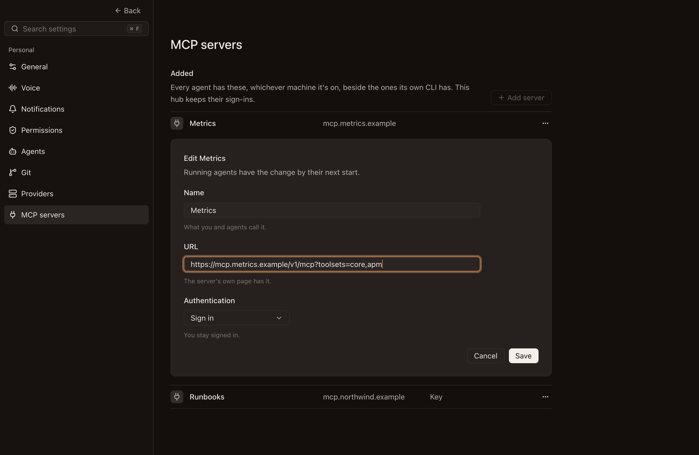

  **Editing a server, moved to another URL.** *Unconfirmed.*

  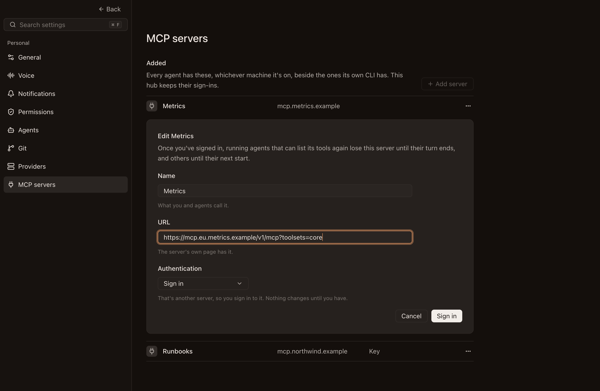

  **Editing a server with a key.** *Unconfirmed.*

  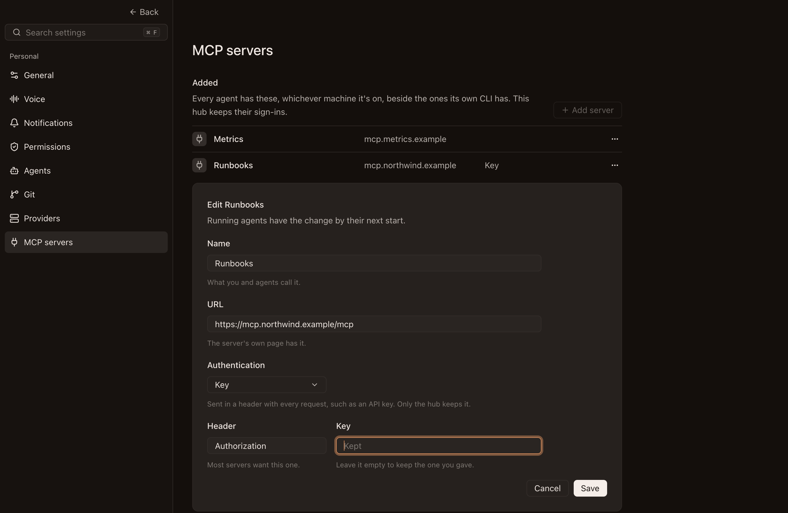

  **Editing a server with a key, moved to another URL.** *Unconfirmed.*

  

- **The iPhone app has no MCP servers page and no signing in to one.** *Not built.*
