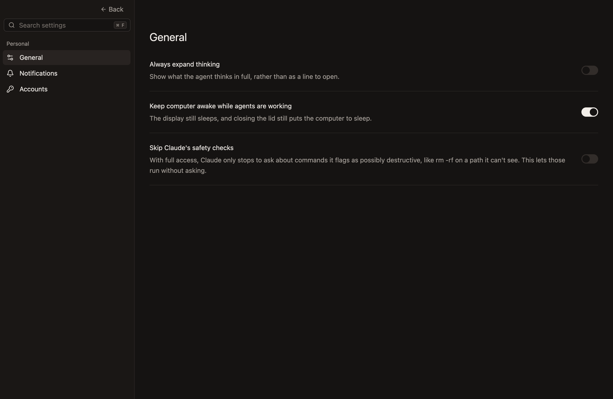
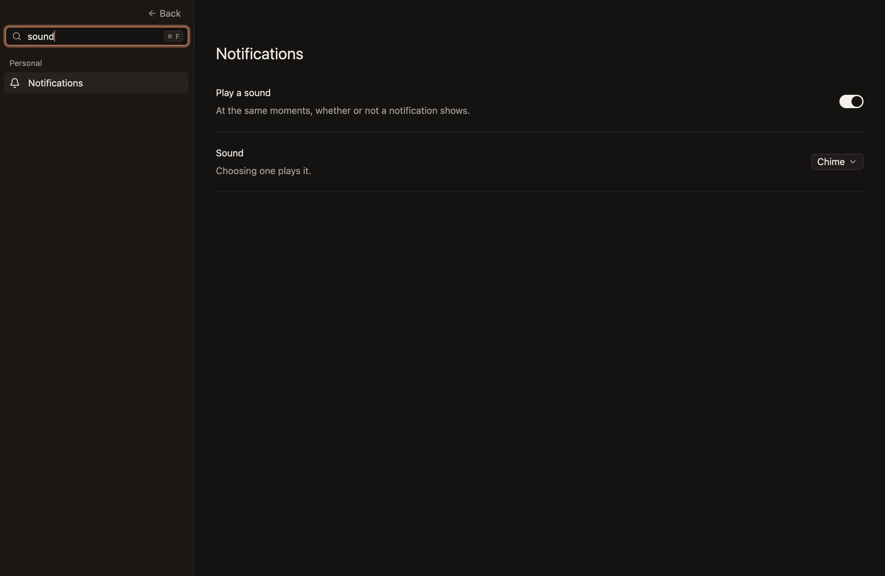
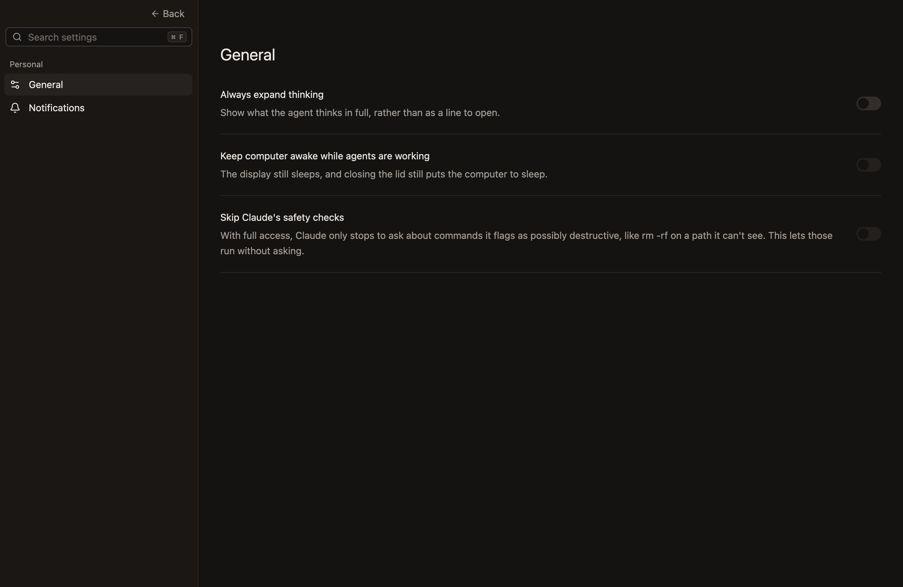
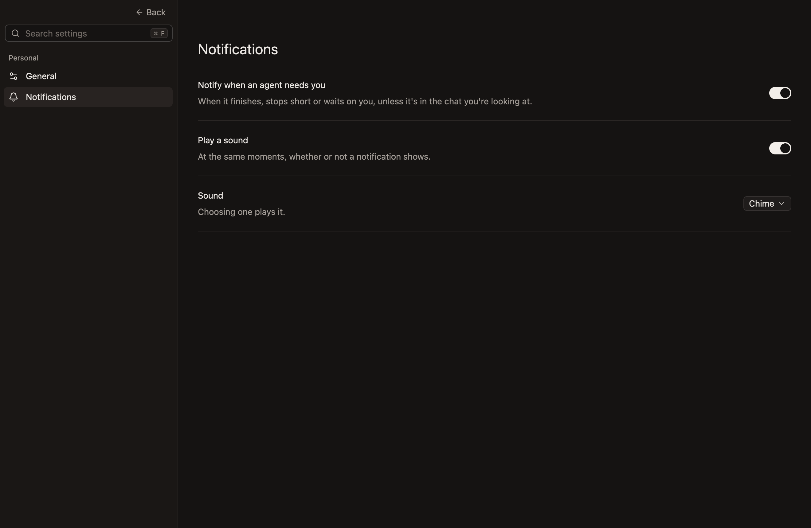

# Settings

The app's own settings, and where they're shown.

- **Settings… in the app menu, or `Cmd-,`, shows Settings in place of the sidebar and the workspace,** in the same window. `Back`, Escape or `Cmd-W` goes back to where you were, with what you were typing still focused, or to a workspace selected in its place meanwhile, such as when the one showing was archived from elsewhere, which then has the keys. While Settings shows, the workspace's keys do nothing, since what they'd act on is hidden, and a reply that comes in the chat it hides is read once you go back. *Unconfirmed:* the ways back, the workspace selected meanwhile, the keys doing nothing, and the reply waiting.
- **A page for each part of the app is in a sidebar on the left, and the chosen page's settings fill the rest.** The sidebar is as wide as the one it stands in for, with a muted `Back` at its top right, level with the window's buttons. *Unconfirmed.*

  **General, the first page.** *Unconfirmed.*

  

- **The pages are listed under small muted headings, each page with an icon before its name.** Personal holds the pages about how the app and its hub work for you, rather than about a project. A page's row is 32px tall, and the one showing is filled. *Unconfirmed.*
- **A search at the sidebar's top finds a setting by what it's called or what it does, in any case, as it's typed.** Only the settings that match are left, with the pages they're on and those pages' headings, and the page says so when nothing matches. While it's empty the search says Search settings, in faint text, and it always shows `⌘F`, which puts the cursor in it with what's typed selected, so what's typed next replaces it, as a Mac's search fields do. Escape and `Cmd-W` go back from the search too, and Settings opens again with nothing in it, on its first page, since a search is for finding one setting now. It's 28px tall, on the pane's colour, with an edge lighter than a line, since it's something to type in. *Unconfirmed.*

  **A search, leaving the settings that match, with their pages and headings.** *Unconfirmed.*

  

  **A search that matches nothing.** *Unconfirmed.*

  

- **A page starts with its name, at 24px, and each setting is a row under it:** what it's called and what it does on the left, its control on the right, and a line under it that sets it apart from the next. The name is below the strip along the top, which stays clear for moving the window.
- **A setting takes effect at once, everywhere it shows, and lasts.** There's no Save button. *Unconfirmed.*
- **A setting belongs to whatever carries it out.** How the app looks and behaves is the app's, and belongs to this Mac rather than to a hub, since the app can show several hubs and has to draw before it reaches any. What a hub does whether or not the app is open is that hub's, which keeps it, so it holds after the hub restarts and every app showing that hub shows the same.
- **A hub's setting can only be changed while its hub is there to ask.** Its switch shows what the hub says, and changes when the hub has. While the hub is out of reach, or with a hub from before it kept settings, the switch shows off and can't be flipped.

  **A hub from before hubs kept settings, whose switch shows off.** *Unconfirmed.*

  

## General

- **Always expand thinking** shows what the agent thinks in full, as it streams and once it's done, rather than as a line to open. It's off unless chosen, since most people read the answer rather than how the agent got there. Thinking you open or close yourself stays as you left it, whichever way the setting is. *Unconfirmed.*
- **Keep computer awake while agents are working** stops the Mac going to sleep by itself while there's work, as `chats.md` says under "A turn". It's the hub's setting. It's on unless turned off, since an agent left working is expected to still be working when you come back. Turned off, the Mac is let go at once, whatever is at work.

## Notifications

- **A chat needs you while it needs a look, as the sidebar shows, or while it's stopped short:** it has a reply nobody has read, it's waiting on you for an answer or an approval, or its agent went away mid-turn or failed its turn, until a turn starts again. *Unconfirmed.*
- **Notify when an agent needs you shows a notification as a chat comes to need you,** and never for the chat you're looking at, which is the one showing in the window in front, since it's in view. While another app is in front, the chat showing is told of too, since nobody is looking at it. It's on unless turned off. *Unconfirmed.*
- **A notification is titled with its workspace's name, and says why, then the chat's title,** as `Finished: Fix the flaky test`, `Stopped short` or `Waiting on you`. A chat has one at a time, the newest. Clicking it shows the chat, in place of Settings or Home, and reads no other chat on the way. *Unconfirmed.*
- **A notification lasts as long as its chat needs you,** wherever that changes: until its reply is read, what it waited on is answered, its agent goes again after stopping short, or it's closed, and until it's the chat you're looking at. A reply nobody has read keeps its notification while the agent works again, as it keeps the name bright in the sidebar. *Unconfirmed.*
- **Only what happens while the app is open is told of.** Opening the app tells of nothing that was already waiting, since the sidebar shows that. What happened while the hub restarted is told of once it's back. A notification left from before the app quit stays until it's dismissed in the system's own list, and clicking it brings the app forward without opening its chat, since the app no longer knows it. *Unconfirmed.*
- **Play a sound plays the sound chosen at the same moments, whether or not a notification shows,** and at most once in two seconds, so several chats coming to need you together sound once. It's on unless turned off. The app plays it, so a Mac's Focus doesn't silence it. *Unconfirmed.*
- **Sound is Chime, the app's own soft strike on a bar, unless another is chosen:** one of the computer's alert sounds, or one the person added to their `Library/Sounds`. Its list has Chime, a line, then the rest by name, with the one chosen ticked, and choosing one plays it. The list is read again each time Settings opens, so a sound added meanwhile shows. A sound that has gone since it was chosen plays Chime. *Unconfirmed.* *Not built:* a sound on Windows and Linux, which play nothing, and list only Chime.
- **A Mac asks whether the app may show notifications the first time it shows one,** and only the app opened from its bundle can, so a build run from a checkout shows none. On Linux a notification takes a notification service, and stays until it's dismissed there. *Unconfirmed.*

**The Notifications page.** *Unconfirmed.*

