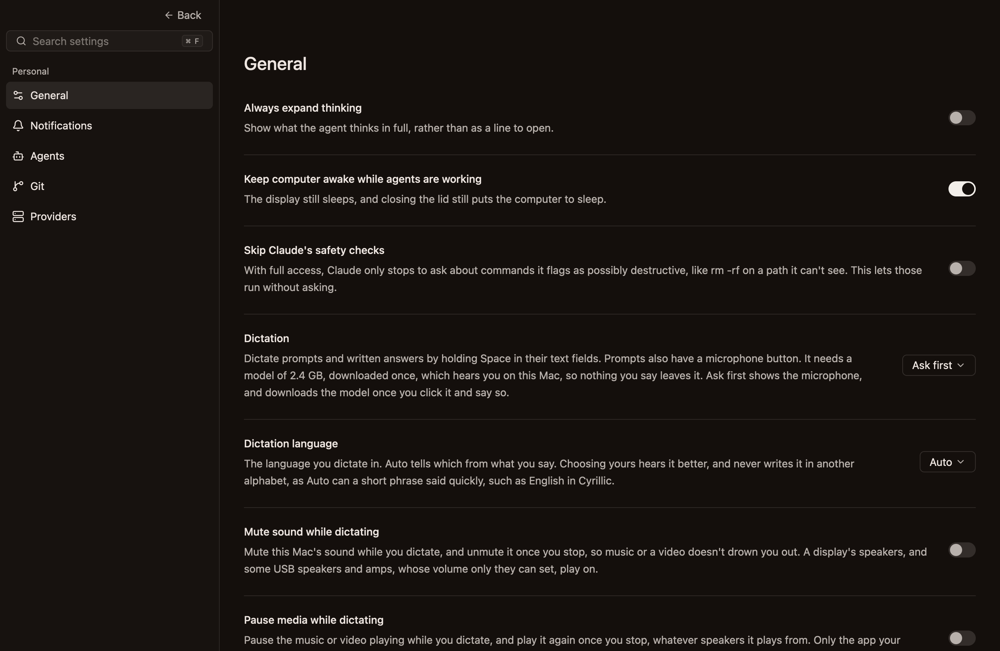
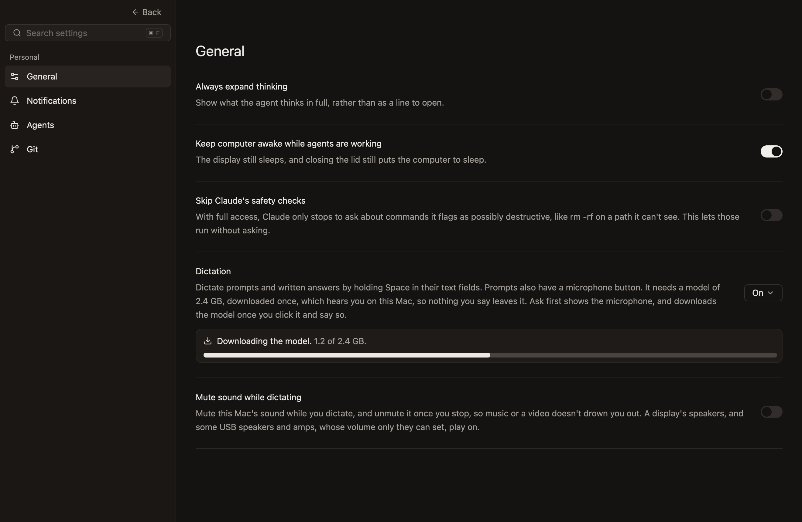
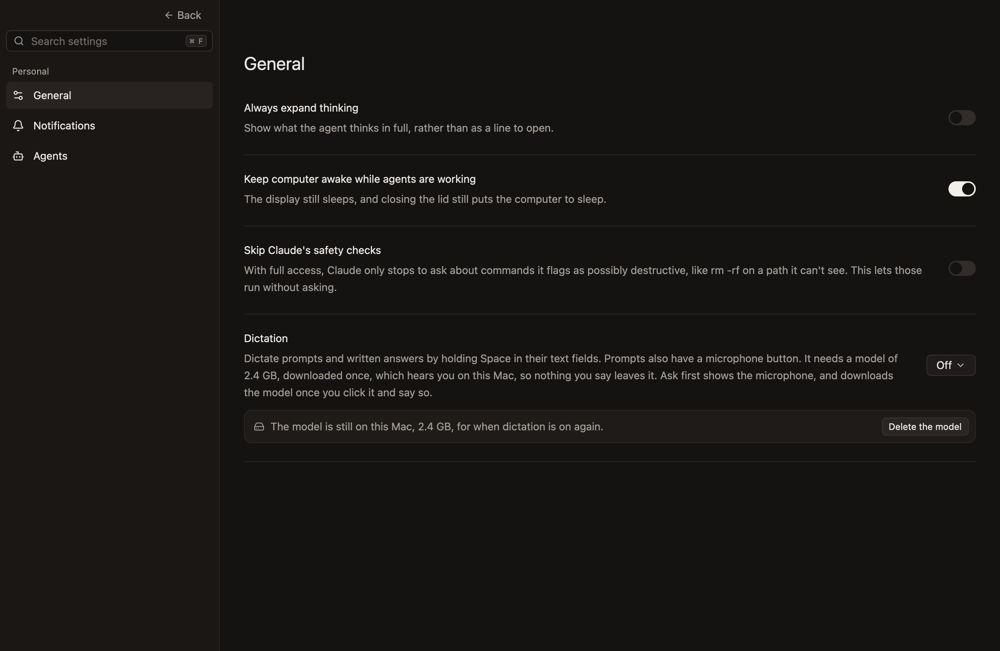
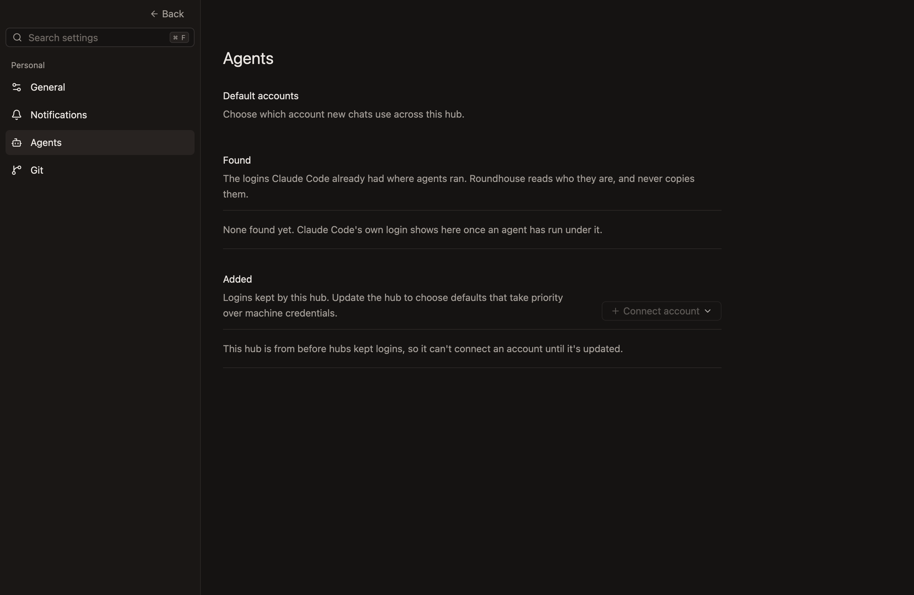

# Settings

The app's own settings, and where they're shown.

- **Settings… in the app menu, `Cmd-,`, or the gear at the bottom of the sidebar, shows Settings in place of the sidebar and the workspace,** in the same window. `Back`, Escape or `Cmd-W` goes back to where you were, with what you were typing still focused, or to a workspace selected in its place meanwhile, such as when the one showing was archived from elsewhere, which then has the keys. While Settings shows, the workspace's keys do nothing, since what they'd act on is hidden, and a reply that comes in the chat it hides is read once you go back. *Unconfirmed:* the gear, the ways back, the workspace selected meanwhile, the keys doing nothing, and the reply waiting.
- **A page for each part of the app is in a sidebar on the left, and the chosen page fills the rest.** The sidebar is as wide as the one it stands in for, with a muted `Back` at its top right, level with the window's buttons. *Unconfirmed.*

  **General, the first page.** *Unconfirmed.*

  

- **The pages are listed under small muted headings, each page with an icon before its name.** Personal holds the pages about how the app and its hub work for you, rather than about a project. A page's row is a regular row, 36px tall, as the sidebar's are, and the one showing is filled. *Unconfirmed.*
- **A search at the sidebar's top finds a setting by what it's called or what it does, in any case, as it's typed.** Only the settings that match are left, with the pages they're on and those pages' headings, and a page that draws what's on it itself, such as Agents, is left whole when what it's called or what it's about matches, such as `accounts`, `login` or `token` for Agents. The page says so when nothing matches. While it's empty the search says Search settings, in faint text, and it always shows `⌘F`, which puts the cursor in it with what's typed selected, so what's typed next replaces it, as a Mac's search fields do. Escape and `Cmd-W` go back from the search too, and Settings opens again with nothing in it, on its first page, since a search is for finding one setting now. It's 28px tall, on the pane's colour, with an edge lighter than a line, since it's something to type in. *Unconfirmed.*

  **A search, leaving the settings that match, with their pages and headings.** *Unconfirmed.*

  

  **A search that matches nothing.** *Unconfirmed.*

  

- **A page starts with its name, at 24px, and each setting is a row under it:** what it's called and what it does on the left, its control on the right, and a line under it that sets it apart from the next. The name is below the strip along the top, which stays clear for moving the window.
- **A page with more to show than a setting's row has room for, such as Agents, draws what's on it under its name instead,** and scrolls the same way. *Unconfirmed.*
- **A setting takes effect at once, everywhere it shows, and lasts.** There's no Save button. *Unconfirmed.*
- **A setting belongs to whatever carries it out.** How the app looks and behaves is the app's, and belongs to this Mac rather than to a hub, since the app can show several hubs and has to draw before it reaches any. What a hub does whether or not the app is open is that hub's, which keeps it, so it holds after the hub restarts and every app showing that hub shows the same.
- **A hub's setting can only be changed while its hub is there to ask.** Its switch shows what the hub says, and changes when the hub has. While the hub is out of reach, or with a hub from before it kept settings, the switch shows off and can't be flipped.

  **A hub from before hubs kept settings, whose switches show off.** *Unconfirmed.*

  

## General

- **Always expand thinking** shows what the agent thinks in full, as it streams and once it's done, rather than as a line to open. It's off unless chosen, since most people read the answer rather than how the agent got there. Thinking you open or close yourself stays as you left it, whichever way the setting is. *Unconfirmed.*
- **Keep computer awake while agents are working** stops the Mac going to sleep by itself while there's work, as `chats.md` says under "A turn". It's the hub's setting. It's on unless turned off, since an agent left working is expected to still be working when you come back. Turned off, the Mac is let go at once, whatever is at work.
- **Skip Claude's safety checks answers Allow for you when an agent with full access asks before using a tool anyway,** as Claude's CLI does when its safety check stops a removal whose target only the command knows, such as `rm -rf "$(cat path)"`, and a subagent's request is answered the same. The chat never waits, nothing tells of it, and the call shows as any other. It's the hub's setting, so it answers while the app is closed too. It's off unless turned on, since what's asked about is what the agent's CLI couldn't rule out doing harm. Plan mode still asks, and so do questions and a plan, and so does an agent whose adapter doesn't say what it asks. A request already waiting as it's turned on waits for you. With a hub from before it, the switch shows off and can't be flipped, as with a hub from before hubs kept settings. *Unconfirmed.*
- **Dictation lets prompt and answer fields be dictated to, as `chats.md` says: Ask first, On or Off.** It needs a model of 2.4 GB, downloaded once into the data directory the app shares with its hub, from Hugging Face, and kept out of Time Machine's backups, since it can be downloaded again. Ask first is what it is until it's chosen: the composer and new-workspace prompt show a microphone, where this Mac can run the model, and offer to turn dictation on, so nothing is downloaded until you say so. On downloads whatever of the model isn't here yet, going on from what an earlier download left, and checks each file before it's used. Then it prepares the model, loading it so the first press doesn't wait. The first time, while Core ML compiles it for the Neural Engine, that can take a few minutes, and it's prepared again each time the app opens with dictation on, which is quick once it's compiled. The model is let go of after 15 minutes with nothing dictated, and the next press loads it again, in under a second. Off has no microphone, stops a download, and keeps what's downloaded for the next time. A choice a newer build saved that this one doesn't know reads as Ask first. It's the app's setting, since what's said is heard on this Mac. *Unconfirmed.* *Not built:* Windows and Linux, where Settings has no Dictation.
- **Under Dictation, a box says how it stands, with what can be done about it,** whenever there's something to say: how much of the model is downloaded, with a bar, that it's preparing, that it's ready and how much room the model takes, what went wrong, with Retry, that this Mac's macOS is too old, or, while it isn't on, that the model is still here. A failed download says why in a few words, such as that the connection stalled or was lost, that Hugging Face couldn't be reached or answered with an error, that what came wasn't the file it should be, or that there's no room for it. The box is a status, so a screen reader says it as it changes. The composer and new-workspace prompt's microphones show the same box while dictation is on and not ready. *Unconfirmed.*

  **Dictation turned on, with half the model downloaded.** *Unconfirmed.*

  

  **Dictation turned on, with the model nowhere to be found.** *Unconfirmed.*

  

  **Dictation off, with the model still here.** *Unconfirmed.*

  

- **Delete the model frees its room,** from the box, once dictation is ready, or while it isn't on and the model is still here. With dictation on, it's turned off first, so the model is let go of. The box says the model is being deleted until it's gone, and choosing On meanwhile downloads it again only once it has. If it can't all be deleted, an alert says why. *Unconfirmed.*

  **Dictation on, and ready.** *Unconfirmed.*

  

## Notifications

- **A chat needs you while it needs a look, as the sidebar shows, or while it's stopped short:** it has a reply nobody has read, it's waiting on you for an answer or an approval, or its agent went away mid-turn or failed its turn, until a turn starts again. *Unconfirmed.*
- **Notify when an agent needs you shows a notification as a chat comes to need you,** and never for the chat you're looking at, which is the one showing in the window in front, since it's in view. While another app is in front, the chat showing is told of too, since nobody is looking at it. It's on unless turned off. *Unconfirmed.*
- **A notification is titled with its workspace's name, and says why, then the chat's title,** as `Finished: Fix the flaky test`, `Stopped short` or `Waiting on you`. A chat has one at a time, the newest. Clicking it shows the chat, in place of Settings or Home, and reads no other chat on the way. *Unconfirmed.*
- **A notification lasts as long as its chat needs you,** wherever that changes: until its reply is read, what it waited on is answered, its agent goes again after stopping short, or it's closed, and until it's the chat you're looking at. A reply nobody has read keeps its notification while the agent works again, as it keeps the name bright in the sidebar. *Unconfirmed.*
- **Only what happens while the app is open is told of.** Opening the app tells of nothing that was already waiting, since the sidebar shows that. What happened while the hub restarted is told of once it's back. A notification left from before the app quit stays until it's dismissed in the system's own list, and clicking it brings the app forward without opening its chat, since the app no longer knows it. *Unconfirmed.*
- **Play a sound plays the sound chosen at the same moments, whether or not a notification shows,** and at most once in two seconds, so several chats coming to need you together sound once. It's on unless turned off. The app plays it, so a Mac's Focus doesn't silence it. *Unconfirmed.*
- **Sound is Chime, the app's own soft strike on a bar, unless another is chosen:** one of the computer's alert sounds, or one the person added to their `Library/Sounds`. Its list has Chime, a line, then the rest by name, with the one chosen ticked, and choosing one plays it. The list is read again each time Settings opens, so a sound added meanwhile shows. A sound that has gone since it was chosen plays Chime. *Unconfirmed.* *Not built:* a sound on Windows and Linux, which play nothing, and list only Chime.
- **A Mac asks whether the app may show notifications the first time it shows one,** and only the app opened from its bundle can, so a build run from a checkout shows none. On Linux a notification takes a notification service, and stays until it's dismissed there. *Unconfirmed.*

**The Notifications page.** *Unconfirmed.*

## Agents

- **Agents lists the accounts agents run under, from the hub's records of them, in two lists, Found and then Added.** Each account is a row: what it's called, what it is and how its login stands, and which day it was last used, then what's left of its limits, and at the far end what can be done with it. Above the lists, Default accounts shows the hub's chosen account for each kind whose adapter accepts a hub-held login. The chosen account's row has a `Default for Claude Code` badge, using the agent's name. The client reads the choice from the hub; it never infers one from account order. *Unconfirmed.*

  **Agents, with Claude Code's own login found, and a login added in each state.** *Unconfirmed.*

  

- **Found has the logins an agent's own CLI already had where agents ran,** such as Claude Code's on this Mac, which the hub reads as each agent launches there, so a login shows once an agent has run under it. Roundhouse reads who it is and never copies it, as Found's line under its heading says, so it can't renew or disconnect one, and the row has no buttons. A row is called by the account's email, and says the plan and how it's logged in, and the rows are in order of what they're called. With none, Found says none has been found yet, and that Claude Code's own login shows there once an agent has run under it, rather than that nobody is logged in, since the hub learns of a login only as an agent runs under it. *Unconfirmed.*

  **Agents with nothing found, as on a server with no login of its own.** *Unconfirmed.*

  

- **Default accounts chooses the account each agent kind's chats are put on while they're on none, as each one's agent first starts,** and every later launch, resume and title call of that chat takes it, whatever the default becomes, until the chat is moved. So a new chat, and one on none from before, such as one that ran under the machine's own login then, is put on whatever the default is as its agent next starts. The selector lists that kind's connected accounts whose logins have not ended. For a chat on none, an added default takes priority over every machine's own credentials. There is no choice to prefer machine credentials while a default exists. With none, the row says Machine login, and a chat whose agent first starts then is put on the machine's own login, once the hub knows whose it is, where it stays once a login is added, until it's moved. One whose machine had nobody logged in, or a login the hub can't tell from another, such as one with an API key, has no account to show and so none to move it off, so it's put on the default once one is added; Codex and Antigravity use their machine's own login and have no selector. Above the rows, Default accounts says that new chats use the account chosen, and that a chat stays on its account until it's moved. Under a default that works, its row says chats already on another account stay there. A hub too old to keep defaults has only the first of those, and its row says nothing more. *Unconfirmed:* those words, and which kinds have no selector. A changed choice reaches every client as the hub's settings record. While offline, saving, or connected to a hub too old to keep defaults, the selector is disabled; a failed change says why and keeps the hub's actual choice.

  

  **A hub that keeps logins but predates defaults says to update, without claiming it follows the new priority.**

  

- **The first added account becomes that kind's default.** Updating a hub with accounts already connected chooses the most recently connected or renewed login that has not ended, once. If all have ended, it chooses the most recent and shows that it needs renewing. Later connections and renewals do not change the choice. *Unconfirmed: the initial choice during an update.*
- **A default that expires, is disconnected, or loses its token stays selected and blocks the launches of chats on no account yet, as any account blocks those of the chats on it.** Renew or reconnect it, or select another added account, which unblocks only the chats on none, since a chat on the account stays on it. Its row keeps the default badge and the selector explains the blocked launch, and that choosing another unblocks only new chats. Disconnect's confirmation explains this consequence, and that chats on the account can't start until it's reconnected or they're moved, alongside the fact that running agents continue. There is no clear-default action that returns to machine credentials. *Unconfirmed: keeping a disconnected default selected.*

  

- **Added has the logins the person gave the hub,** each a token the agent's own CLI made. Claude supports hub-held logins; Codex and Antigravity credentials remain with their CLIs on the worker's machine. A row is called by the name the person gave it, and says the agent kind, when the login ends, or that it was disconnected. Connected accounts come first by name, then disconnected accounts by name. With none, Added says to connect an account to add its login to the hub. *Unconfirmed: the list order, and which kinds hold logins.*
- **A login warns in amber, with a warning sign, from a month before it ends, and in red once it has,** such as `Ends in 9 days, on Nov 10, 2026` and `Ended on Oct 29, 2026`, so there's time to renew it. When a twelfth of how long a login lasts is less than a month, it warns from that long before it ends instead, by the hub's record of when it was connected and when it ends, so one that lasts a week isn't a warning from the moment it's connected. The days are counted by the calendar, so they agree with the date. Before that it says only when it ends, as `Ends Oct 12, 2027`. The hub takes a token to end a year after it was connected, at the latest, since its CLI doesn't say. *Unconfirmed.*
- **A row's last line says which day the person last sent something in a chat under the account,** by the calendar in the reader's time zone rather than by the hour: `Last used today`, `Last used yesterday` and `Last used 3 days ago`, then by the week from 7 days, as `Last used 2 weeks ago`, by the calendar month from a month, as `Last used 2 months ago`, so the 1st to the 31st of one month is `4 weeks ago`, and from twelve months on by its date, as `Last used on Sep 28, 2025`. It changes as the day does. It's the hub's record of it, so every app says the same. Before then the line isn't there, rather than saying never, since an account may not have been used yet, and a hub from before it kept that says nothing either. *Unconfirmed.*
- **What's left of each of an account's limits is at the right, as a bar that empties beside how much is left,** such as `38% left` of the `5h limit`, for the limits the chat's limits' card would show, as `chats.md` says under "The context and the account". A limit goes as it starts again, since what was heard of it is no longer so, and a row whose limits have all started again shows none, until an agent under the account hears them again. One no agent has heard a limit for says `No limits heard of yet`. *Unconfirmed.*
- **Connect account opens a panel at the top of Added, for a login of a new account.** It has the command that makes a token, to copy and run in a terminal of the person's own, where the agent's CLI signs them in its own way: `claude setup-token` for Claude, as the hub's description of the agent gives it. Then a field to paste the token into, which has the cursor, shows only dots and can't be copied from, and a field for the account's name, which a chat under it shows. Connect is off until both have something in them, and Enter in either connects too. Roundhouse never runs the command, signs anyone in or reads a terminal. With several kinds of agent that can have a login, Connect account is a menu of them. *Unconfirmed.*

  **The panel, with a token pasted and a name typed.** *Unconfirmed.*

  

- **The app hands the token to the hub and keeps it nowhere itself:** not on disk, not in a log and not in its settings. The panel goes once the hub has connected it, and the field it was pasted into goes with it. A panel that goes before the hub has answered, as when it's cancelled, another is opened, or Agents is left, takes the wait for the answer with it, so what the hub answers lands on no other panel. When a panel goes while something in it has the focus, the focus goes back to Settings, so its keys still work. *Unconfirmed.*
- **What the hub refuses is said in red in the panel, which stays open with the token's field made empty,** so the token is pasted again: in the hub's own words for a name or a token it can't take, such as a token with a space inside, and in the app's for a token another account holds already, or an account the hub no longer has. *Unconfirmed.*
- **A token that's connected already is refused for a new account under another name, rather than renaming the account that holds it,** which would look as if an account had been added. The panel says it's connected already, under another name. Under the same name it's the same connect again, as when the app didn't hear the hub's answer, and finds that account.
- **Renew has the hub put a new token in place of a login it holds, as when it's about to end. It's in the row's `…` menu, with Disconnect, since a login lasts long enough that neither is wanted often.** Connect again does the same for a login that was disconnected. Each opens the panel under the account's row, naming the account, without a field for its name, and the account keeps its name, its limits and its chats. A panel is scrolled into sight as it opens, wherever it is on the page, and as much of it as fits shows, from its top. *Unconfirmed.*

  **Renewing a login that ends in nine days.** *Unconfirmed.*

  

- **Disconnect asks first, in the system's alert, then has the hub forget the token, so connecting it again takes pasting a token again.** The account stays, as Connect again, since its chats still name it. The token isn't revoked, so it still works wherever else it's kept, and agents already running under it go on until they stop, while the chats on it can't start again until it's reconnected or they're moved, as the alert says. Why the hub couldn't is said under the row, and so is there being no hub to ask, when it went while the alert was up. *Unconfirmed.*
- **With no hub to ask, the accounts stay listed, every button is off, and nothing is said of the hub's age.** *Unconfirmed.*
- **A hub from before hubs kept logins can't connect one, and says so in place of Added's rows, with Connect account off.** One that describes its agents with none of them given what makes a login says so from the start, and one that refuses to connect a login as too old for it says so from then on, while Agents shows. One that hasn't described its agents, as before it has said, has Connect account off and says nothing of its age, since nothing it has said tells. *Unconfirmed.*

  **A hub from before hubs kept logins, which describes Claude with nothing that makes a login.** *Unconfirmed.*

  
