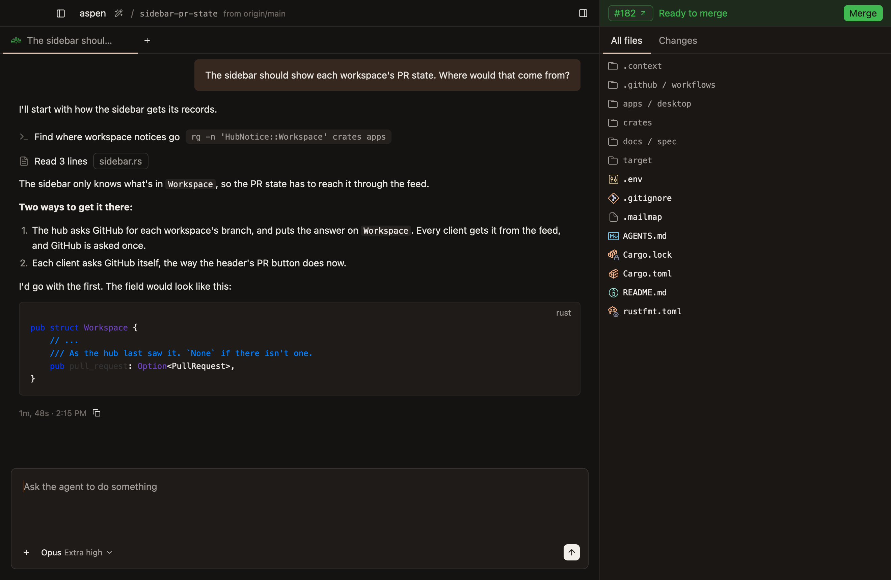
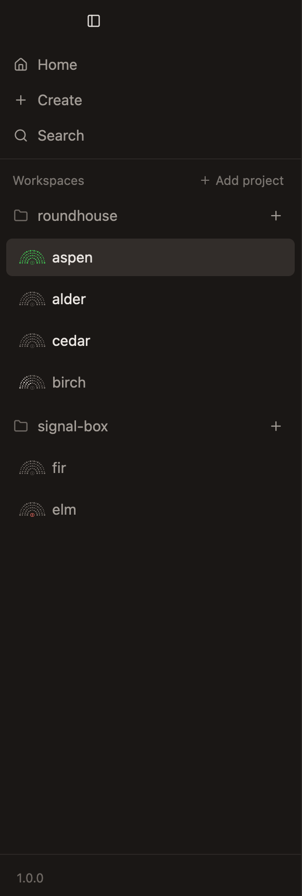
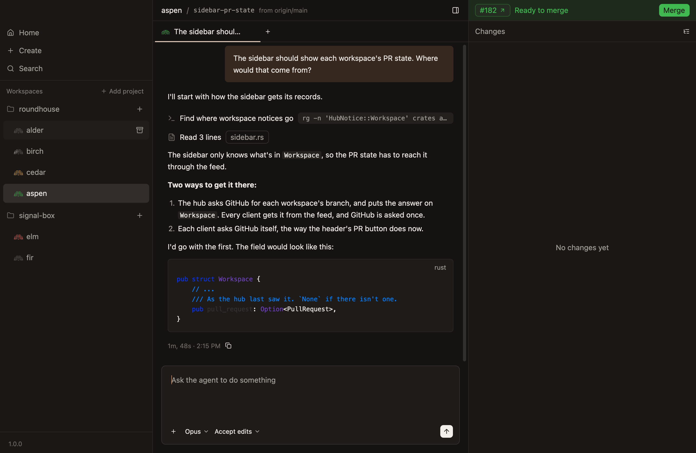
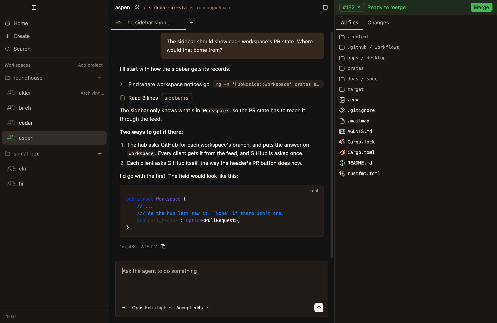
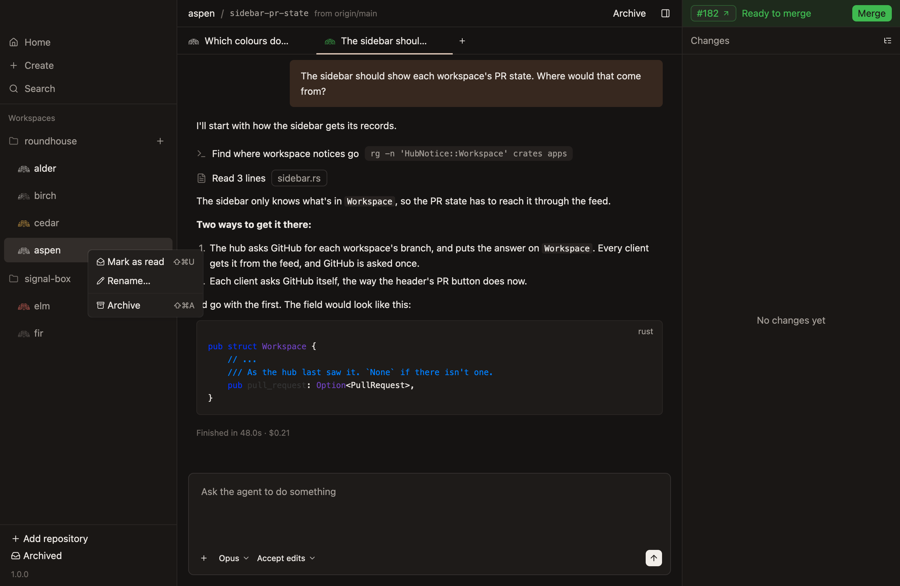
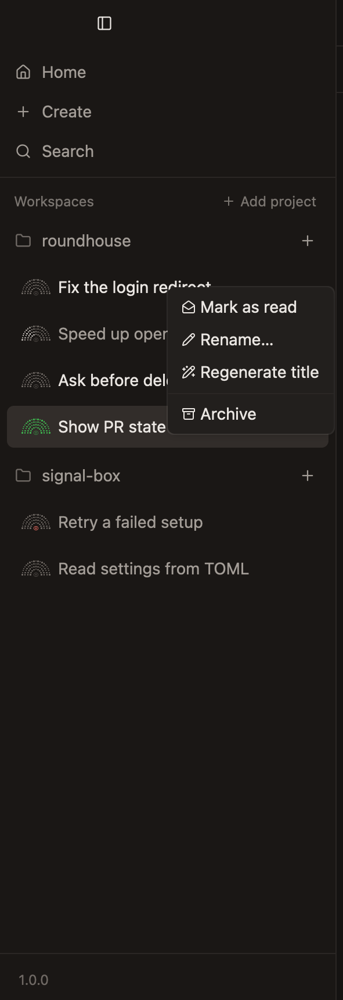
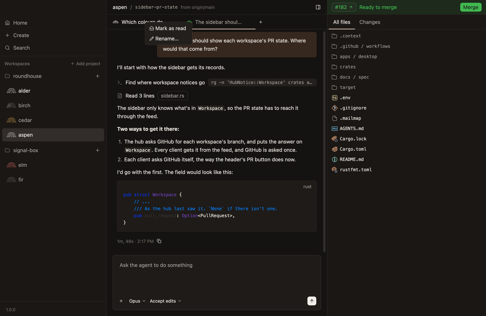

# Sidebar

- **Home, Create and Search sit at the top, above the workspaces, with a line under them.** Home shows every workspace in place of the workspace, as `home.md` says, and Create opens the new-workspace dialog for the selected workspace's project, or for the one Home's list shows while Home shows, as `Cmd-N` does. Each is a muted icon and label, filled while what it opens is showing. *Unconfirmed.*
- **Search is only a place for searching.** *Not built:* it does nothing when pressed, and what it searches isn't decided.
- **The workspaces are listed by project, under a small faint heading.** A project's row has its folder, its name in medium weight, and a button for a new workspace in it. Its workspaces are set in below it, so they read as its, each with its mark and its name at body size. Rows are 36px, 4px apart. *Unconfirmed.*
- **Add project is at the heading's right end, in words,** so it isn't taken for the button for a new workspace on each project's row under it. The heading shows before there's a project too, so the button is in the same place from the start. Without a hub, such as while it restarts, Add project is greyed out, and the heading shows only over projects already listed. *Unconfirmed:* without a hub.
- **An archived workspace isn't listed.** Home shows archived workspaces, and brings one back, as `home.md` says.
- **A workspace's mark speaks for its open chat with the most going on:** one whose agent is working, then one that stopped short, then one that only left something running. *Unconfirmed.*
- **A workspace's row shows how many lines it has added and removed,** in green and red at its right, with either left out when it's none. *Not built:* the hub doesn't send them.

## Hiding and widening

- **A button beside the window's buttons hides the sidebar, and shows it again,** as the button at the other end of the header does the sidebar of changes. It stays where it is whether the sidebar shows or not, so it's always in the same place, except in full screen, where macOS puts the window's buttons away and it sits where they were. While the sidebar is hidden, the workspace has its room, and what's in the strip along the top starts after the button: the workspace's header, Home's bar, or an error, which sits above the header and leaves it to start at the window's edge. The choice holds until the app quits.
- **Both sidebars slide open and shut, in a fifth of a second,** each moving out past its edge of the window as one piece, so it's plain where it went. What's beside a sidebar moves with it, so nothing jumps. A sidebar turned back partway slides from where it had got to. Reduce Motion skips the slide.
- **Dragging a sidebar's inner edge changes how wide it is,** from 220px to 480px for this one and from 300px to 800px for the sidebar of changes, and no wider than leaves 360px between the two. This one can push the sidebar of changes as far as its narrowest, and the sidebar of changes drags only into the room this one leaves. The pointer shows the edge can be dragged, and the edge shows a short bar while the pointer is on it. The width holds in every workspace, and while the sidebar is hidden, until the app quits.
- **In a window too narrow for both sidebars at their widths and 360px between them, the sidebar of changes gives way first, and then this one,** each no further than its narrowest, and each is as wide as it was dragged again once the window has the room. A window narrower still squeezes what's between them. A sidebar takes as much of the window as shows of it, so one sliding away gives up its room as it goes and the other widens into it, rather than all at once. The sidebar of changes takes room only where it shows, so on Home and in Settings this one is as wide as it was dragged.
- **A sidebar dragged to within 8px of its usual width takes it,** which is 290px for this one and 432px for the sidebar of changes, so the usual layout is easy to get back to.
- **A Mac's trackpad taps as the edge takes its usual width,** as Keynote's does when what's dragged lines up with a guide, so the place can be felt without looking. It taps once as the edge arrives, and not again while the pointer moves on within reach of it, or as the edge leaves. A mouse feels nothing, and macOS decides from the trackpad, accessibility settings and the person's preferences whether it plays. *Unconfirmed.*

**The sidebar hidden, with the workspace's header starting after the button that shows it again.**

## Replies you haven't read

- **A chat that needs a look has its name at full brightness in medium weight,** in its tab and in its workspace's row: one with a reply you haven't read, or one waiting on you for an answer or an approval. Every other name is muted, so which agents have finished or are stuck since you last looked stands out without opening each one. That includes the selected workspace's name and the open chat's title, which look as they do when they aren't selected, as `look.md` says for lists. A chat waiting on you stays that way until it's answered, whether or not it's showing. Its mark doesn't change, since the fan's colour is the pull request's alone, as `look.md` says. A reply is the end of a turn, and one the agent was cut off from shows as stopped short instead. The hub keeps how far each chat is read, so every client agrees. *Unconfirmed.*
- **A reply is read once its chat is showing in the window in front,** whether it comes while the chat is showing or the chat is shown later. One that comes while another app is in front waits until you come back. *Unconfirmed.*
- **Right-clicking a tab or a workspace's row marks it read, or unread again.** Marking a workspace read reads all its chats, and marking it unread marks the newest reply in its chat last worked in. A chat marked unread stays unread while it's showing, until you go to another chat, workspace or app and come back to it. *Unconfirmed.*
- **`Cmd-Shift-U` marks the workspace showing read, or unread again,** as its row's menu would, and is the key Mail uses for a message. That row's menu shows it beside the item. Other rows' menus show no key, since it wouldn't act on them, and neither do tabs' menus, since it marks the workspace rather than the chat. *Unconfirmed.*

**Replies you haven't read, in another workspace and in this one's other chat.** *Unconfirmed.*

## Archiving

- **Pointing at a workspace's row shows a button that archives it,** at the row's right end, in line with its project's button for a new workspace, so a finished workspace can go without opening it first. Only the row under the pointer has one, not even the workspace showing, so the list stays quiet. No name is cut short to keep room for it, so the end of a long name gives way to it only while it shows. Pressing it doesn't open the workspace. *Unconfirmed.*
- **Right-clicking a row offers Archive too,** below a line, after what a chat's tab offers and Regenerate title, which `workspaces.md` describes. Both archive as `Cmd-Shift-A` does, asking first if there's work it would lose, as `workspaces.md` says. *Unconfirmed.*
- **Each item in a row's or a tab's menu has an icon:** an envelope to mark it unread, an open one to mark it read, a pencil to rename it, a pencil with sparks for a new title, and a box to archive it. *Unconfirmed.*
- **Renaming has no key,** since a Mac has no usual one, and Return, which Finder renames with, sends what's typed in the composer. *Unconfirmed.*
- **`Cmd-Shift-A` archives the workspace showing,** and only its row's menu shows the key beside Archive, since it wouldn't act on another row. *Unconfirmed.*
- **While a workspace is being made, archived or restored, none of those can start,** so a button or key pressed twice does it once, and the buttons that archive are greyed out. *Unconfirmed.*
- **The workspace being archived says Archiving… at its row's right end, in place of its button,** from the press until it has gone, wherever the pointer is and whether its button, its menu or `Cmd-Shift-A` started it, so it's clear the press took. Its pull request's Archive, if it offers one, says it too. *Unconfirmed.*

**Pointing at a row that isn't showing.** *Unconfirmed.*

**Archiving a row that isn't showing, from its button, once the pointer has left it.** *Unconfirmed.*

**The menu of the workspace showing, whose other chat has a reply nobody has read.** *Unconfirmed.*

**The menu of another workspace, which shows no keys, since they'd act on the one showing.** *Unconfirmed.*

**A tab's menu, for a chat with a reply nobody has read.** *Unconfirmed.*

