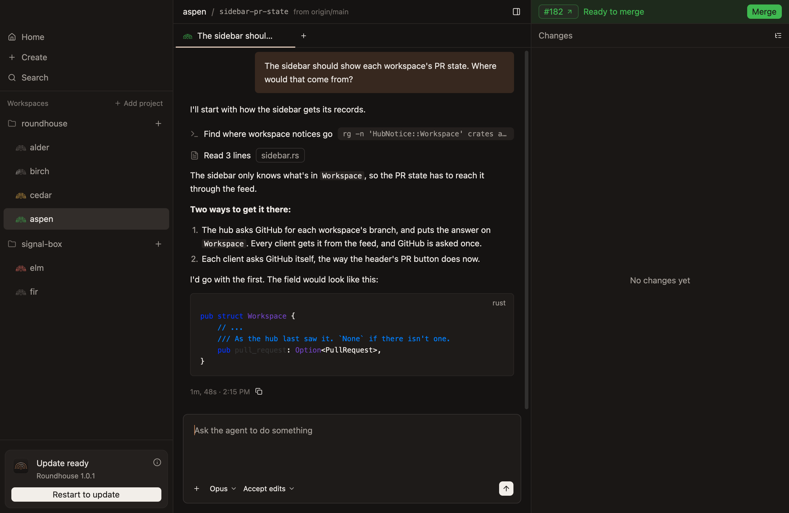
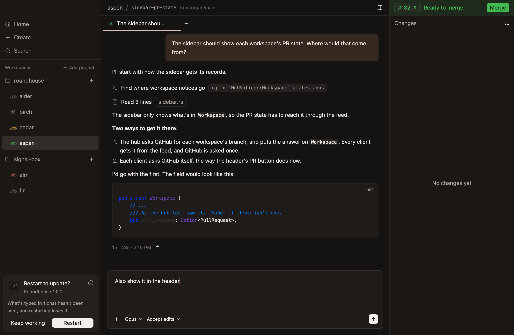
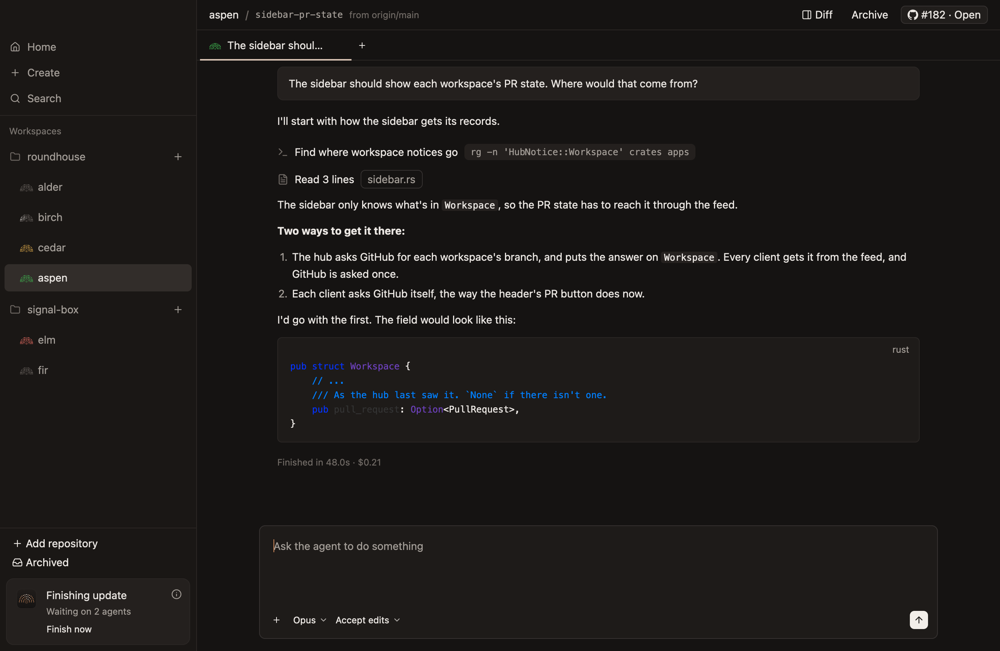
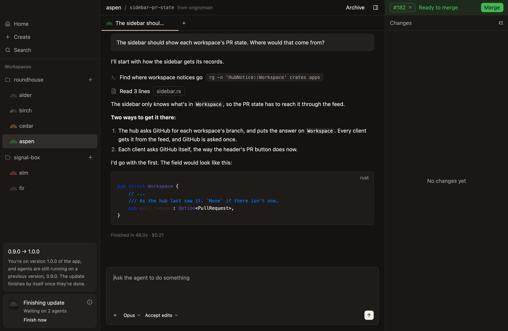
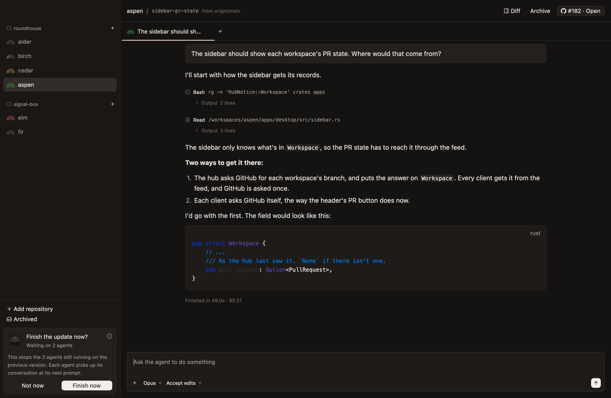
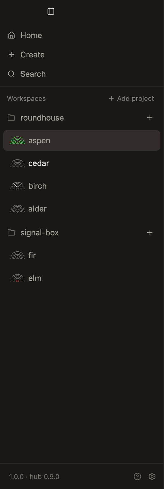
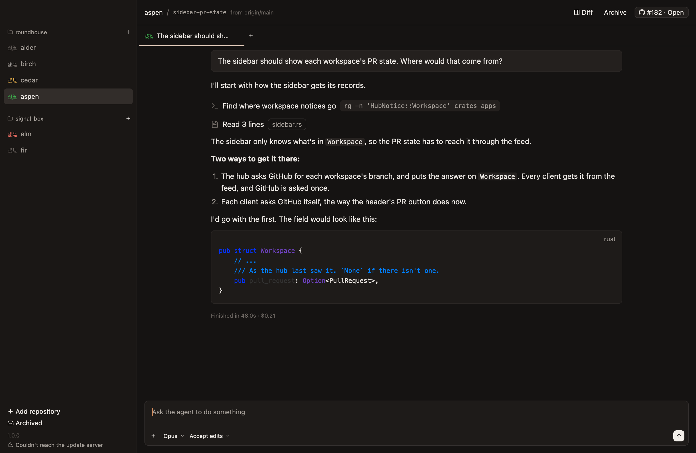
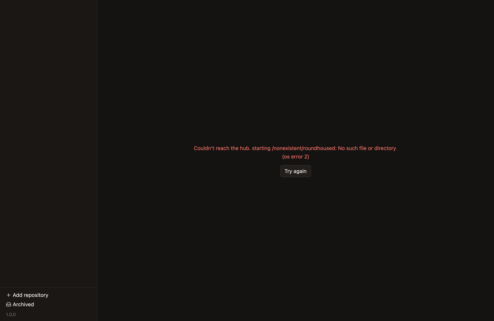

# Updates

What someone using the desktop app sees when it or its hub updates, or when there is no hub to reach. How it works is under "Managing a hub" in `docs/architecture.md`.

- **Updating never stops running agents unless you choose to.** An update looks like this:
  1. The app downloads an update in the background and installs it when you quit, without relaunching. Everything shows as before, and running agents keep going on the old hub. *Unconfirmed:* `Restart to update` installs it sooner, and opens the app again.
  2. Once the app is on the new version, it restarts the hub at once, even with agents at work and while you're using the app. That stops nothing: each agent carries on where it was, on the version it started with, and the workspace stays on screen through it. Waiting until nothing is running would mean never, since someone at work keeps starting agents. It waits only for a setup script that's running to finish. *Not built:* on Windows, where a hub's agents still stop with it, so the app restarts it there only once nothing is running, as it does a hub from before.
  3. Each workspace moves to the new version by itself, once nothing is at work in it. Nothing shows it, since it changes nothing anyone sees.
  4. Only a real protocol break shows a screen, with how many agents are running and a way to restart the hub.
- **A hub from before agents could outlive it waits for them, and you can restart it yourself rather than wait.** Restarting one of those stops its agents, so the app restarts it only once nothing is running, as it did before. While the hub is older than the app and wasn't started by hand, the app offers to restart it, and says how many agents and setup scripts that would stop. Each stopped agent picks up its conversation at its next prompt. *Unconfirmed:* `Restart now`, at the bottom of the sidebar, does it, as "The build line" below shows.
- **A workspace stays on screen while the app connects to a hub again,** whether the app is restarting the hub or the hub went away. What's typed meanwhile is kept, since that's often the moment someone starts their next prompt. Send and Enter wait until the hub is back, and what's typed stays in the composer, because a hub that's being stopped would take the prompt and then cut its agent off. The app only says "Connecting…" when there's nothing to show yet. *Unconfirmed:* that Enter waits, rather than sending once the hub is back.
- **An older hub keeps working.** The app hides or disables what it doesn't support, and only a real protocol break stops it.
- **A hub someone runs themselves is left alone,** even on the same Mac. The app says when it's older, and only its admins stop it.
- **A problem updating says so under the build in the sidebar,** with the detail on hover, until a later check works. A feed or package that isn't the one the release workflow signed says "Update refused" at once. Not reaching the update server only shows once it has lasted a day, since being offline for a while is ordinary, unless you check for updates yourself. An app that can't replace itself where it is says so when it opens, and one that macOS runs from where it was downloaded asks to be moved to Applications. *Unconfirmed.*
- **Nothing about updating is a native dialog.** Checking for updates answers in the sidebar, and an update you asked for shows as the same card as one that downloaded by itself. Before restarting the app would lose what's typed, the update's card asks, in its own place. Before restarting now would stop agents, a dialog of the app's own asks, over the window.
- **Check for Updates… in the app menu looks right away,** rather than waiting for the next look, which comes when the app opens and every hour. The sidebar says it's checking, under the build, until the look finishes. A newer version shows as its card. What went wrong shows as a problem at once, even not reaching the update server, because you asked. Otherwise "Up to date" shows under the build for a few seconds. A build that doesn't update itself says so the same way, and one that can't update where it is already says why. *Unconfirmed.*

## The build line

The bottom of the sidebar shows which build is running, faint, and only brings up the hub when it isn't the app's build. While an update has something to say, a card with the app's icon takes the version's place, saying where it's got to and what to do next. An info mark in its corner says more on hover, in a box just above the card and as wide as it: which version it's updating from and to, as its heading, then what that means for what's running. Nothing about an update arriving or finishing by itself is a modal or a notification, since every merge publishes one. The one dialog is the one you ask for, before `Restart now` stops something. *Unconfirmed:* all of this section, and each screen in it.

**An update is downloaded.** The card says "Update ready" with the version, and `What's new` beside it, a link to a page of what the version changes. It's only on this card, since that's when someone is deciding to take the update. *Not built:* the page, so the link opens nothing. `Restart to update` is the card's main action. That installs it and opens the app again, and agents keep running, since the hub outlives the app. Quitting installs it too. What's typed and attached in a composer isn't lost, since the hub keeps it, as `chats.md` says, and nor is an answer being typed to a question, or a comment being written, as `diff.md` says, or what's in the new-workspace dialog, as `workspaces.md` says. So restarting first waits up to two seconds for what's still on its way there, such as a file just attached, as quitting does. Anything else not sent would be lost, such as what the hub didn't take in time, like a prompt still on its way, so the card asks first when there is: its title becomes "Restart to update?", it says how many chats and comments have something it would lose, and `Keep working` and `Restart` take its button's place. The question holds nothing else up, so more can be typed while it asks, and `Restart` asks again if more would be lost than it said.

**The app has updated, and a hub from before agents could outlive it is still running them.** Any other local hub has restarted by then, so the update is done, and no card shows, unless it's waiting for a setup script to finish. Then the card says "Finishing update" and "Waiting on other work", and the app goes on using that hub until it has gone. *Unconfirmed.* For one of these, the card says "Finishing update" and how many agents it's waiting on, or "Waiting on other work" when what's left is a setup script or something else connected to it, such as the command line, and the app restarts the hub as soon as that's done. An agent waiting on its pull request doesn't hold the update up, and isn't counted, since the new hub goes on with the wait and starts the agent again once it ends. *Unconfirmed.* An agent that asked you something, or wants an approval, holds the update up too, and never finishes by itself, so the card says that apart, as "1 agent is waiting on you", or after the rest, as "Waiting on 1 agent. 1 more is waiting on you." Otherwise the update looks stuck, since nothing in the sidebar shows as working.

`Restart now` is a quiet button, since it stops them, and a dialog asks first, over the window: "Restart now?", what that stops, such as "This stops the 1 agent still running on the previous version. The agent picks up its conversation at its next prompt.", and `Not now` and `Restart now`. `Not now` closes it and changes nothing, so the update still finishes by itself. More can start while it asks, so `Restart now` asks again if more would stop than it said. When what's left is something else connected to it, the dialog says that restarting cuts that off, rather than that it stops agents. With nothing using the hub at all, `Restart now` restarts at once, without asking. The dialog doesn't hold up the update finishing by itself, and closes if it does.

**A hub someone runs themselves is another build.** The version says so, as "1.0.0 · hub 0.9.0", and the app leaves it alone.

**A problem updating** shows under the version, muted, as the rule above says. A download that isn't what the release workflow signed is red, since it may be someone tampering with the update.

## When there's no hub

**The app couldn't reach a hub, or start one.** *Unconfirmed.*

