# Updates

What someone using the desktop app sees when it or its hub updates, or when there is no hub to reach.

- **Updating never stops running agents unless you choose to.** An update looks like this:
  1. The app downloads an update in the background and installs it when you quit, without relaunching. Everything shows as before, and running agents keep going on the old hub. *Unconfirmed:* `Restart to update` installs it sooner, and opens the app again.
  2. Once the app is on the new version, it restarts the hub at once, even with agents at work and while you're using the app. That stops nothing: each agent carries on where it was, on the version it started with, and the workspace stays on screen through it. Waiting until nothing is running would mean never, since someone at work keeps starting agents. It waits only for a setup script that's running to finish. *Not built:* on Windows, where a hub's agents still stop with it, so the app restarts it there only once nothing is running, as it does a hub from before.
  3. Each workspace moves to the new version by itself, once nothing is at work in it. Until then, the card its name opens says which version it's on, and each of its chats says where its agent next starts on the new one, as "A chat on a new version" below shows.
  4. Only a real protocol break shows a screen, with how many agents are running and a way to restart the hub.

  Right after two breaks close together in how the hub talks to its workers, an update comes in steps. The app takes the last version before the second break, which can still talk to the agents at work on the version before the first, so it stops none of them, and once each workspace has moved to it, as step 3 says, the newest downloads, to install at the next quit or `Restart to update`. *Unconfirmed:* that the newest downloads as soon as the last workspace has moved, rather than at the next look.
- **A hub from before agents could outlive it waits for them, and you can restart it yourself rather than wait.** Restarting one of those stops its agents, so the app restarts it only once nothing is running, as it did before. While the hub is older than the app and wasn't started by hand, the app offers to restart it, and says how many agents, setup scripts and terminals that would stop, since a terminal's shell runs beside the agents and stops with them. *Unconfirmed:* terminals. Each stopped agent picks up its conversation at its next prompt. *Unconfirmed:* `Restart now`, at the bottom of the sidebar, does it, as "The build line" below shows.
- **A workspace stays on screen while the app connects to a hub again,** whether the app is restarting the hub or the hub went away. What's typed meanwhile is kept, since that's often the moment someone starts their next prompt. Send and Enter wait until the hub is back, and what's typed stays in the composer, because a hub that's being stopped would take the prompt and then cut its agent off. The app only says "Connecting…" when there's nothing to show yet. *Unconfirmed:* that Enter waits, rather than sending once the hub is back.
- **An older hub keeps working.** The app hides or disables what it doesn't support, and only a real protocol break stops it.
- **A hub someone runs themselves is left alone,** even on the same Mac. The app says when it's older, and only its admins stop it. A hub installed as a service is another kind, which a client updates when someone says, as "A hub installed as a service" below says.
- **A problem updating says so in the version's place at the bottom of the sidebar,** with all of what it says and the detail on a card above it on hover, since a long one is cut short before the buttons, until a later check works. A feed or package that isn't the one the release workflow signed says "Update refused" at once. Not reaching the update server only shows once it has lasted a day, since being offline for a while is ordinary, unless you check for updates yourself. An app that can't replace itself where it is says so when it opens, and one that macOS runs from where it was downloaded asks to be moved to Applications. *Unconfirmed.*

  **An app that macOS runs from where it was downloaded, asking to be moved to Applications. Its words are cut short before the buttons, and all of them show on hover.** *Unconfirmed.*

  

  **An update refused, in red, since it isn't what the release workflow signed. Its words are cut short too.** *Unconfirmed.*

  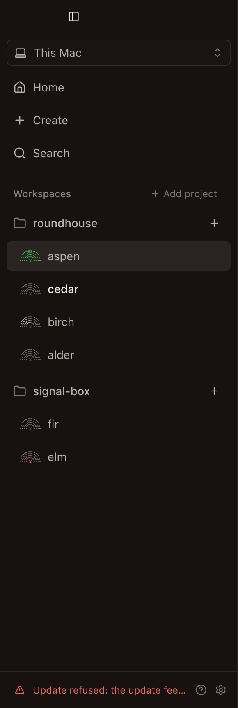

- **Nothing about updating is a native dialog.** Checking for updates answers in the sidebar, and an update you asked for shows as the same card as one that downloaded by itself. Before restarting the app would lose what's typed, the update's card asks, in its own place. Before restarting now would stop agents, a dialog of the app's own asks, over the window.
- **Check for Updates… in the app menu, and Check for Updates in the question mark's menu at the bottom of the sidebar, look right away,** rather than waiting for the next look, which comes when the app opens and every hour. The sidebar says it's checking, in the version's place, beside a ring whose light goes round as a running task's does, until the look finishes, and that's said over a problem already showing, since whoever checked is waiting on it. A newer version shows as its card. What went wrong shows as a problem at once, even not reaching the update server, because you asked. Otherwise "Up to date" shows in the version's place for a few seconds, with a tick. A build that doesn't update itself says so the same way, and one that can't update where it is already says why. Whatever's in the version's place, the line stays as tall, so nothing in the sidebar moves as a check starts and ends, and words too long for it are cut short before the buttons, with all of them on hover. *Unconfirmed.*

  **The sidebar saying it's checking, in the version's place.** *Unconfirmed.*

  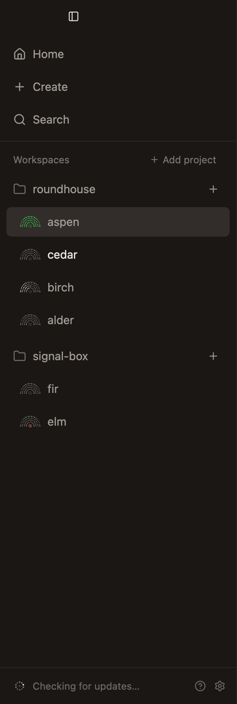

  **What a check that found nothing newer says, for a few seconds.** *Unconfirmed.*

  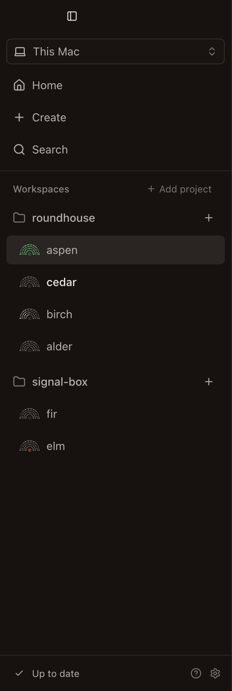

## The build line

The bottom of the sidebar shows which build is running, faint, since a bug report has to say which code it came from, and only brings up the hub when it isn't the app's build. While an update has something to say, a card with the app's icon sits over that line, saying where it's got to and what to do next, and the line stays, so its buttons are where they always are. An info mark in its corner says more on hover, in a box just above the card and as wide as it: which version it's updating from and to, as its heading, then what that means for what's running. Nothing about an update arriving or finishing by itself is a modal or a notification, since every merge publishes one. The one dialog is the one you ask for, before `Restart now` stops something. *Unconfirmed:* all of this section, and each screen in it.

- **The build line ends with two buttons, a question mark and then a gear,** faint until the pointer is on one. The question mark's menu has Check for Updates, then Changelog, and is where help goes as there's more of it. It opens upward, with its right edge at the button's, so it stays over the sidebar. Changelog opens the history of `main` on GitHub, newest first, since every merge is published as the next version. *Not built:* a page of the changelog, and one that starts at the version that's running. The gear opens Settings, as `Cmd-,` does, which its tooltip says. *Unconfirmed.*

  **The question mark's menu, open over the sidebar.** *Unconfirmed.*

  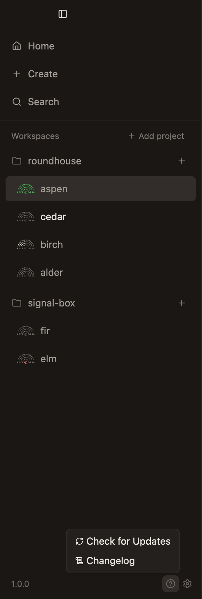

- **An update is downloaded.** The card says "Update ready" with the version, and `What's new` beside it, a link to a page of what the version changes. It's only on this card, since that's when someone is deciding to take the update. *Not built:* the page, so the link opens nothing. `Restart to update` is the card's main action. That installs it and opens the app again, and agents keep running, since the hub outlives the app. Quitting installs it too. What's typed and attached in a composer isn't lost, since the hub keeps it, as `chats.md` says, and nor is an answer being typed to a question, or a comment being written, as `diff.md` says, or what's in the new-workspace dialog, as `workspaces.md` says. So restarting first waits up to two seconds for what's still on its way there, such as a file just attached, as quitting does. Anything else not sent would be lost, such as what the hub didn't take in time, like a prompt still on its way, so the card asks first when there is: its title becomes "Restart to update?", it says how many chats and comments have something it would lose, and `Keep working` and `Restart` take its button's place. The question holds nothing else up, so more can be typed while it asks, and `Restart` asks again if more would be lost than it said.

  **The card once an update is downloaded, with What's new and Restart to update.** *Unconfirmed.*

  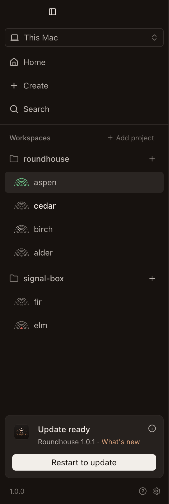

  **The card asking first, when restarting would lose a comment that hasn't been sent.** *Unconfirmed.*

  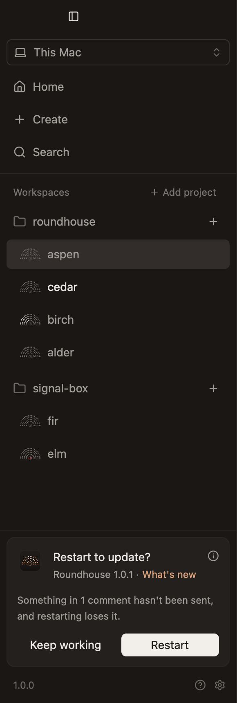

- **The app has updated, and a hub from before agents could outlive it is still running them.** Any other local hub has restarted by then, so the update is done, and no card shows, unless it's waiting for a setup script to finish. Then the card says "Finishing update" and "Waiting on other work", and the app goes on using that hub until it has gone. *Unconfirmed.* For one of these, the card says "Finishing update" and how many agents it's waiting on, and how many terminals are open that restarting it would end, such as "1 terminal is open", since a terminal never ends by itself, so it's clear what to close. It says "Waiting on other work" when what's left is a setup script, or a request still under way, such as creating or archiving a workspace, and the app restarts the hub as soon as that's done. Another client that's only connected doesn't hold it up, since it loses nothing, while waiting on it would keep the update waiting for as long as it stays open. The app on another device connects again to the next hub, and the command line, following a chat with `attach`, stops and says where to pick it up again. An agent waiting on its pull request doesn't hold the update up, and isn't counted, since the new hub goes on with the wait and starts the agent again once it ends. *Unconfirmed.* An agent that asked you something, or wants an approval, holds the update up too, and never finishes by itself, so the card says that apart, as "1 agent is waiting on you", or after the rest, as "Waiting on 1 agent. 1 more is waiting on you." Otherwise the update looks stuck, since nothing in the sidebar shows as working.

  `Restart now` is a quiet button, since it stops them, and a dialog asks first, over the window: "Restart now?", what that stops, such as "This stops the 1 agent still running on the previous version. The agent picks up its conversation at its next prompt.", and `Not now` and `Restart now`. `Not now` closes it and changes nothing, so the update still finishes by itself. More can start while it asks, so `Restart now` asks again if more would stop than it said. When what's left is a request under way, the dialog says that restarting cuts that off, rather than that it stops agents. With nothing using the hub at all, `Restart now` restarts at once, without asking. The dialog doesn't hold up the update finishing by itself, and closes if it does.

  **The card while the update waits on an agent still running, with one more waiting on you.** *Unconfirmed.*

  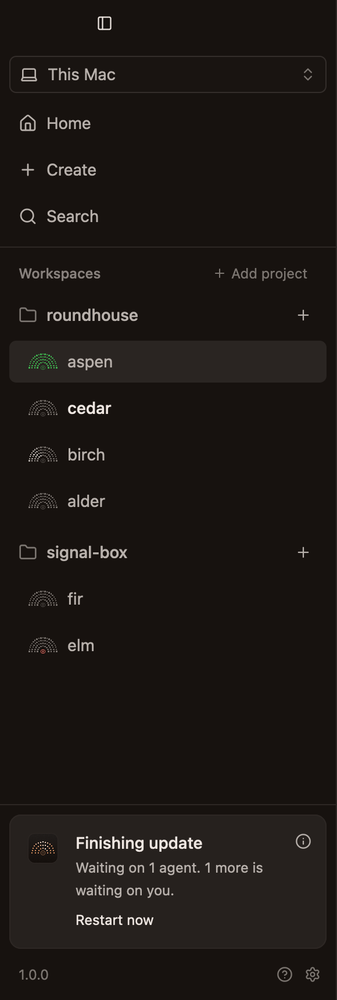

  **What the card's info mark says, in a box just above it.** *Unconfirmed.*

  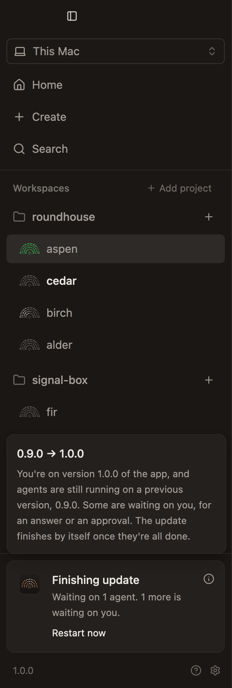

  **The dialog that asks before `Restart now` stops the agents still running.** *Unconfirmed.*

  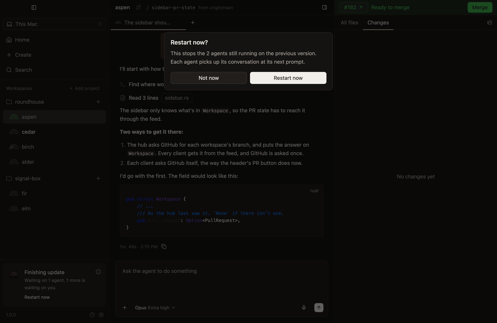

- **A hub someone runs themselves is another build.** The version says so, as "1.0.0 · hub 0.9.0", and the app leaves it alone. Resting the pointer on it shows a card above it that says which is the hub's and which the app's, and that the app leaves the hub for whoever started it to update.

  **The build line with a hub someone runs themselves, on another version.** *Unconfirmed.*

  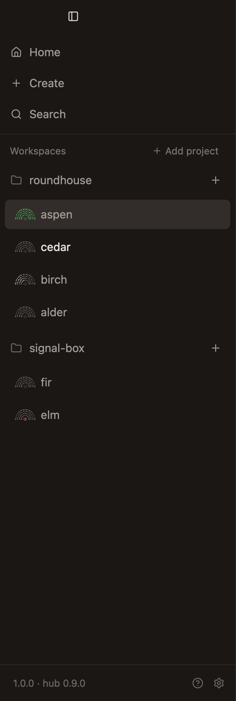

  **What the version says of a hub someone runs themselves, on the card above it.**

  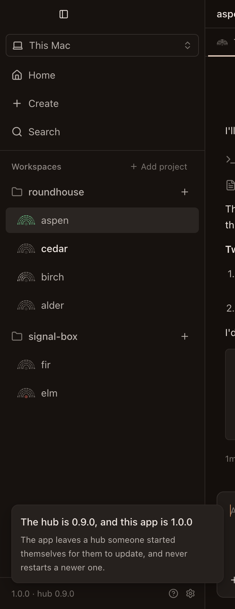

- **A problem updating** shows in the version's place, muted, as the rule above says. A download that isn't what the release workflow signed is red, since it may be someone tampering with the update.

  **Not reaching the update server, in the version's place.** *Unconfirmed.*

  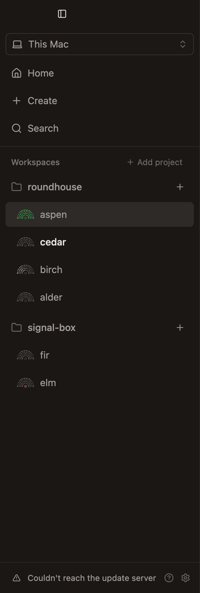

  **What went wrong, on the card above it.**

  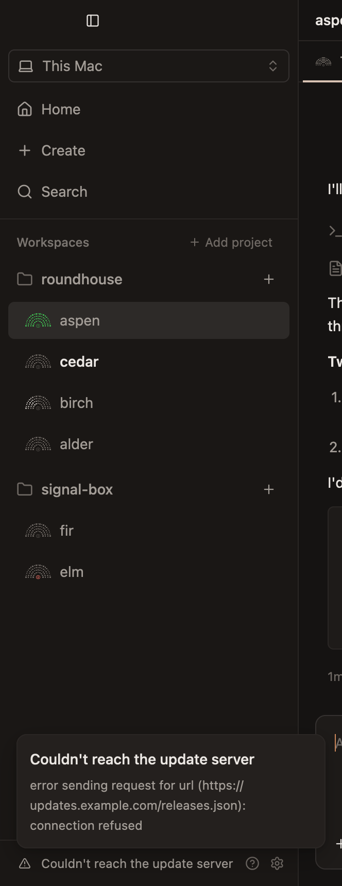

## A chat on a new version

- **A chat says where its agent moved to a new version,** with a rule across it, drawn as a compaction's is, with an arrow rising out of a circle: `Roundhouse chat worker updated from 0.9.0 to 1.0.0`. It names Roundhouse, so it isn't taken for the agent's CLI or its model updating, and says both versions on one line. A new version brings the worker's new tools and fixes, so that's where they reach the agent, and a bug report has to say which version a turn ran on. What the agent was told when the chat began stays as it was, since its CLI keeps that with the conversation. The rule is where the agent next starts, above the prompt that started it, which is drawn where the agent read it, so everything under the rule ran on the new version, and a chat nobody goes back to says nothing. However many updates came before then, there's one rule, from the version the agent last ran on, and an agent started again on the same version, as after the Mac restarts, has none. An update leaves the API's cache of the conversation as it was, so the rule says nothing of it. A prompt that found it expired after all says so with its own rule, as `chats.md` says, since then it's the wait that cost it. *Unconfirmed:* the rule's mark, where it goes, and that it says nothing of the cache.

  **A prompt sent once the app had updated, under the rule saying its agent started on the new version.** *Unconfirmed.*

  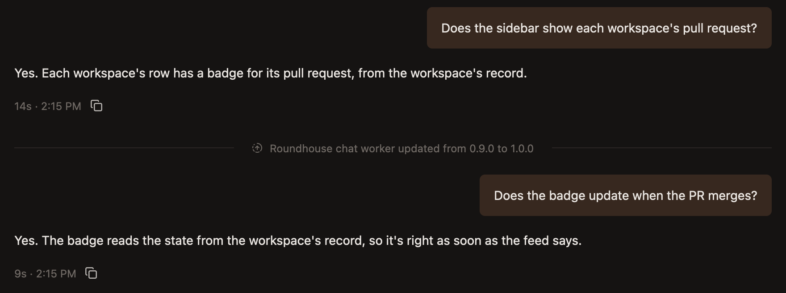

- **A workspace still on the version before the app's,** whose name's card says which version it's on, and that it moves to the app's once nothing in it is at work, as `workspaces.md` says of the card. It's the only place that shows a workspace waiting to move. *Unconfirmed.*

  **The card of a workspace still on the version before the app's.** *Unconfirmed.*

  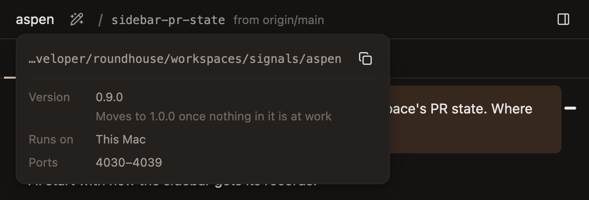

## A hub installed as a service

A hub installed as a service, on a machine such as a server with no desktop app on it, updates only when someone using one of its clients says. A hub that ran ahead of its clients would cut off one that hasn't updated, as a hub left behind is cut off by them, so whoever is using them chooses when. *Not built:* all of this section but the archive it's installed from.

- **Each release publishes the hub as an archive,** for a Mac and for Linux on amd64 and ARM64, holding `roundhoused` and `roundhouse`, which `roundhouse hub install` makes a service. The feed lists it on the release's full package, with its size and checksums, under the feed's signature, so a hub checks the one it downloads as the app checks its package. The newest is also published as `Roundhouse-<channel>-hub.tar.gz`, by a name that stays the same, to install from. *Unconfirmed:* the names. *Not built:* the Linux workers a provider puts in its instances, in the Mac's archive, which wait on #600.
- **The app shows the hub's update as it shows its own,** on a card over the build line, once the hub it's connected to has found a newer version: "Hub update ready", with the version, and `Update hub` as the card's main action. That version is the newest release the hub's workers can move to, so the hub's update crosses one protocol break at a time, as the app's does. *Unconfirmed:* the card's words.
- **Updating the hub stops no agents,** as the app restarting its own hub stops none. Each agent carries on where it was, on the version it started with, and each workspace moves to the new version once nothing in it is at work, as above. The workspace stays on screen while the app connects again, and every other client of the hub connects again by itself. *Not built:* on a provider other than the local one, whose workers stop their agents when they lose their hub, so updating stops them, and on Windows, where a hub's agents still stop with it.
- **Updating the hub doesn't wait for its other devices, or warn of them.** An update that crosses a protocol break cuts off any device still one break behind, which says "Update required" until its app updates itself, as each app does. Asking first would hold up whoever is updating for a device that may be sitting unused, and the device cut off gets back on by restarting. #2150 is to warn of it.
- **A hub a protocol break behind a device is updated on its machine,** by installing a newer release's hub there, as the guide says, since the device can't reach it to update it. That device's app says so where it shows that the hub needs updating.
- **Any paired device can update the hub,** since such a hub is used from other machines, though a paired device can't stop or restart it otherwise, as `hubs.md` says.

## When there's no hub

**The app couldn't reach a hub, or start one.** *Unconfirmed.*

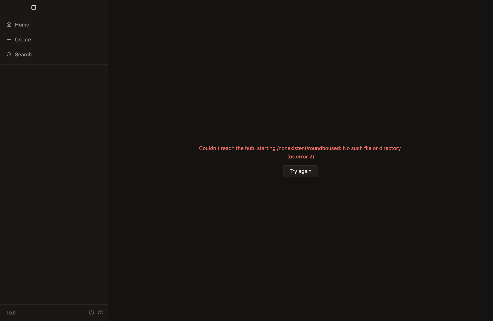
