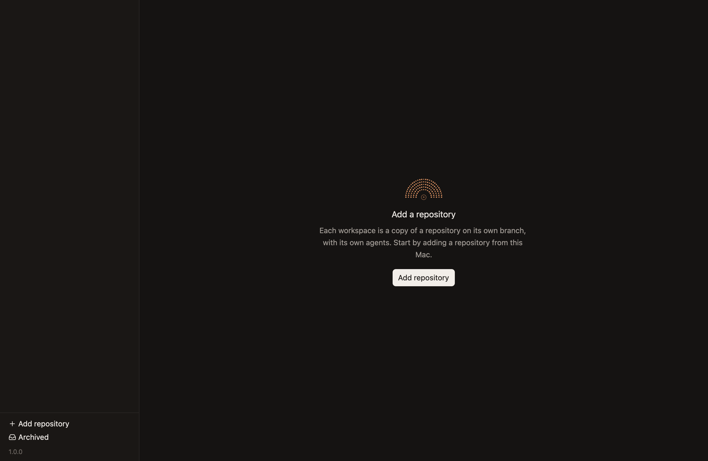
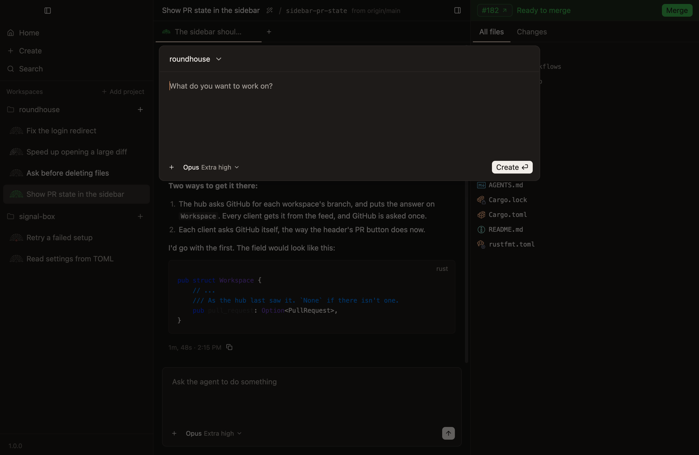
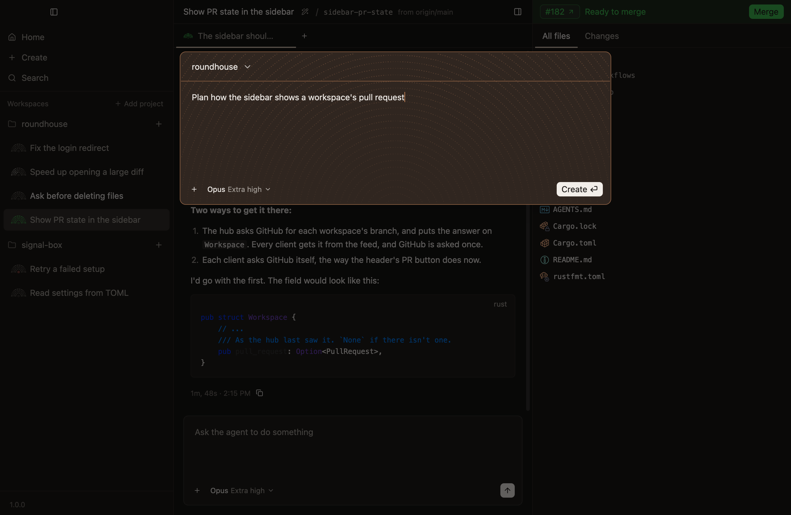
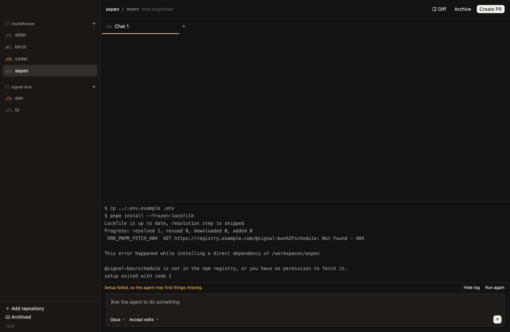
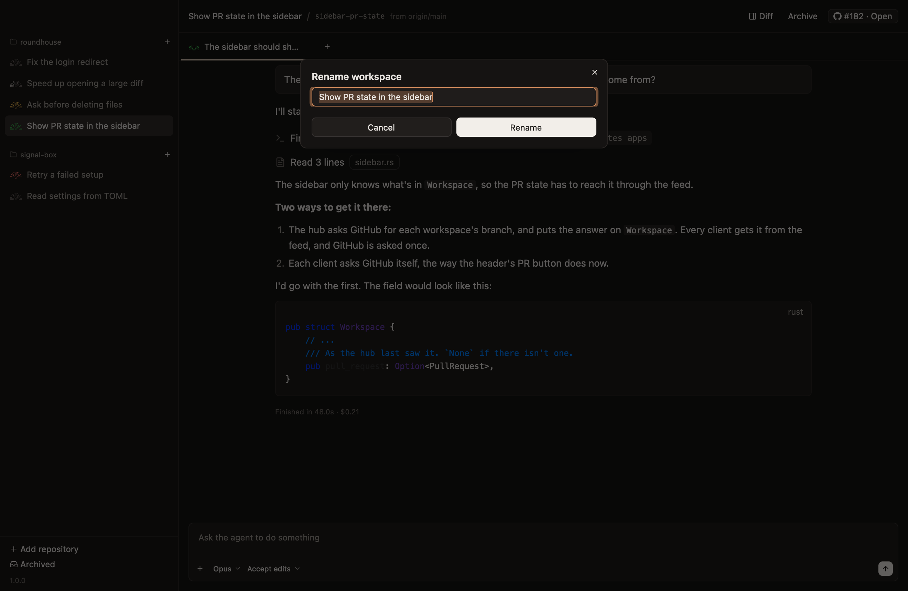
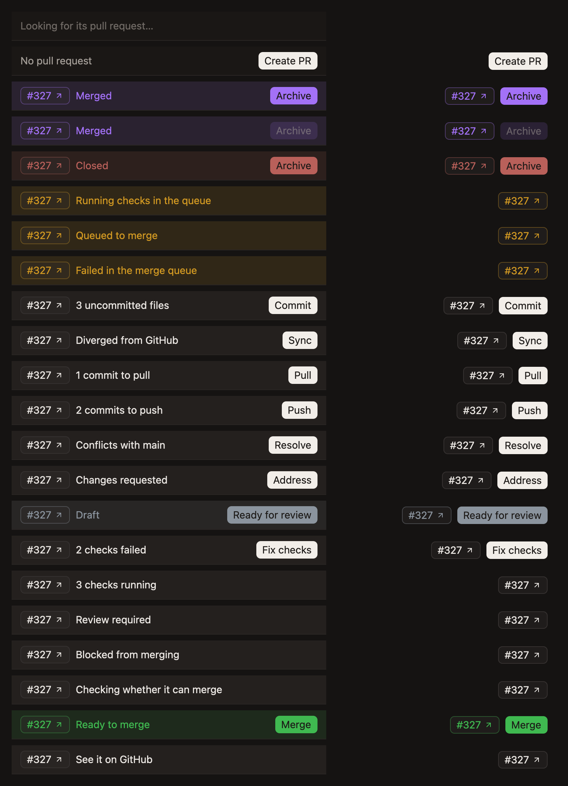

# Workspaces

## Creating and setting up

**Before there's a project.** *Unconfirmed.*

- **New Workspace in the File menu, `Cmd-N`, Create in the sidebar and on Home, and the `+` beside a project open a dialog that asks what to work on,** so the task is given as the workspace is made, and the agent starts on it at once. `Cmd-N` and Create open it for the project `sidebar.md` says, and a `+` for its own. *Unconfirmed.*
- **The dialog holds the project, the first prompt, the model and its effort, plan mode, and files to go with the prompt.** The project's name at the top opens a menu of the others. Files are pasted or dropped, as in a chat's composer. *Unconfirmed.*
- **The dialog's `+` is at its bottom left, as the composer's is, and opens the same menu,** which attaches files and turns plan mode on and off, as `Shift-Tab` does there too, and in plan mode the new workspace's first chat starts planning.
- **In plan mode the dialog is copper over plan mode's texture, as the composer is.** *Unconfirmed.*
- **Create is the dialog's main action, and Return presses it.** Shift-Return starts a new line. Create with nothing typed makes the workspace and sends nothing, so making one is still two keys. *Unconfirmed.*
- **Create closes the dialog at once, and the sidebar shows the workspace being made,** since it fetches first and can take a while. Once it's made it's selected, and the prompt is its first chat's, sent with the model, effort and plan mode chosen. If it can't be made, what was typed goes back to the dialog with plan mode, and the dialog opens again to show it. A prompt the new chat couldn't be sent goes to its composer, and the chat is asked into plan mode if the prompt was to be planned. So nothing typed is lost, and nothing to be planned is sent with full access. *Unconfirmed.*
- **The dialog opens while another workspace is being made, and its Create waits until that one is.** A workspace that's made meanwhile is selected behind the dialog, and typing stays in the dialog until it closes. *Unconfirmed.*
- **The model and effort start as a chat nobody has chosen for would run, Opus at Extra high,** as `chats.md` says. *Unconfirmed.*
- **Closing the dialog keeps what's in it for the next time it opens,** whether with Escape or a click outside it. The model and effort stay as chosen for the next workspace too, but plan mode doesn't, since it belongs to the task at hand, as in a new chat. *Unconfirmed.*
- **The dialog's header also starts a workspace from another branch or a pull request, and links an issue to it.** *Not built.*

**The new-workspace dialog, opened over a workspace.** *Unconfirmed.*

**A task described in the dialog, with a screenshot to go with it, for Opus at extra high effort.** *Unconfirmed.*

**A task described in the dialog, in plan mode.** *Unconfirmed.*

- **Setup runs in the background once the worktree exists.** It copies gitignored files matching `.worktreeinclude`, then `file_include_globs`, then `.env*`, and runs `scripts.setup`. A prompt sent meanwhile is recorded at once and delivered when setup finishes. A failure warns, and never blocks. Restoring a workspace runs it again. The matching is git's own, so patterns mean what they do in `.gitignore`. *Unconfirmed.*

**A new workspace whose setup script failed, with its log open.** *Unconfirmed.*

## Titles

- **The sidebar and a workspace's header show its title,** so telling workspaces apart doesn't mean opening each one. Until it has one, they show its name.
- **A workspace's title is generated from its first prompt.** Until the title arrives, or if generating it fails, it's the prompt's first line, cut at a word after 48 characters, so a prompt is never held up for it.
- **A generated title is a few words in sentence case, with no full stop,** such as "Fix login redirect", so it fits a sidebar row.
- **A title is generated by a call of its own to a small model, not by asking the workspace's agent,** so it costs the agent no context and never shows in its chat.
- **A title can be changed by hand, and one typed by hand is never replaced by a generated one that nobody asked for.**
- **A title is one line of at most 120 characters,** so a pasted paragraph can't fill a row. Line breaks become spaces, and characters that can't be seen or that reorder text are left out, so a row reads as the title does.
- **A workspace from before titles takes the title of its oldest chat,** which is that chat's first prompt's first line, rather than whatever is said in it next.
- **A new title leaves the workspace's name alone.** The name, such as `holly`, is the worktree's directory, the branch it starts on, and `CONDUCTOR_WORKSPACE_NAME`. Renaming a worktree under a running agent would break its working directory, and any absolute paths setup made.
- **Rename… is in the menu a right-click opens, on a workspace in the sidebar or a chat's tab,** and asks in a dialog, with the title selected so typing replaces it.
- **Regenerate title asks for a new title from everything asked in the workspace,** since the work can move on from its first prompt. It's under Rename… in the menu a right-click on a workspace's row opens, and a button beside the title in the workspace's header. Both have Rename…'s pencil, with sparks, so it reads as renaming that the app does. A title, branch or base too long for the header ends in an ellipsis, so the button is never pushed out of view. *Unconfirmed.*
- **The new title names the work as a whole, from every chat's prompts, oldest first,** by a call like the one for the first title. It names one thing, and never a chore such as a review or merging, which most workspaces end with and a model given only the newest prompt would name. Of each prompt it's given the start, and of a long history the first prompt and the newest, so the call stays as small as the first. *Unconfirmed.*
- **A new title that's asked for replaces one typed by hand too, but not one set while it's on its way,** so renaming by hand always wins over a call that's slow to answer. *Unconfirmed.*
- **While a new title is on its way, the workspace's row says Renaming… and the header's button spins,** so it's clear the press took, and neither asks again. If none comes, such as when the agent's CLI isn't logged in, the app says why and the title stays. *Unconfirmed.*
- **Until a workspace has a title, Regenerate title is greyed out,** since nothing has been asked in it to title it from. One renamed by hand before anything is asked has a title and nothing to make another from, so asking says so and changes nothing. An archived workspace isn't titled again. *Unconfirmed.*

**Renaming a workspace, with every workspace titled.** *Unconfirmed.*

**Waiting for a new title, asked for from the header.** *Unconfirmed.*

## Settings from Conductor

A repository set up for Conductor works here unchanged, because Roundhouse reads its settings and sets its variables under Conductor's names. There are no names of Roundhouse's own for these.

- **Settings:** `.conductor/settings.local.toml` in the repository, then `.conductor/settings.toml` in the worktree, then `~/.conductor/settings.toml`. The first to set a value wins.
- **Scripts:** `[scripts]` with `setup` and `archive`. Run scripts, `run_mode` and managed settings aren't read.
- **Files to copy:** `.worktreeinclude`, then `file_include_globs`, then the default `.env*` pattern.
- **Variables** for scripts and agents: `CONDUCTOR_WORKSPACE_NAME`, `CONDUCTOR_WORKSPACE_ID`, `CONDUCTOR_WORKSPACE_PATH`, `CONDUCTOR_ROOT_PATH`, `CONDUCTOR_DEFAULT_BRANCH`, `CONDUCTOR_PORT`, the first of ten ports for the workspace, and `CONDUCTOR_IS_LOCAL`.

## Archiving

- **Archiving removes the worktree and keeps the branch,** following it if the agent renamed it. It refuses if there are uncommitted changes, or commits on no branch, unless forced. That's checked before anything changes, and again once the agents have stopped. Ignored files such as `.env` and `node_modules` go with the worktree. Committed work can't be lost, and uncommitted work can't be lost by accident. *Unconfirmed.*
- **Archive is on a workspace's row, in the sidebar and in Home, and on its pull request's bar once the pull request is merged or closed,** where it's the next thing to do. `Cmd-Shift-A` archives the workspace showing, as `sidebar.md` says.
- **Archiving is done once the worktree is out of the way, and its files are deleted after,** since a build's output can be tens of thousands of files, which take seconds to delete. Moving the worktree aside on its own disk is instant, and frees its path and branch, so it can be restored at once. One that can't be moved, such as a disk of its own, is deleted before archiving is done. One with submodules is left to git, which refuses it unless forced, since a submodule's own commits are in it. *Unconfirmed.*

## Pull requests

- **The top of the sidebar of changes is the pull request's bar,** level with the workspace's header: the pull request's number, which opens it on GitHub, the first thing in the way of merging it, and the one thing to do about it. The whole bar takes the pull request's colour, as `look.md` says, so where it stands reads at a glance from across the window. While the sidebar is hidden, the header shows the number and the action instead, since it has no room for the words. *Unconfirmed.*
- **The bar says the first thing in the way, in this order:** merged or closed, a place in the merge queue, then what's here and not on GitHub, which is uncommitted files and then commits to push or pull, then what GitHub can't merge with, which is conflicts with the base, changes requested, a draft and failed checks, then what it's waiting on, which is checks running, a review, the repository's other rules and GitHub still working it out, and ready to merge once nothing is. Done comes first because nothing else matters then, and the queue next because it merges the pull request whatever else is true. What's here comes before what GitHub says, because GitHub's answers are about an older commit until it's pushed. *Unconfirmed.*
- **Each check counts once, as its latest run,** since GitHub keeps the runs that a newer push or a rerun replaced, and counting those would call a pull request whose checks passed failing. *Unconfirmed.*
- **A pull request whose newest commit isn't in the worktree has at least one commit to pull,** such as one pushed from elsewhere, until a fetch says how many. *Unconfirmed.*
- **What this version doesn't know shows as neither good nor bad news,** in the theme's colours, with "See it on GitHub" and nothing to do. That covers a word GitHub adds and a hub too old to say how the pull request can merge, either of which a guess could call ready. *Unconfirmed.*
- **Its action asks the agent, as `Create PR` does,** in the chat showing, which it then shows: Commit, Push, Pull, Sync, Resolve, Address, Ready for review, Fix checks or Merge. The agent knows why the changes were made and how the repository works, such as how it merges and whether through a queue. A merged or closed pull request offers Archive, and one waiting on GitHub or on someone else offers nothing. *Unconfirmed.*
- **`Create PR` asks the agent to commit, push and run `gh pr create`,** and the app shows the result from `gh pr view`. The agent knows why the changes were made, so it writes the better description. *Unconfirmed.*
- **The pull request is read again each time its workspace is shown, when a turn ends, and every 30 seconds while it shows, unless it's merged or closed,** because checks, reviews and the queue move on GitHub while nobody's looking, and a workspace with none gets one when the agent or someone on GitHub opens it. Until the first answer, the bar shows what the hub last found, or says it's looking if the hub hasn't looked, rather than offering to create a pull request the workspace may already have. Only the newest answer shows, since an older one can arrive after it, and a failure to ask keeps what was known. *Unconfirmed.*
- **The hub keeps each workspace's pull request, and reads every one again on its own,** so each row in the sidebar shows where its pull request stands without being opened. What it found is kept across restarts, so an app that opens again, such as after an update, shows every row's at once, and `gh` failing, such as while offline, never takes away a pull request already found. Only `gh` saying there's none does. Where it can't be read at all, without `gh`, a login to it or a GitHub remote, a workspace with none found offers to create one.
- **Reading them stays within what GitHub can spare,** since its hourly limit is shared with every agent's own `gh`. Reads nobody is waiting on spend at most a call a second, after a burst of thirty, one at a time. The workspace showing and a turn that just ended go at once, and count against that, so the rest wait longer. It goes by what GitHub says is left of the limit, and leaves the last fifth of it to everything else, which a read someone is waiting on can still use until none is left. A pull request that keeps coming back the same waits longer each time, from two minutes up to half an hour, as does one that can't be read, such as while offline, and one with checks running or in the merge queue waits the least. Reads nobody is waiting on stop while no app is connected, since nobody would see them, though a turn that ends still reads its own. A merged or closed pull request waits to be shown.

**Every state of the pull request's bar, as the sidebar of changes shows it, and beside it what the header shows while the sidebar is hidden. Merged shows three times: the second while another workspace is being archived, and the third while this one is.** *Unconfirmed.*

