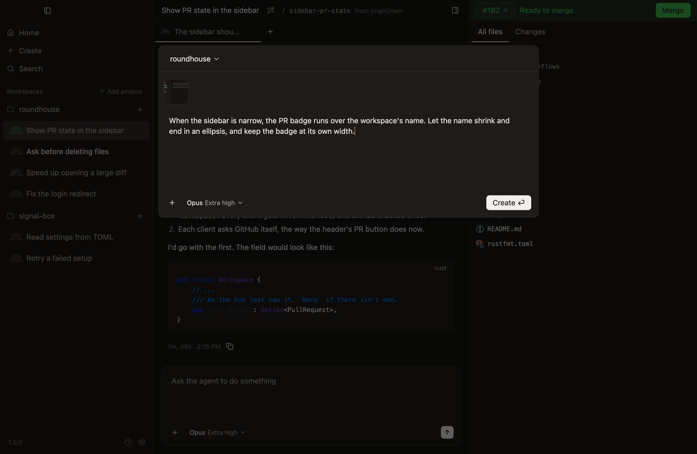
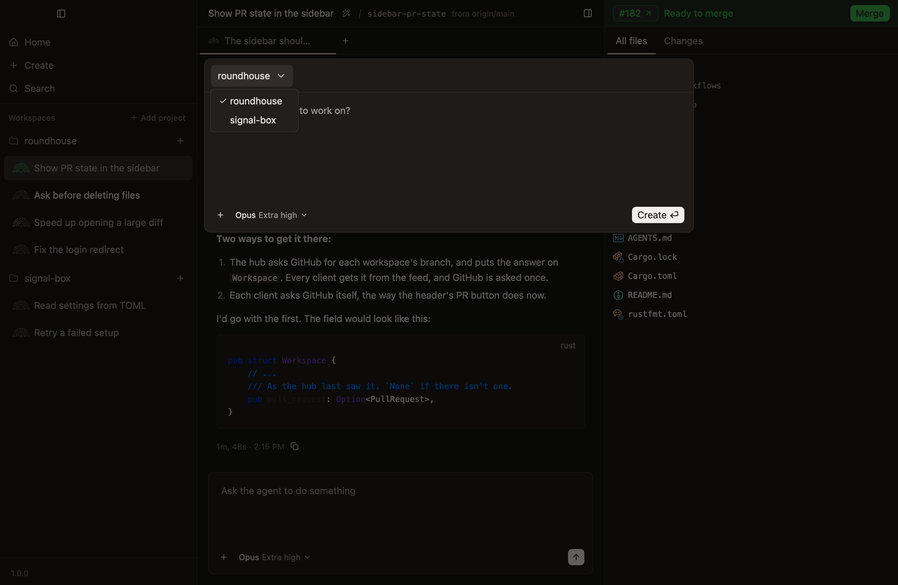
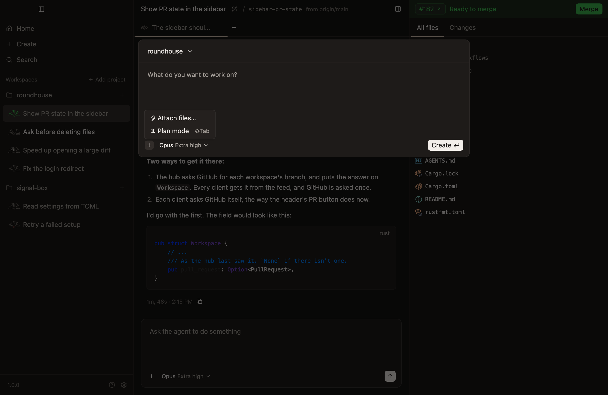
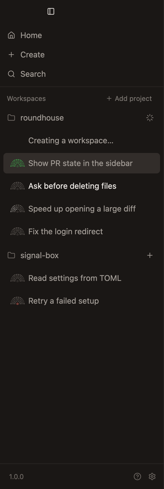
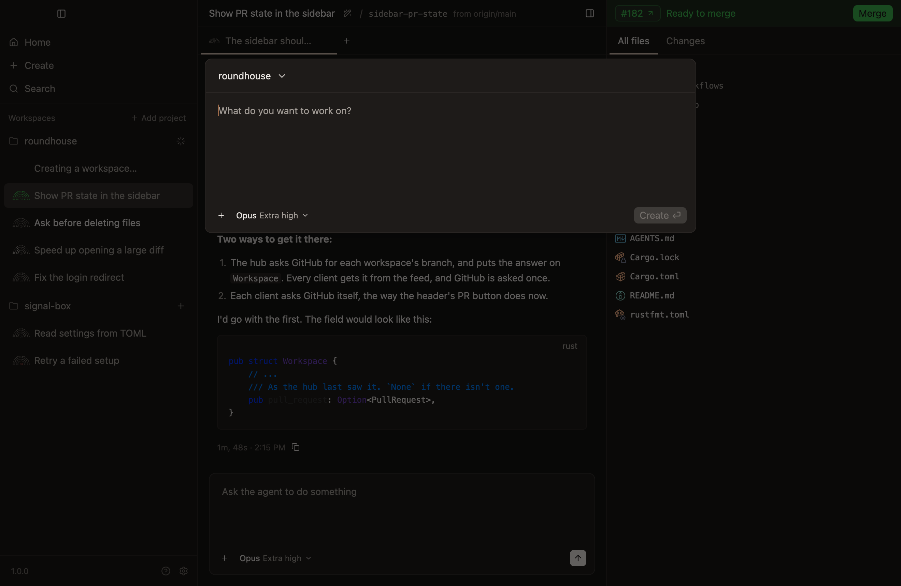
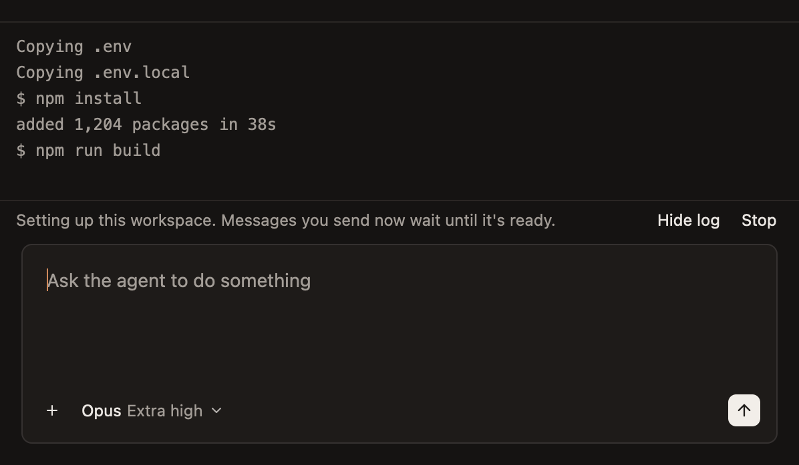
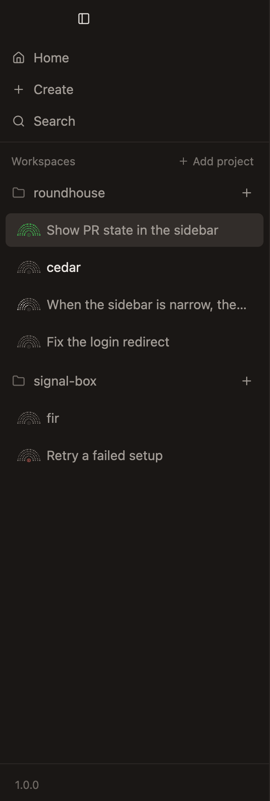
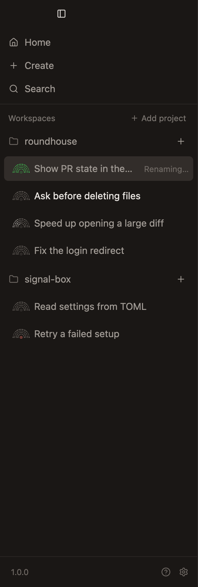
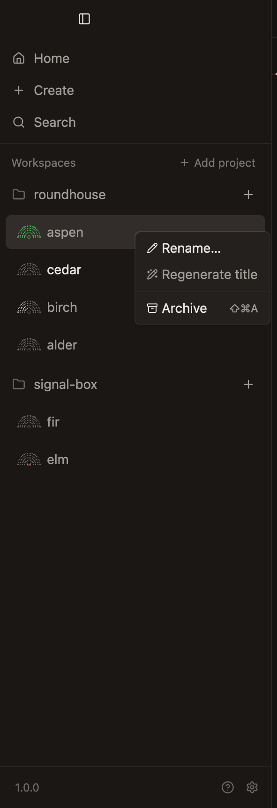
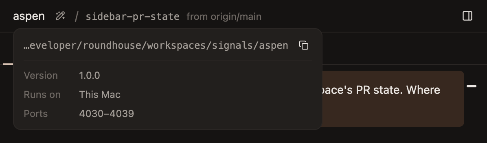

# Workspaces

## Creating and setting up

**Before there's a project.** *Unconfirmed.*

- **New Workspace in the File menu, `Cmd-N`, Create in the sidebar and on Home, and the `+` beside a project open a dialog that asks what to work on,** so the task is given as the workspace is made, and the agent starts on it at once. `Cmd-N` and Create open it for the project `sidebar.md` says, and a `+` for its own. *Unconfirmed.*
- **The dialog holds the project, the first prompt, the model and its effort, plan mode, and files to go with the prompt.** The project's name at the top opens a menu of the others. Files are pasted or dropped, as in a chat's composer. *Unconfirmed.*

  **The new-workspace dialog, opened over a workspace.** *Unconfirmed.*

  

  **A task described in the dialog, with a screenshot to go with it, for Opus at extra high effort.** *Unconfirmed.*

  

  **The project's name, opened as a menu of the others.** *Unconfirmed.*

  

- **The dialog's `+` is at its bottom left, as the composer's is, and opens the same menu,** which attaches files and turns plan mode on and off, as `Shift-Tab` does there too, and in plan mode the new workspace's first chat starts planning.

  **The dialog's `+`, opened.** *Unconfirmed.*

  

- **In plan mode the dialog is copper over plan mode's texture, as the composer is.** *Unconfirmed.*

  **A task described in the dialog, in plan mode.** *Unconfirmed.*

  

- **Create is the dialog's main action, and Return presses it.** Shift-Return starts a new line. Create with nothing typed makes the workspace and sends nothing, so making one is still two keys. *Unconfirmed.*
- **Create closes the dialog at once, and the sidebar shows the workspace being made,** since it fetches first and can take a while. Every window shows it, wherever it was asked for, such as from the command line. Once it's made it's selected, if what showed as Create was pressed still shows. Another workspace, Home or Settings showing in its place stays, since that's where the person went, or where the app went for them, as when the workspace showing was archived from elsewhere. The prompt is its first chat's, sent with the model, effort and plan mode chosen. If it can't be made, what was typed goes back to the dialog with plan mode, and the dialog opens again to show it. A prompt the new chat couldn't be sent goes to its composer, and the workspace is selected even if something else shows by then, so the prompt is there to see. The chat is asked into plan mode if the prompt was to be planned. So nothing typed is lost, and nothing to be planned is sent with full access. *Unconfirmed.*

  **The sidebar while a workspace is being made in `roundhouse`, whose `+` waits.** *Unconfirmed.*

  

- **The dialog opens while another workspace is being made, and its Create waits until that one is.** A workspace that's made meanwhile is selected behind the dialog, unless the person went elsewhere first, as the line above says, and typing stays in the dialog until it closes. *Unconfirmed.*

  **The dialog, opened while another workspace is being made, its Create waiting.** *Unconfirmed.*

  

- **The model and effort start as a chat nobody has chosen for would run, Opus at Extra high,** as `chats.md` says. *Unconfirmed.*
- **Closing the dialog keeps what's in it for the next time it opens,** whether with Escape or a click outside it. The model and effort stay as chosen for the next workspace too, but plan mode doesn't, since it belongs to the task at hand, as in a new chat. *Unconfirmed.*
- **The hub keeps what's in the dialog, files and all, until the workspace is made,** so it's there when the app opens again, and in any other client, as a chat's draft is, as `chats.md` says. A change made in another client shows as it reaches the hub, unless something from here is on its way, which then replaces it. The project the dialog is opened for takes the place of the one kept. The hub makes the workspace from what it keeps, so a file it kept goes with the prompt even before the dialog has read it back, and keeps what was in the dialog until the new chat has the prompt, so quitting meanwhile loses nothing. Then it empties the dialog, unless something was typed in it since, here or in another client, which stays. A prompt the hub couldn't give the new chat whole, such as one carrying a file it couldn't copy, stays in the dialog, which opens again to show it. *Unconfirmed.*
- **The dialog's header also starts a workspace from another branch or a pull request, and links an issue to it.** *Not built.*

- **A workspace's branches go in a folder of its name, so `euston` starts on `euston/start`,** and the branches made for its work can go beside it, as `euston/try-the-parser`. So a workspace's branches stay together, and one prefix finds them all, in `git branch`, on GitHub and in a stack. Git can't have a branch `euston` beside a folder `euston/`, so the first branch has a name of its own in the folder, and a name git has a branch or a folder of branches by, here or among `origin`'s as last fetched, is taken, as one with a directory is. So is a remote's name, since a branch in a folder named `origin` would be found before `origin`'s own, and so is `head` where the repository has a remote, since on a file system that doesn't tell case apart, a branch `head/start` pushed there can't sit beside the remote's `HEAD`. Git's names count whatever their case, since it keeps a branch as a file, and a file system that doesn't tell case apart takes `Euston` for `euston`. *Unconfirmed:* `origin`'s branches, a remote's name, `head`, and counting names whatever their case. A workspace made before its branches went in a folder keeps the branch it was made on, named `euston`.
- **A workspace made without a name of its own is named after a railway station,** such as `euston`, as a roundhouse is a railway's building. Each is one word of plain letters that's easy to say and to spell, since it's typed as a branch and a directory. It's picked at random from those no other workspace of the project has, archived or not, so names made one after another are seldom alike. When the name is taken after all, because git has it, which the hub learns once the workspace's worker is up, or a workspace made at the same moment has it, the same station gets a number, such as `euston-2`, and the next number nobody has, git included, each time, up to eight names in all, after which the workspace isn't made. Once every station is taken, one is picked at random with the lowest number nobody has with it. *Unconfirmed.*
- **Keeping a workspace's branches in its folder is best effort.** An agent or a person can name a branch anything, and nothing stops git doing it, since what would stop it, a `reference-transaction` hook, would break `gh` and the person's own terminal. Which branches are a workspace's comes from what its worktree has had checked out, whatever they're called, so a branch outside the folder loses nothing, and is only harder to find.
- **Agents make a workspace's branches and other worktrees with Roundhouse's tools, which name them in its folder,** and Claude is reminded to use them rather than git. *Not built.*
- **Setup runs in the background once the worktree exists.** It copies gitignored files matching `.worktreeinclude`, then `file_include_globs`, then `.env*`, and runs `scripts.setup`. A prompt sent meanwhile is recorded at once and delivered when setup finishes. A failure warns, and never blocks. Restoring a workspace runs it again. The matching is git's own, so patterns mean what they do in `.gitignore`. *Unconfirmed.*

  **A new workspace still setting up, with its log open.** *Unconfirmed.*

  

  **A new workspace whose setup script failed, with its log open.** *Unconfirmed.*

  

## Titles

- **The sidebar and a workspace's header show its title,** so telling workspaces apart doesn't mean opening each one. Until it has one, they show its name.

  **Workspaces in the sidebar with titles generated, one from a long prompt's first line, and two with none yet, which show their names.** *Unconfirmed.*

  

- **A workspace's title is generated from its first prompt.** Until the title arrives, or if generating it fails, it's the prompt's first line, cut at a word after 48 characters, so a prompt is never held up for it.
- **A title is generated from a prompt's images as well as its words,** since a prompt such as "What do we need to do to resolve this?" is often about a screenshot. The call is given the first three images, up to 32 MB between them, and none of the prompt's other files. A prompt of only images has no first line, so until its title arrives, the workspace shows its name and the chat is Untitled, and if none comes, until a prompt with words. Regenerate title is greyed out meanwhile, as it is for any workspace without a title. *Unconfirmed.*
- **A generated title is a few words in sentence case, with no full stop,** such as "Fix login redirect", so it fits a sidebar row.
- **A title is generated by a call of its own to a small model, not by asking the workspace's agent,** so it costs the agent no context and never shows in its chat.
- **A title can be changed by hand, and one typed by hand is never replaced by a generated one that nobody asked for.**
- **A title is one line of at most 120 characters,** so a pasted paragraph can't fill a row. Line breaks become spaces, and characters that can't be seen or that reorder text are left out, so a row reads as the title does.
- **A workspace from before titles takes the title of its oldest chat,** which is that chat's first prompt's first line, rather than whatever is said in it next.
- **A new title leaves the workspace's name alone.** The name, such as `euston`, is the worktree's directory, the folder its branches go in, and `CONDUCTOR_WORKSPACE_NAME`. Renaming a worktree under a running agent would break its working directory, and any absolute paths setup made.
- **Rename… is in the menu a right-click opens, on a workspace in the sidebar or a chat's tab,** and asks in a dialog, with the title selected so typing replaces it.

  **Renaming a workspace, with every workspace titled.** *Unconfirmed.*

  

- **Regenerate title asks for a new title from everything asked in the workspace,** since the work can move on from its first prompt. It's under Rename… in the menu a right-click on a workspace's row opens, and a button beside the title in the workspace's header. Both have Rename…'s pencil, with sparks, so it reads as renaming that the app does. A title, branch or base too long for the header ends in an ellipsis, so the button is never pushed out of view. *Unconfirmed.*

  **A title too long for the header, ending in an ellipsis before Regenerate title's button.** *Unconfirmed.*

  

- **The new title names the work as a whole, from every chat's prompts, oldest first,** by a call like the one for the first title. It names one thing, and never a chore such as a review or merging, which most workspaces end with and a model given only the newest prompt would name. Of each prompt it's given the start, and of a long history the first prompt and the newest, so the call stays as small as the first. It's given the oldest of their images, by the first title's limits, since the first prompt's set the task. *Unconfirmed.*
- **A new title that's asked for replaces one typed by hand too, but not one set while it's on its way,** so renaming by hand always wins over a call that's slow to answer. *Unconfirmed.*
- **While a new title is on its way, the workspace's row says Renaming… and the header's button spins,** so it's clear the press took, and neither asks again. If none comes, such as when the agent's CLI isn't logged in, the app says why and the title stays. *Unconfirmed.*

  **Waiting for a new title, asked for from the header.** *Unconfirmed.*

  

  **Waiting for a new title, as the sidebar shows it.** *Unconfirmed.*

  

- **Until a workspace has a title, Regenerate title is greyed out,** since nothing has been asked in it to title it from. One renamed by hand before anything is asked has a title and nothing to make another from, so asking says so and changes nothing. An archived workspace isn't titled again. *Unconfirmed.*

  **The menu of a workspace nothing has titled yet.** *Unconfirmed.*

  

## Where a workspace is

**Resting the pointer on a workspace's name in its header shows where it is,** in a card under the name: the path of its worktree in the code font, cut at its start if it's too long, since its end is the workspace's own folder, with a button that copies it whole, then under a rule, the version its agents run on, where they run, and the ten ports set aside for it, the first of which is `CONDUCTOR_PORT`. One worker does all of a workspace's work, every chat's included, so the card is the workspace's rather than a chat's. The card goes a third of a second after the pointer leaves the name, as the context's card does, so the pointer can cross to the button, and stays while it's on the card. What isn't known is left out, such as the path before the worktree is made. A workspace still on a version before the app's says so, as `updates.md` shows. *Unconfirmed.*

## Settings from Conductor

A repository set up for Conductor works here unchanged, because Roundhouse reads its settings and sets its variables under Conductor's names. There are no names of Roundhouse's own for these.

- **Settings:** `.conductor/settings.local.toml` in the repository, then `.conductor/settings.toml` in the worktree, then `~/.conductor/settings.toml`. The first to set a value wins.
- **Scripts:** `[scripts]` with `setup` and `archive`. Run scripts, `run_mode` and managed settings aren't read.
- **Files to copy:** `.worktreeinclude`, then `file_include_globs`, then the default `.env*` pattern.
- **Variables** for scripts and agents: `CONDUCTOR_WORKSPACE_NAME`, `CONDUCTOR_WORKSPACE_ID`, `CONDUCTOR_WORKSPACE_PATH`, `CONDUCTOR_ROOT_PATH`, `CONDUCTOR_DEFAULT_BRANCH`, `CONDUCTOR_PORT`, the first of ten ports for the workspace, and `CONDUCTOR_IS_LOCAL`.

## Archiving

- **Archiving removes the worktree and keeps the branch,** following it if the agent renamed it. It refuses if there are uncommitted changes, or commits on no branch, unless forced. That's checked before anything changes, and again once the agents have stopped. Ignored files such as `.env` and `node_modules` go with the worktree. Committed work can't be lost, and uncommitted work can't be lost by accident. *Unconfirmed.*
- **Archive is on a workspace's row, in the sidebar and in Home, and on its pull request's bar once the pull request is merged or closed,** where it's the next thing to do. `Cmd-Shift-A` archives the workspace showing, as `sidebar.md` says.
- **Archiving is done once the worktree is out of the way, and its files are deleted after,** since a build's output can be tens of thousands of files, which take seconds to delete. Moving the worktree aside on its own disk is instant, and frees its path and branch, so it can be restored at once. One that can't be moved, such as a disk of its own, is deleted before archiving is done. One with submodules is left to git, which refuses it unless forced, since a submodule's own commits are in it. *Unconfirmed.*

## Other worktrees

- **The worktrees a workspace's agents make for its work besides its own are the workspace's,** so Roundhouse makes and records each one, and archiving the workspace removes them with it, rather than each lasting until an agent remembers to remove it. An agent makes one for a subagent, or for any work that needs a checkout of its own. *Not built.*
- **A workspace's other worktrees go in `.children/` beside the workspaces, in a folder named after the workspace,** so `euston/try-the-parser`'s is `.children/euston/try-the-parser`. No workspace's name starts with a dot, and none is inside the workspace's own worktree, where it would show in `git status` and go along when archiving moves the worktree aside. *Not built.*
- **Each is in a directory of one name: its branch's, without the workspace's folder, with each `/` left in it written `-`,** so `euston/x/y`'s is `.children/euston/x-y`, and `fix/login`'s, a branch outside the folder, is `.children/euston/fix-login`. Laid out as its branch is, one worktree would be made inside another, as `euston/x/y`'s would be inside `euston/x`'s. *Not built.* *Unconfirmed.*
- **A new one is on a new branch in the workspace's folder, from the commit the workspace's worktree has checked out unless the agent gives a base, or on one of the workspace's branches as it is.** A name that's taken gets `-2`, `-3` and so on, so the agent never has to choose again. *Not built.*
- **A workspace made before its branches went in a folder names a new branch beside its own, as `euston--try-the-parser`,** while git still has its branch `euston`, or its worktree has had it, since git can't have `euston/…` beside `euston`. Its worktrees go in the same folder of `.children/` either way. *Not built.* *Unconfirmed.*
- **Ignored files are copied into a new one as setup copies them,** since copying is quick. *Not built.*
- **The setup script runs in a new one only when the agent asks for it,** since a subagent that doesn't build shouldn't wait for setup. *Not built.*
- **Archiving refuses if any of a workspace's other worktrees has uncommitted changes or commits on no branch, naming which, as it does for the workspace's own, unless forced.** Then it removes them all, and keeps every branch, since squashed merges leave no way to tell that a branch's work has landed. *Not built.*
- **Restoring brings back only the workspace's own worktree.** The others' branches are kept, and a worktree can be made on one again. *Not built.*

## Pull requests

- **The top of the sidebar of changes is the pull request's bar,** level with the workspace's header: the pull request's number, which opens it on GitHub, the first thing in the way of merging it, and the one thing to do about it. The whole bar takes the pull request's colour, as `look.md` says, so where it stands reads at a glance from across the window. While the sidebar is hidden, the header shows the number and the action instead, since it has no room for the words. *Unconfirmed.*

  **Every state of the pull request's bar, as the sidebar of changes shows it, and beside it what the header shows while the sidebar is hidden. Merged shows three times: the second while another workspace is being archived, and the third while this one is.** *Unconfirmed.*

  

- **The bar says the first thing in the way, in this order:** merged or closed, a place in the merge queue, then what's here and not on GitHub, which is uncommitted files and then commits to push or pull, then what GitHub can't merge with, which is conflicts with the base, changes requested, a draft and failed checks, then what it's waiting on, which is checks running, a review, the repository's other rules and GitHub still working it out, and ready to merge once nothing is. Done comes first because nothing else matters then, and the queue next because it merges the pull request whatever else is true. What's here comes before what GitHub says, because GitHub's answers are about an older commit until it's pushed. *Unconfirmed.*
- **Each check counts once, as its latest run,** since GitHub keeps the runs that a newer push or a rerun replaced, and counting those would call a pull request whose checks passed failing. *Unconfirmed.*
- **A pull request whose newest commit isn't in the worktree has at least one commit to pull,** such as one pushed from elsewhere, until a fetch says how many. *Unconfirmed.*
- **What this version doesn't know shows as neither good nor bad news,** in the theme's colours, with "See it on GitHub" and nothing to do. That covers a word GitHub adds and a hub too old to say how the pull request can merge, either of which a guess could call ready. *Unconfirmed.*
- **Its action asks the agent, as `Create PR` does,** in the chat showing, which it then shows: Commit, Push, Pull, Sync, Resolve, Address, Ready for review, Fix checks or Merge. The agent knows why the changes were made and how the repository works, such as how it merges and whether through a queue. A merged or closed pull request offers Archive, and one waiting on GitHub or on someone else offers nothing. *Unconfirmed.*
- **`Create PR` asks the agent to commit, push and run `gh pr create`,** and the app shows the result from `gh pr view`. The agent knows why the changes were made, so it writes the better description. *Unconfirmed.*
- **A workspace's pull request is its branch's, and a branch's is one it has been at a commit of,** not any from a branch of the same name. Each computer names its workspaces from the same list, so another's can share a name, and `gh` finds a pull request by the branch's name. Its pull request would then show on a workspace it has nothing to do with, whose actions ask the agent to push into it. A commit made on the branch, or a push from it, leaves the branch at a commit of its pull request, and so does checking out someone else's branch to work on it. One that only shares the name has commits the branch was never at, even once they're fetched or merged in, or only started from, when this one was made from a remote's branch other than the pull request's, as a workspace is made from `origin`'s default branch. Once one is found, it stays the branch's however it moves on, as when someone else rewrites it, and when another computer's branch of the same name has one too. A branch renamed keeps its pull request, and one deleted and made again by the same name starts with none. *Unconfirmed:* that a branch made from a remote's branch other than its pull request's hasn't been at the commit it was made at.
- **The pull request is read again each time its workspace is shown, when a turn ends, and every 30 seconds while it shows, unless it's merged or closed,** because checks, reviews and the queue move on GitHub while nobody's looking, and a workspace with none gets one when the agent or someone on GitHub opens it. It's also read when the worktree checks out a branch other than the one it was last found on, merged or not, since a pull request is its branch's, and an agent often starts on its next piece of work on a new branch in the middle of a turn, and when the branch checked out is pushed to its upstream, though not when a fetch or a pull moves the branch it tracks. Until the first answer, the bar shows what the hub last found, or says it's looking if the hub hasn't looked, rather than offering to create a pull request the workspace may already have. Only the newest answer shows, since an older one can arrive after it, and a failure to ask keeps what was known. *Unconfirmed.*
- **The hub keeps each workspace's pull request, and reads every one again on its own,** so each row in the sidebar shows where its pull request stands without being opened. What it found is kept across restarts, so an app that opens again, such as after an update, shows every row's at once, and `gh` failing, such as while offline, never takes away a pull request already found. Only `gh` saying there's none does, or finding only one that isn't the branch's. Where it can't be read at all, without `gh`, a login to it or a GitHub remote, a workspace with none found offers to create one.
- **Reading them stays within what GitHub can spare,** since its hourly limit is shared with every agent's own `gh`. Reads nobody is waiting on spend at most a call a second, after a burst of thirty, one at a time. The workspace showing, a turn that just ended and a branch that's moved go at once, and count against that, so the rest wait longer. A branch that's moved is the agent's doing, which it can do over and over, so its read waits until ten seconds after the workspace's last. It goes by what GitHub says is left of the limit, and leaves the last fifth of it to everything else, which a read someone is waiting on can still use until none is left, though not one for a branch that's moved. A pull request that keeps coming back the same waits longer each time, from two minutes up to half an hour, as does one that can't be read, such as while offline, and one with checks running or in the merge queue waits the least. Reads nobody is waiting on stop while no app is connected, since nobody would see them, though a turn that ends or a branch that moves still reads its own. A merged or closed pull request waits to be shown, unless it was found on another branch than the one checked out, since then it isn't the workspace's.
